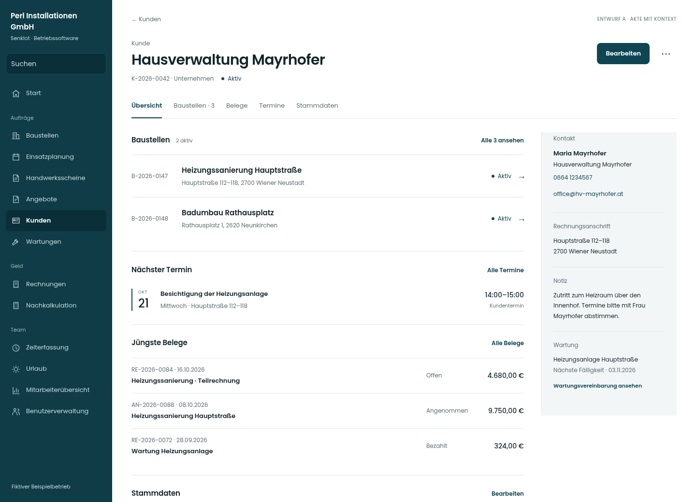
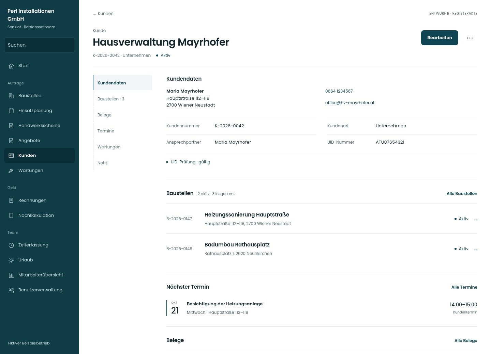
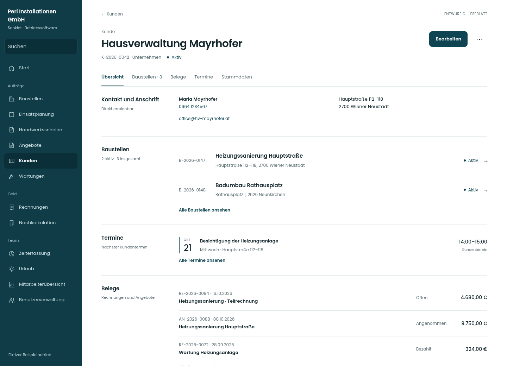

# Lot · Drei neue Aktenentwürfe · Studie 04

Gestaltungsstudien mit fiktiven Daten. Die Live-App wurde nicht verändert. Die drei Varianten zeigen bewusst dieselbe Kundenakte, damit die Anordnung und nicht der Beispieldatensatz den Vergleich bestimmt. Variante A ist zusätzlich als Baustellen- und Benutzerakte ausgearbeitet.

## Screens direkt öffnen

| Richtung | Desktop | Tablet | Handy |
| --- | --- | --- | --- |
| **A · Akte mit Kontext** | [Kunde](bilder/a-kunde-desktop.png) | [Kunde](bilder/a-kunde-834.png) | [Kunde](bilder/a-kunde-mobil.png) |
| **B · Registerakte** | [Kunde](bilder/b-kunde-desktop.png) | [Kunde](bilder/b-kunde-834.png) | [Kunde](bilder/b-kunde-mobil.png) |
| **C · Leseblatt** | [Kunde](bilder/c-kunde-desktop.png) | [Kunde](bilder/c-kunde-834.png) | [Kunde](bilder/c-kunde-mobil.png) |
| **A · Baustelle** | [Baustelle](bilder/a-baustelle-desktop.png) | [Baustelle](bilder/a-baustelle-834.png) | [Baustelle](bilder/a-baustelle-mobil.png) |
| **A · Benutzer** | [Benutzer](bilder/a-benutzer-desktop.png) | [Benutzer](bilder/a-benutzer-834.png) | [Benutzer](bilder/a-benutzer-mobil.png) |

Die Desktop- und Handyvorschauen zeigen den ersten sichtbaren Bildschirmausschnitt. Vollständige Seiten liegen jeweils als `*-1440.png`, `*-834.png` und `*-390.png` im Bilderordner; bei vollständigen Handyseiten sitzt die fixierte Aktion an der Position des ursprünglichen Bildschirmfensters.

## A · Akte mit Kontext — meine Empfehlung

Ein kompakter Kopf mit rechts ausgerichteter Hauptaktion, direkt darunter die Aktenbereiche. Die breite Hauptspalte gehört dem Arbeitsinhalt; eine zusammenhängende, ruhige Kontextspalte sammelt Kontakt, Anschrift, Zuständigkeit und Notizen. Keine einzelnen Kontaktkacheln, keine großen Kennzahlen im Aktenkopf. Unterschiedliche Zeilentypen bleiben einheitlich: Nummer als Orientierung, Bezeichnung als Hauptinformation, Ort darunter und Status in einer festen rechten Spur.

- **Kunde:** aktive Baustellen und nächster Termin vor den jüngsten Belegen; Stammdaten und UID bleiben erreichbar. Kontakt und Wartung stehen gebündelt daneben.
- **Baustelle:** Auftrag vor Termin und Scheinen. Fachzeit und Budget stehen klein im Auftragsbereich; die schmale Linie stellt ausschließlich das vorhandene Verhältnis dar. Helferzeit bleibt getrennt. Kunde, Adresse und Team gehören in die Kontextspalte.
- **Benutzer:** Beschäftigung, Arbeitszeit und Startwerte sind sachlich getrennt. Anmeldekonto steht daneben. Aktuelle Salden werden nicht aus Startwerten abgeleitet; sie gehören weiterhin in die Mitarbeiterübersicht.
- **Mobil:** eine Spalte, Telefon und E-Mail als direkte Einstiege oben, Termine in klaren Zeilen, fixierte Hauptaktion. Die vollständigen Kontextangaben folgen dem Hauptinhalt.

**Abwägung:** Die Kontextspalte kostet Breite. Am Tablet muss sie kompakt bleiben; sehr breite Listen gehören in ihren eigenen Bereich. Kontaktschnellzugriffe am Handy sind nötig, damit Kontakt nicht ans Seitenende verschwindet.

[Baustellenakte](bilder/a-baustelle-desktop.png) · [Benutzerakte](bilder/a-benutzer-desktop.png) · [Kundenakte vollständig](bilder/a-kunde-1440.png)

## B · Registerakte

Ein festes Aktenregister links, breite Inhaltszeilen rechts. Stammdaten haben feste Beschriftungs- und Wertspuren, die Navigation deckt einzelne Fachbereiche ab. Diese Richtung passt zu häufigem Nachschlagen und umfangreicher Verwaltung.

**Abwägung:** Neben der globalen Navigation entsteht eine zweite Navigationsebene. Das ist sehr gezielt bedienbar, wirkt aber technischer und braucht Platz. Am Handy wird das Register horizontal.

## C · Leseblatt

Eine durchgehende, breite Lesefläche. Jeder Abschnitt hat links seine Überschrift, rechts die Inhalte; die obere Sprungleiste führt zu den Abschnitten. Kontakt, Baustellen, Termine und Belege sind in einer festen Reihenfolge lesbar. Auf dem Handy stehen Überschriften über ihrem Inhalt.

**Abwägung:** Ruhig und sehr gut nachvollziehbar, aber bei großen Akten länger. Kontaktdaten stehen nicht neben tiefer liegenden Inhalten. Datenreiche Listen müssten auf einen begrenzten Einstieg und ihren vollständigen Fachbereich aufgeteilt werden.

## Gemeinsame Lot-Linie

Bestehende Poppins-Schrift mit 400/600 für Text und Titel sowie 500 für Zahlen; Petrol, Weiß und die vorhandene neutrale Papierfläche. Linien geben Struktur. Keine Dekokarten, Pillen, großen Statistikblöcke oder zusätzlichen Inhaltssymbole. Das Termin-Datum und die Fachzeitlinie erklären vorhandene Informationen.

Die allgemeine Navigation ist zur Orientierung skizziert; diese Studie schlägt keine Änderung der übrigen App-Navigation vor. Die Bildschirme zeigen eine berechtigte Verwaltungsrolle. Die Darstellung legt keine neuen Rechte oder Module fest.

## Umfang und Prüfung

Die fünf Seiten wurden bei **390, 834 und 1.440 Pixeln** in Chromium fotografiert und auf Seitenüberlauf, JavaScript-Seitenfehler sowie automatisiert prüfbare WCAG-A/AA-Regeln untersucht. Es gab dabei keine Seitenüberläufe, JavaScript-Seitenfehler oder gemeldeten axe-Verstöße. Das genaue Ergebnis steht in [darstellungspruefung.json](darstellungspruefung.json). Neun zusätzliche Kombinationen aus langen Namen und Bildschirmbreiten zeigen keinen überlappenden Kopf; Öffnen und Escape-Schließen des Beispielfensters funktionieren ([Nachweis](langnamen-und-fenster.json)). Daraus folgt keine vollständige Barrierefreiheits- oder Funktionsabnahme der App.

Die HTML-Dateien sind Ansichtsprototypen. Reiter und Register führen in diesem Vergleich zu Abschnitten der Seite; im Produkt muss die endgültige Aufteilung noch festgelegt werden. Bearbeiten öffnet ein Layoutfenster mit einem Beispielfeld. Weitere Einstiege sind als Vorschau kenntlich gemacht. Es gibt keine Datenbankverbindung oder Speicherung. Vollständige Listen, Rollen-, Leer-, Fehler-, Formular- und Sonderzustände sind nicht ausgearbeitet.

Vor einer Umsetzung müssen alle bestehenden Felder, Aktionen und Module eindeutig den neuen Bereichen zugeordnet und die bisherigen Schutzregeln erhalten werden. Dazu gehören UID/VIES, Zuordnung alter Baustellen, Wartungen, Nummernwechsel, Stundenbudgetregeln, Pläne, Kontoumstellung, eigenständiges Geburtsdatum, Datenschutz und ungespeicherte Änderungen. Diese Studie ersetzt die Prüfung dieser Abläufe nicht.

**Vorschlag zur Entscheidung:** A als gemeinsame Grundstruktur; Arbeitsinhalte in klaren Listen, Stammdaten kompakt, Kontakt und Zuständigkeit auf einer festen Seite. B ist eine bewusst stärker auf Verwaltung ausgerichtete Alternative, C eine stärker auf Lesen ausgerichtete.

## Lokal ansehen

[Paket als ZIP herunterladen](../Lot-Akten-Alternativen-04-2026-10-20.zip?raw=true), vollständig entpacken und `index.html` öffnen. Es enthält alle Seiten und Schriften. Alternativ im entpackten Ordner `python -m http.server 8000` starten und `http://localhost:8000` aufrufen. GitHub zeigt HTML-Dateien als Quelltext, die Screens und diese Anleitung dagegen direkt an.
