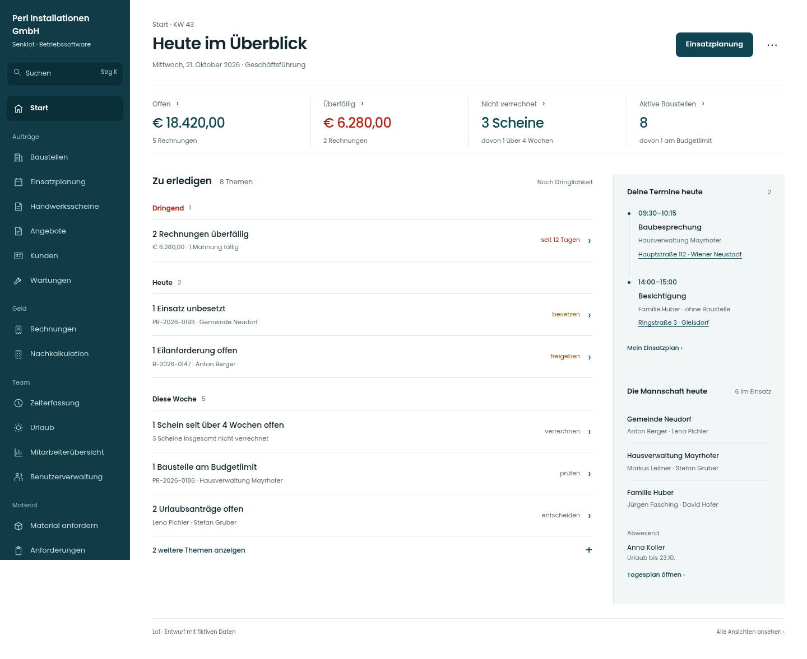
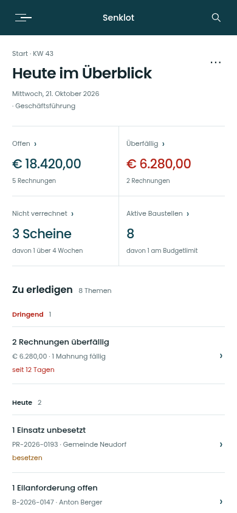
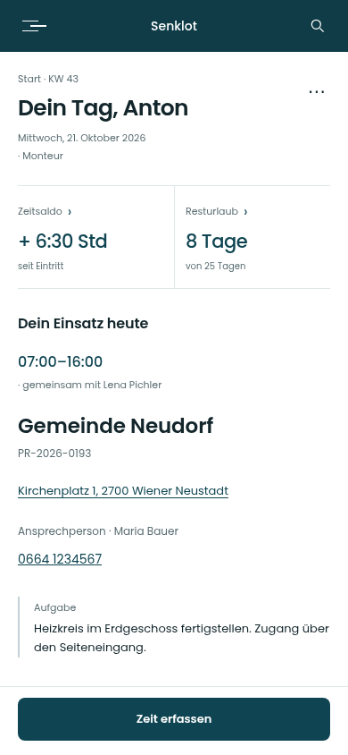

# Lot · Entwurf für die Startseite

Gestaltungsentwurf vom 21.10.2026, angelehnt an die freigegebene „Akte mit Kontext“. Alle Namen, Termine und Zahlen sind fiktive Beispieldaten. Die Live-App und ihre Daten wurden nicht verändert.

## Screens ansehen

| Ansicht | Desktop | Tablet | Mobil |
|---|---|---|---|
| Geschäftsführung | [Screen](bilder/leitung-1440.png) | [Screen](bilder/leitung-834.png) | [Screen](bilder/leitung-390.png) |
| Monteur | [Screen](bilder/monteur-1440.png) | [Screen](bilder/monteur-834.png) | [Screen](bilder/monteur-390.png) |
| Ruhiger Tag | [Screen](bilder/ruhiger-tag-1440.png) | [Screen](bilder/ruhiger-tag-834.png) | [Screen](bilder/ruhiger-tag-390.png) |

### Geschäftsführung · Desktop

### Geschäftsführung · Mobil

### Monteur · Mobil

## Gestaltung und Verhalten

- Kompakter Kopf, Poppins, Petrol und dieselben Linien und Flächen wie in den neuen Akten. Zahlen in Gewicht 500.
- Vier bestehende Kennzahlen bleiben als verlinkte Leiste. „Offen“ und „Überfällig“ behalten ihre getrennte Bedeutung aus der App; im Entwurf heißt es deshalb nicht „davon überfällig“.
- Breiter Arbeitsbereich mit „Dringend“, „Heute“ und „Diese Woche“. Jede ganze Zeile führt zur gefilterten Fachansicht. Höchstens drei Themen pro Abschnitt sind sofort sichtbar; weitere Themen klappen auf.
- Feste Kontextspalte für eigene Termine und die Mannschaft. Die feine Linie verbindet Termine, bildet aber keine maßstäbliche Zeitachse ab. Keine erfundenen Auslastungskurven, Erledigungsprozente oder dekorativen Diagramme.
- Mobil wird der Inhalt gestapelt. Die Geschäftsführung sieht Aufgaben vor dem Tageskontext. Beim Monteur steht der eigene Einsatz vor den Nachträgen; „Zeit erfassen“ bleibt am unteren Bildschirmrand erreichbar. Das ist ein Vorschlag für die Reihenfolge, noch keine Änderung des bestehenden Verhaltens.
- Beim Monteur bleiben Adresse, Telefon, Aufgabe, „Wie zuletzt buchen“, Schein, Material, Rüstliste und Einsatzplan erreichbar. „Wie zuletzt buchen“ ist weiterhin ein Einstieg in ein vorbelegtes Formular; es speichert keine Buchung.
- Der ruhige Tag zeigt eine begründete Leermeldung und weiterhin den Tageskontext.

## Funktionsumfang einer späteren Umsetzung

Dieser Entwurf zeigt Geschäftsführung, Monteur und einen ruhigen Tag. Verwaltung, Buchhaltung und Projektleitung behalten ihre bestehenden rollenabhängigen Inhalte; hierfür werden noch keine vollständigen separaten Screens behauptet. Auch Menüeinträge und Module müssen weiterhin aus den vorhandenen Rechten und aktivierten Modulen entstehen, nicht aus den statischen Beispielen dieser Studie.

Grundlage waren `DashboardView.tsx` und die Dateien unter `src/features/dashboard/start/` auf main nach PR #340. In einer Umsetzung müssen die vorhandenen Ladezustände, Teilausfälle, Laufwarnungen, Wartungshinweise, fehlenden Eintrittsdaten, Feiertage, Zeitkonten, Berechtigungen und sämtliche Themen aus `aufbau.ts` und `regeln.ts` erhalten bleiben. Eine fehlende Datenquelle darf weiterhin keine Entwarnung auslösen. Diese Ausnahmezustände sind hier nicht alle ausgerendert.

## HTML-Prototyp

ZIP herunterladen, vollständig entpacken und `index.html` im Browser öffnen. Schriftdateien samt Lizenz sind enthalten. Die GitHub-Ansicht zeigt HTML als Quelltext; die PNG-Screens lassen sich direkt auf GitHub öffnen.

Die Fachansichten sind im Prototyp nicht implementiert: Verweise öffnen einen Hinweis mit dem vorgesehenen Ziel. Aufklappen und die Rüstlisten-Checkboxen funktionieren lokal, ohne dauerhafte Speicherung. Der Telefonlink nutzt ein fiktives Beispiel. Die Seitenleiste ist eine gestalterische Darstellung, kein produktiver Rechtefilter.

## Darstellung geprüft

Drei Ansichten auf 1440, 834 und 390 Pixel Breite. Keine horizontalen Seitenüberläufe und keine JavaScript-Seitenfehler. Automatisierte axe-Prüfung mit WCAG 2/2.1/2.2 A/AA: keine Befunde in diesen neun Darstellungen. Das ersetzt keine vollständige manuelle Prüfung der späteren App. Zusätzliche Aufgaben lassen sich auf allen Breiten aufklappen; der Vorschauhinweis öffnet und schließt.

`darstellungspruefung.json` enthält die Ergebnisse. Die Screens mit `-ausschnitt` zeigen den echten Bildschirmbereich inklusive fester mobiler Zeitleiste. Im langen Monteur-Vollbild sitzt die Zeitleiste am Seitenende, damit sie keine Inhalte in der Bildmitte verdeckt.
