# Senklot – Bilder für die Landingpage

**Neue Aktenentwürfe vom 20.10.2026:** [Baustelle, Kunde und Benutzer ansehen](lot-v2-akten-entwurf-03/README.md) · [Screens und klickbare Vorschau herunterladen](Lot-Akten-Entwurf-03-2026-10-20.zip?raw=true). Jeweils Desktop und Handy, zusätzlich Tablet, weitere Bereiche und Bearbeitungsfenster. Die Baustelle beginnt jetzt direkt mit den Auftragsangaben; Preis und Stunden stehen kleiner im Auftrag. Gestaltungsentwürfe; die Live-App ist unverändert.

## Aktuell: Lot v2 · tatsächliche Umsetzung 01

**Seit 16.10.2026 live:** [App öffnen](https://installateur-demo.firebaseapp.com/) · [Auslieferungsnachweis und Handbuch](lot-v2-auslieferung-2026-10-16/README.md).

120 Screens der umgesetzten Oberfläche, jeweils Handy, Tablet und Desktop. Gemeinsame Linie, Personenvergleich, optionaler Kalender und erhaltener Wochenplan. Fiktiver Vorschau-Bestand. Der App-Code liegt in [PR #311](https://github.com/juliandeutsch22/Prototype-App-Installateure/pull/311); diese Bilder sind kein Live-Deployment.

- [Umsetzung ansehen und Einzelbilder öffnen](lot-v2-umsetzung-01/README.md)
- [Galerie herunterladen](Lot-v2-Umsetzung-01-2026-10-15.zip?raw=true) – entpacken, `galerie.html` öffnen.
- [Prüfstand und offene Abnahme](lot-v2-umsetzung-01/Pruefung.md)
- [SHA256-Prüfsumme](Lot-v2-Umsetzung-01-SHA256.txt)

## Vorheriger Entwurf: Lot v2 · Gesamtkonzept 10

217 Ansichten für Desktop, Tablet und Handy; 651 Screens und eine durchsuchbare Galerie. Überarbeitete Mitarbeiterübersicht und Wochenplanung, danach Einzelprüfung sämtlicher bisherigen Konzeptansichten. Fiktive Daten; keine Änderung der Live-App.

- [Alle Screens ansehen und Änderungen nachvollziehen](lot-v2-gesamtkonzept-10/README.md)
- [Komplettes Paket herunterladen](Lot-v2-Gesamtkonzept-10-2026-10-15.zip?raw=true) – entpacken, `galerie.html` öffnen.
- [Alle 217 Einzelentscheidungen](lot-v2-gesamtkonzept-10/UX-Pruefung.md)
- [Mobile Ansichten als großes Bild](lot-v2-gesamtkonzept-10/bilder/Uebersicht-Mobil.jpg)
- [Noch notwendige Funktionsabnahmen](lot-v2-gesamtkonzept-10/Funktionsschutz.md)

Die früheren Stände und ursprünglichen Landingpage-Bilder folgen unten.

110 Aufnahmen aus 47 Ansichten/Zuständen und fünf fertige Gerätemockups, Stand 14.10.2026. Echte App-Oberflächen mit fiktiven Demodaten.

## Downloads

- [Alle Screenshots, Mockups und die Galerie (61 MB)](Senklot-Landingpage-2026-10-14.zip?raw=true)
- [Nur die fünf Mockups, PNG und JPEG (5 MB)](Senklot-Mockups-2026-10-14.zip?raw=true)
- [Hero-Mockup direkt als transparentes PNG](mockups/01-hero.png?raw=true)
- [Offene technische Punkte](Offene-technische-Punkte.md)
- [SHA256-Prüfsummen](Senklot-Downloads-SHA256.txt)

Das große ZIP vollständig entpacken, dann `index.html` öffnen. Die Galerie funktioniert offline und bietet Filter für Desktop, Handy, Tablet und dunkle Darstellung. Transparente Mockup-PNGs: 3840 × 2880 Pixel. Die tatsächliche Downloadgröße ist 60,7 MiB bzw. 4,9 MiB.

## Vorschau

### Planung und Zeiterfassung

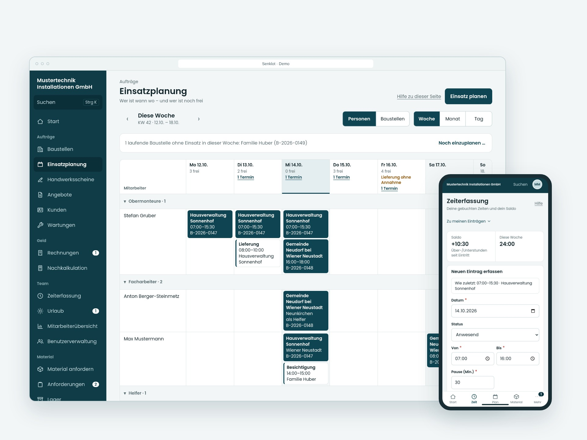

### Monatsplan und eigene Einsätze

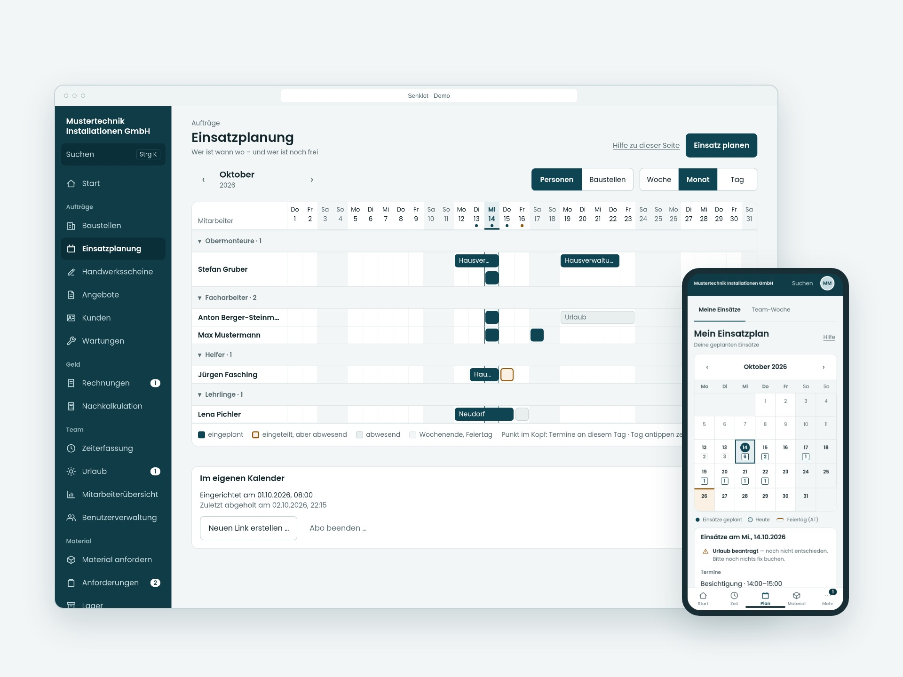

### Außendienst

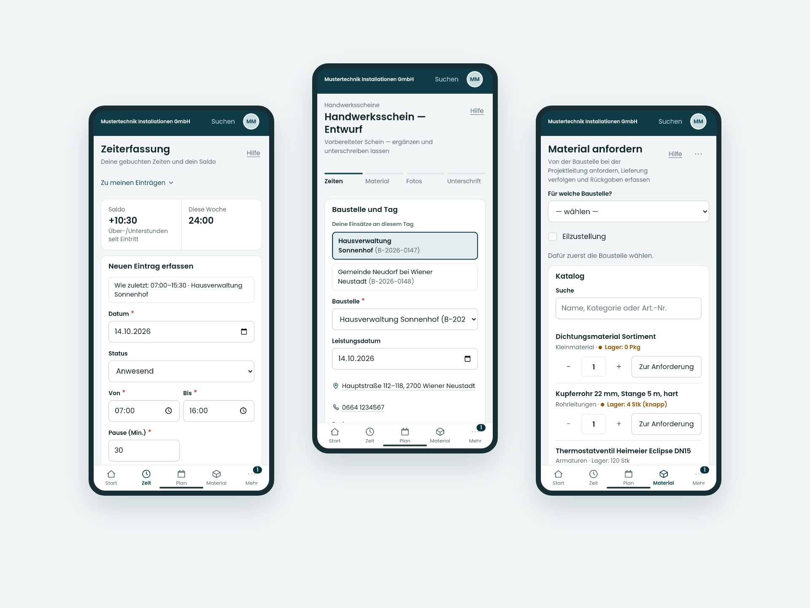

### Angebot und Rechnung

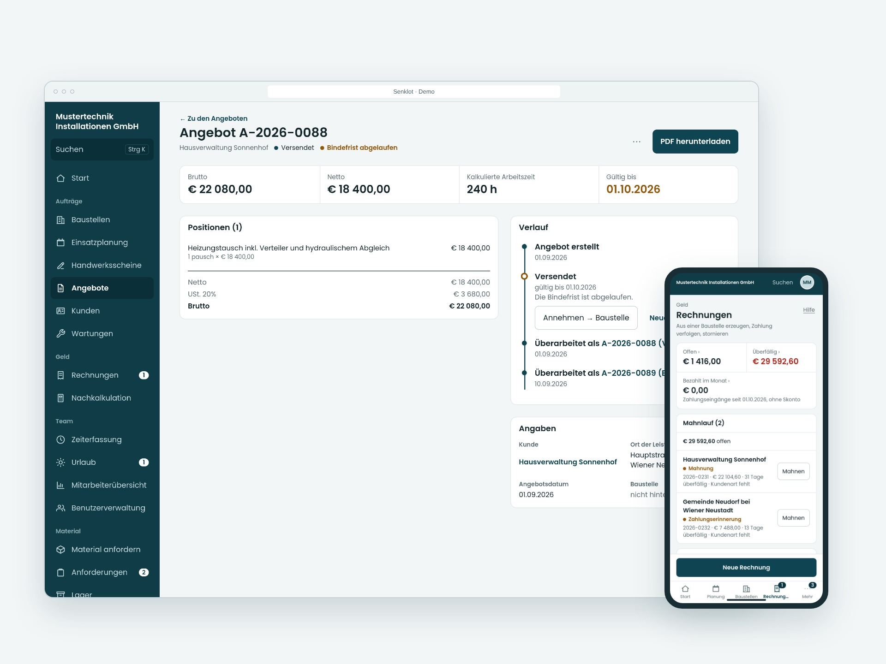

### Hell und dunkel

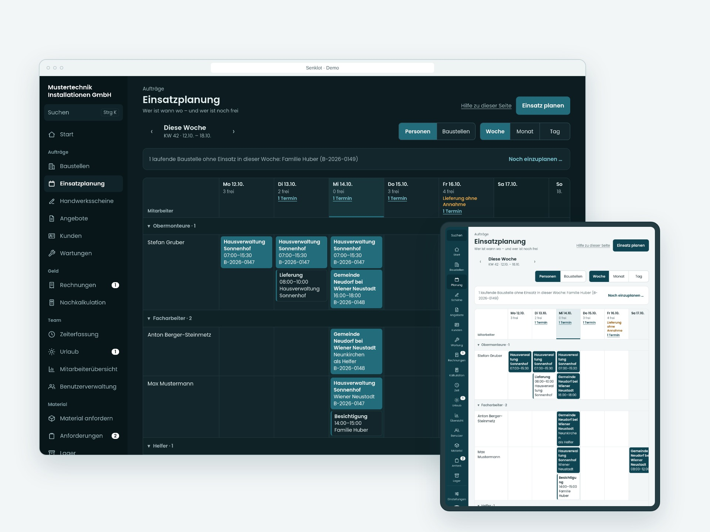

Dies ist ein eigener Bilderzweig, kein neuer App-Stand. `main`, App-Code, Produktivdaten und Deployments wurden für diese Bereitstellung nicht verändert. Die Demodaten und grünen Laufzustände bestätigen keine produktive Sicherung oder fachliche Abnahme. Interne Plattformadministration, Zwei-Faktor-Geheimnisse und Wiederherstellungscodes sind nicht enthalten.

## Neuer Gestaltungsentwurf: Lot v2

Vier eigenständig entworfene Ansichten: Heute, Rechnungen, Baustellenakte und Zeiterfassung. Weniger Karten, gemeinsame Listen-/Aktenmuster und mobile Erfassung.

- [Klickbaren Entwurf und alle Bilder herunterladen](Lot-v2-Entwurf-2026-10-14.zip?raw=true) – ZIP entpacken, `index.html` öffnen.
- [Entwurf: Umfang, Bedienung und Grenzen](lot-v2-entwurf/README.md)
- [Übersicht als großes Bild](lot-v2-entwurf/Lot-v2-Uebersicht.png?raw=true)

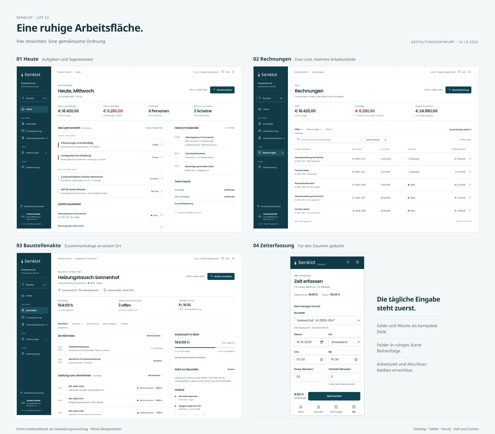

### Heute

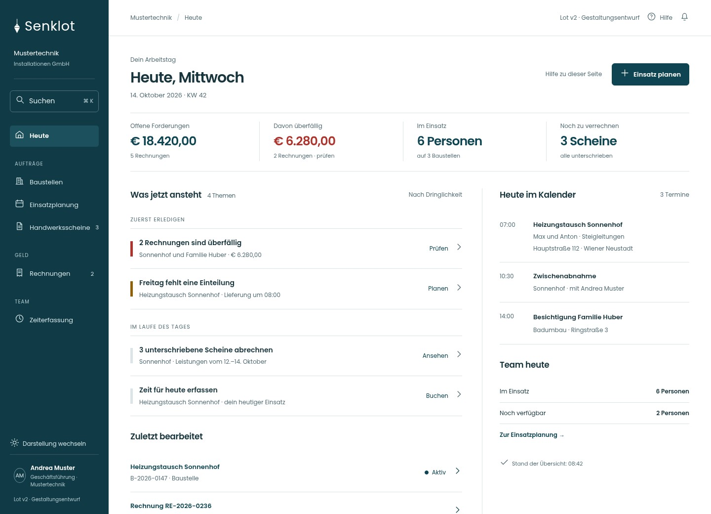

### Rechnungen

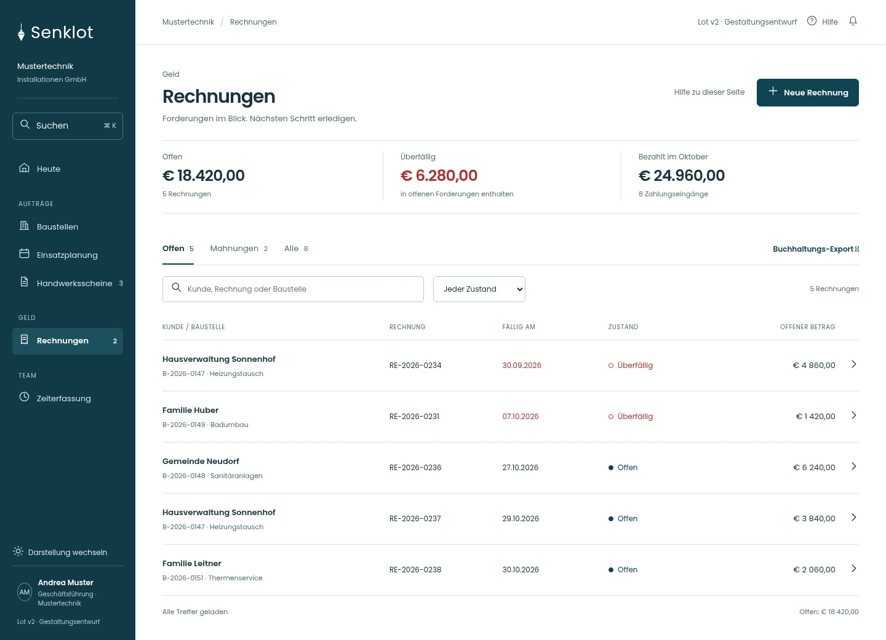

### Baustellenakte

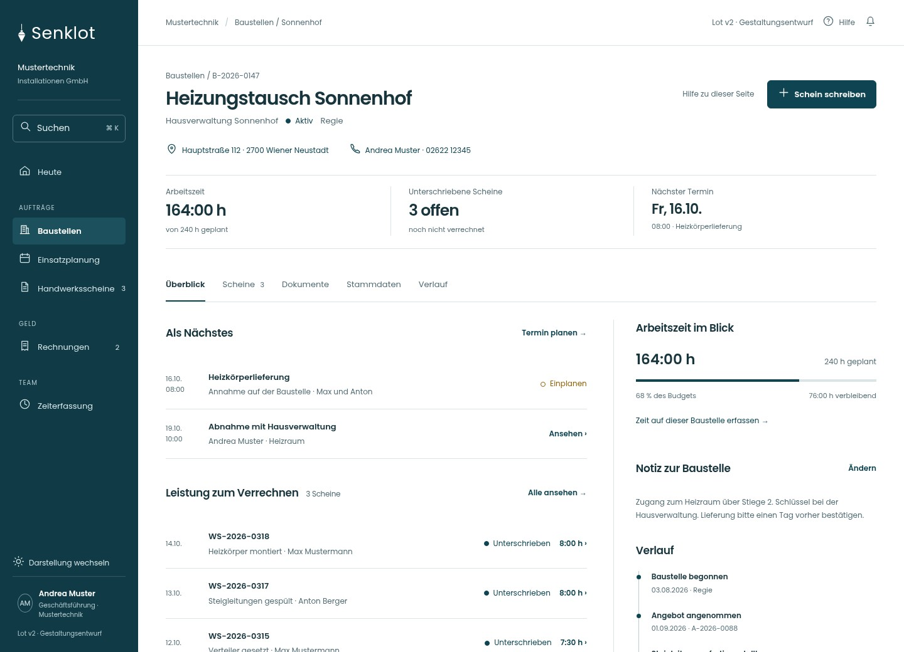

### Zeit erfassen am Handy

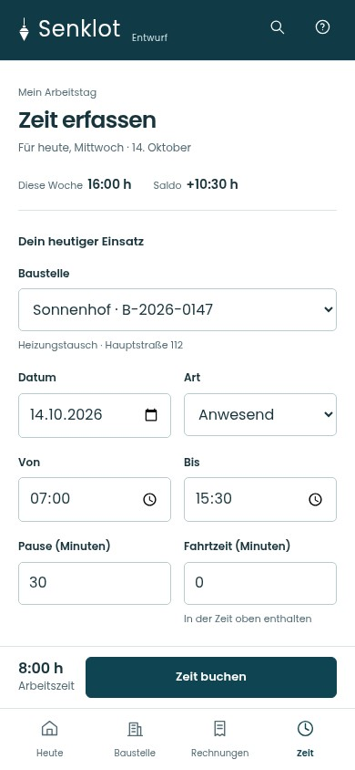

Dieser Entwurf verwendet fiktive Daten und simulierte Aktionen. Er ist keine bereits ausgeführte Änderung der App.

## Lot v2 – Feinschliff / Entwurf 02 (15.10.2026)

Typografie und Positionen verfeinert: größere, leichter gesetzte Kennzahlen, gezielte Betonungen und ein prägnanter Datumsanker. Ergänzt sind beschriftete Forderungsanteile, ein Stundenbudgetkreis und ein dynamisches Arbeitszeit-/Pausenband. Keine zusätzlichen Icons. Die erste Fassung bleibt erhalten.

- [Klickbaren Feinschliff und alle Bilder herunterladen](Lot-v2-Feinschliff-2026-10-15.zip?raw=true) – ZIP entpacken, `index.html` öffnen.
- [Vorher / Nachher als großes Bild](lot-v2-feinschliff/Lot-v2-Vergleich.png?raw=true)
- [Vier verfeinerte Ansichten](lot-v2-feinschliff/Lot-v2-Uebersicht.png?raw=true)
- [Beschreibung und Grenzen](lot-v2-feinschliff/README.md)

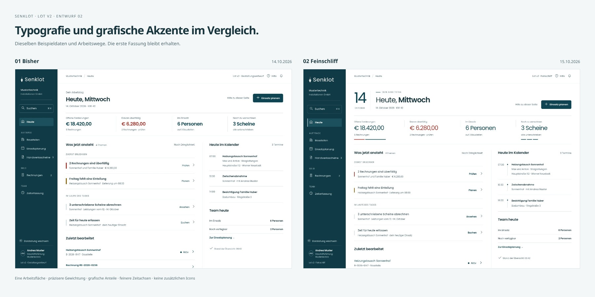

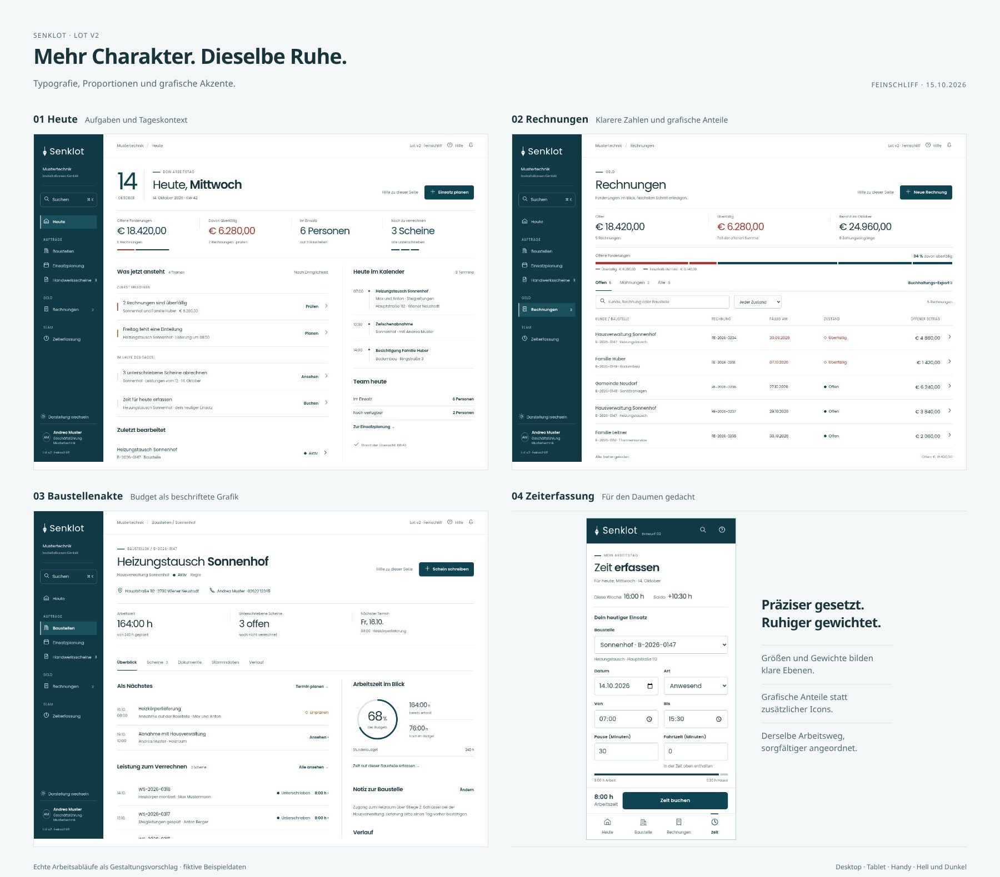

Eigenständige Gestaltungsvorschau mit fiktiven Daten; die App wurde nicht verändert.

## Lot v2 – Entwurf 03: erste Schriftgestaltung, neue Diagramme

Auf Wunsch vom 15.10.2026 kombiniert diese Fassung die einheitliche Typografie der ersten Version mit den inhaltlichen Grafiken der zweiten Version. Große Datumsziffer, wechselnde Titelgewichte und Schmucklinien sind entfernt. Forderungsanteile, Budgetkreis, Zeitband und die feine Kalender-Zeitachse bleiben erhalten.

- [Entwurf 03 und Bilder herunterladen](Lot-v2-Entwurf-03-2026-10-15.zip?raw=true) – entpacken, `index.html` öffnen.
- [Beschreibung und Umfang](lot-v2-entwurf-03/README.md)
- [Alle vier Ansichten als großes Bild](lot-v2-entwurf-03/Lot-v2-Uebersicht.png?raw=true)
- [Vergleich mit der ersten Fassung](lot-v2-entwurf-03/Lot-v2-Vergleich.png?raw=true)

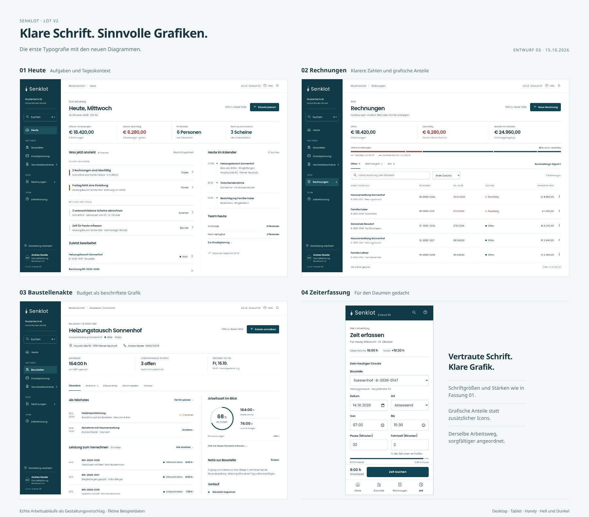

Die bisherigen Fassungen und die laufende App bleiben unverändert.

## Lot v2 – Entwurf 04: Kennzahlen etwas dünner

Die großen Kennzahlen sind auf Wunsch eine Stufe leichter: Poppins Medium (500) statt Semibold (600). Größen, Positionen, Titel und übrige Texte bleiben wie in Entwurf 03.

- [Aktualisierten Entwurf herunterladen](Lot-v2-Entwurf-04-2026-10-15.zip?raw=true) – entpacken, `index.html` öffnen.
- [Kennzahlen in voller Auflösung](lot-v2-entwurf-04/Kennzahlen.png?raw=true)

Die laufende App bleibt unverändert.

## Lot v2 · Screen-Mockups 05: zusammenhängende Arbeitswege

Sechs neue Screens auf Grundlage von Entwurf 04: Heute, Rechnungsliste mit Details, unterschriebener Schein, Baustellenakte, Bestätigung einer Zeitbuchung und abgeschlossene Mahnfälle. Die ruhige Typografie mit etwas dünneren Kennzahlen bleibt erhalten.

- [Alle Bilder, Galerie und klickbare Vorschau herunterladen](Lot-v2-Screen-Mockups-2026-10-15.zip?raw=true) – entpacken und `galerie.html` öffnen.
- [Umfang und Bedienung](lot-v2-screen-mockups/README.md)
- [Übersicht in voller Auflösung](lot-v2-screen-mockups/Lot-v2-Screen-Mockups-Uebersicht.png?raw=true)

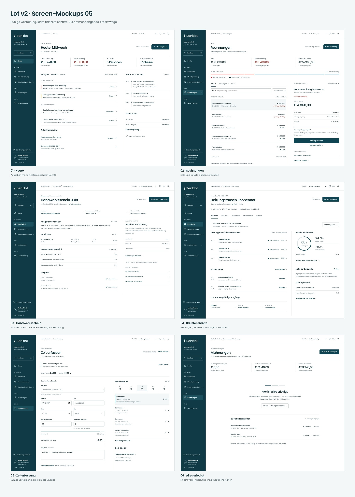

Eigenständige Gestaltungsvorschau mit fiktiven Daten. Die App wurde nicht umgebaut oder neu ausgeliefert. Die vorherigen Entwürfe bleiben erhalten.

## Lot v2 · Gesamtkonzept 06: die gesamte App

Alle bestehenden Bereiche mit insgesamt **206 Konzeptansichten und Zuständen**, einschließlich Rollenvarianten, Formularschritten und Dialogen. Grundlage sind sämtliche 38 Routendeklarationen, elf Einstellungs-Unterseiten und 132 Feature-Komponenten. Die ruhige Gestaltung von Entwurf 04 bleibt; wiederholte Prozesshinweise und zusätzliche Grafiken ohne konkreten Nutzen aus Entwurf 05 sind reduziert.

- [Gesamtkonzept, Galerie und alle Bilder herunterladen](Lot-v2-Gesamtkonzept-2026-10-15.zip?raw=true) – vollständig entpacken und `galerie.html` öffnen.
- [Alle 206 Ansichtsblätter direkt auf GitHub ansehen](lot-v2-gesamtkonzept/README.md)
- [Vollständiges Konzept lesen](lot-v2-gesamtkonzept/Konzept.md)
- [Abdeckung der Bestandsseiten](lot-v2-gesamtkonzept/Abdeckung.md)

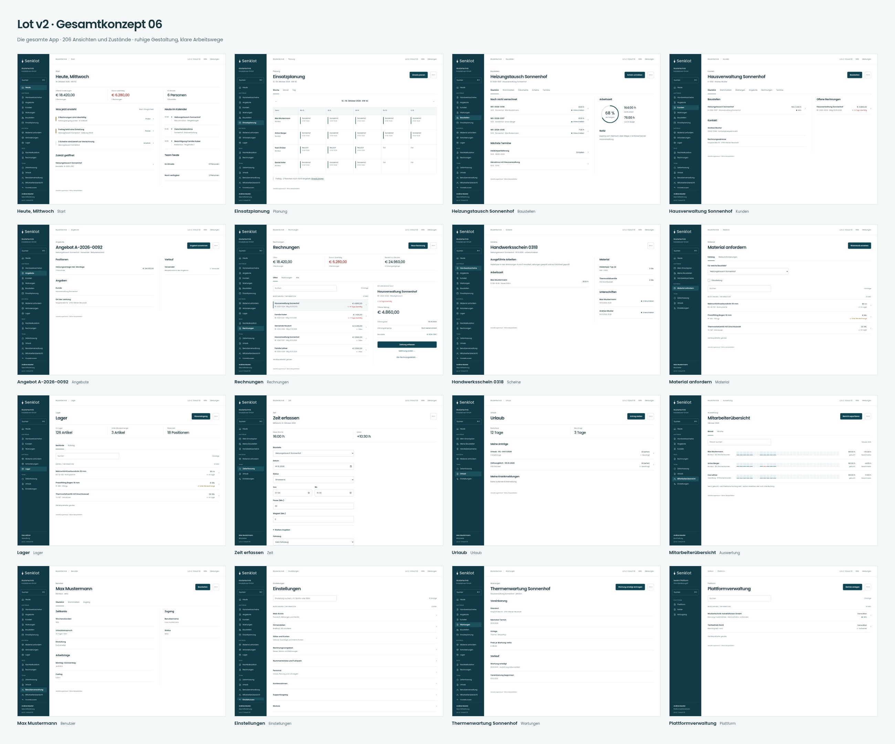

618 Darstellungen bei 1440, 834 und 390 px ohne die geprüften Layoutfehler; 42 repräsentative automatisierte WCAG-Prüfungen ohne gemeldete Verstöße. Die Offline-Galerie, der Entwurf und das Konzept benötigen keine Installation oder Netzwerkverbindung.

Dies ist eine Gestaltungsvorlage mit fiktiven Daten. Die App und ihre Produktivdaten wurden nicht geändert oder neu ausgeliefert. Die Umsetzung ist noch nicht begonnen.

## Senklot-Website: Sicherheit und World4you-SMTP (03.11.2026)

PHP-/SMTP-Backend mit optional aktivierbarem Cloudflare-Spamschutz, Sicherheitsheadern und separaten Rechtstexten mit den bereitgestellten Betreiberangaben. Die neue Revision ist lokal geprüft und noch nicht auf World4you hochgeladen. Betreiberangaben und Texte von Julian Deutsch sind integriert; Cloudflare und technischer Missbrauchsschutz sind ergänzt. Für den Formularstart fehlen weiterhin Anbieterabgleich, Postfachdaten und Turnstile-Schlüssel. Die 12-Monats-Löschfristen sind im Postfach organisatorisch umzusetzen.

- [World4you-Uploadpaket](senklot-landingpage-2026-11-02/world4you-upload.zip?raw=true)
- [Konkrete Einrichtung und verbleibende Aufgaben](senklot-landingpage-2026-11-02/VEROEFFENTLICHEN.md)
- [Vollständiges Entwicklerpaket](senklot-landingpage-2026-11-02/landingpage.zip?raw=true)
- [Prüfprotokolle](senklot-landingpage-2026-11-02/nachweise/sicherheit/README.md)

Echte Konfiguration und gespeicherte Anfragen sind von beiden Paketen ausgeschlossen. Die App bleibt unverändert.

## Senklot-Website: Feedback, Pilotpreise und optionaler Einstieg (04.11.2026)

Überarbeitete Landingpage mit klarerem Auftragsablauf, Einstieg, Datenübernahme, Support und Betriebsgrundlagen. Einführungspreise 129 / 179 / 249 € netto, zwölf Monate Preisgarantie ab Vertragsbeginn und weiterhin 10 % Jahresrabatt. Die begleitete Einrichtung ist optional (199 / 399 / 699 € netto), nicht vorausgewählt und wird ohne ausdrückliche Auswahl nicht als angefragt übermittelt. Je Tarif lässt sich der enthaltene Einrichtungsumfang aufklappen.

- [World4you-Uploadpaket](senklot-landingpage-2026-11-02/world4you-upload.zip?raw=true)
- [Desktop-Vorschau](senklot-landingpage-2026-11-02/landingpage-1440.png) · [Mobile Vorschau](senklot-landingpage-2026-11-02/landingpage-390.png)
- [Einrichtung aufgeklappt](senklot-landingpage-2026-11-02/06-einrichtung-offen-1440.png)
- [Preise](senklot-landingpage-2026-11-02/06-preise-1440.png) · [Einstieg](senklot-landingpage-2026-11-02/08-einstieg-1440.png) · [Betriebsgrundlagen](senklot-landingpage-2026-11-02/09-vertrauen-1440.png)
- [Einrichtung und verbleibende Aufgaben](senklot-landingpage-2026-11-02/VEROEFFENTLICHEN.md)

70 PHP-Prüfungen, 13 Node-Prüfungen und Browserprüfungen bei 320 / 390 / 834 / 1440 Pixeln. Das Paket wurde nicht auf World4you hochgeladen; echte Zustellung und Kontokonfiguration bleiben dort zu prüfen. Keine echten E-Mails versendet und keine Änderungen an der Betriebssoftware.

## Senklot-Website: Kontaktformular ohne Cloudflare (04.11.2026)

Der lokale Standardmodus schützt das Formular mit Honeypot, kurzer Mindestzeit, signierten Einmal-Tokens und serverseitigen Anfragebegrenzungen. Dafür sind kein Cloudflare-Konto und keine externen Schlüssel nötig. SMTP-, Preis-, Einrichtungs- und Wiederholungsschutz bleiben erhalten. Vorhandene Turnstile-Konfigurationen bleiben kompatibel; es gibt keinen automatischen Wechsel bei Dienstausfällen.

- [Aktuelles World4you-Paket](senklot-landingpage-2026-11-02/world4you-upload.zip?raw=true)
- [Konfiguration und verbleibende Schritte](senklot-landingpage-2026-11-02/VEROEFFENTLICHEN.md)
- [Prüfprotokolle](senklot-landingpage-2026-11-02/nachweise/sicherheit/README.md)

70 bisherige PHP-Prüfungen plus 41 neue Prüfungen des lokalen Schutzes, lokale Browserchecks und ein vollständiger Apache/PHP/TLS-SMTP-Test ohne externe Zustellung. Der World4you-Upload und der echte Postfacheingang wurden aus dieser Sitzung nicht ausgeführt.

## Senklot-Website: Formular, FAQ und gestaltete Anfrage-Mail (04.11.2026)

Alle optionalen Felder sind direkt sichtbar. Der lokale Spamschutz läuft im normalen Betrieb ohne sichtbaren Hinweisblock; echte Fehler bleiben sichtbar und können erneut versucht werden. Die zehn FAQ-Antworten stehen in zwei Themengruppen unter einer gemeinsamen Überschrift. Die Anfrage-Mail ist in Petrol mit eingebettetem Senklot-Logo gestaltet und enthält zusätzlich eine vollständige Klartextversion. Empfänger, Antwortadresse, Preise und freiwillige Einrichtung bleiben erhalten. Keine externen Bilder oder Schriftarten in der Mail.

- [Aktuelles World4you-Uploadpaket](senklot-landingpage-2026-11-02/world4you-upload.zip?raw=true)
- [FAQ Desktop](senklot-landingpage-2026-11-02/10-faq-1440.png) · [FAQ mobil](senklot-landingpage-2026-11-02/10-faq-390.png)
- [Formular Desktop](senklot-landingpage-2026-11-02/07-kontakt-1440.png) · [Formular mobil](senklot-landingpage-2026-11-02/07-kontakt-390.png)
- [Mail Desktop](senklot-landingpage-2026-11-02/11-anfrage-mail-760.png) · [Mail mobil](senklot-landingpage-2026-11-02/11-anfrage-mail-390.png)

126 PHP-Prüfungen, 14 Node-Prüfungen, Browserchecks sowie ein lokaler Apache/PHP/TLS-SMTP-Test mit Prüfung der tatsächlichen HTML-/Klartext-Mail und des eingebetteten Logos sind bestanden. Keine echten E-Mails aus dieser Sitzung verschickt. Der neue Stand ist noch nicht aus dieser Sitzung auf World4you hochgeladen. **Beim Update die bestehende `senklot-intern/config.php` und `senklot-intern/speicher/` erhalten.** Für die Gestaltung sind keine neuen SMTP-Einstellungen erforderlich.
