# Senklot – Bilder für die Landingpage

110 Aufnahmen aus 47 Ansichten/Zuständen und fünf fertige Gerätemockups, Stand 14.10.2026. Echte App-Oberflächen mit fiktiven Demodaten.

## Downloads

- [Alle Screenshots, Mockups und die Galerie (61 MB)](Senklot-Landingpage-2026-10-14.zip?raw=true)
- [Nur die fünf Mockups, PNG und JPEG (5 MB)](Senklot-Mockups-2026-10-14.zip?raw=true)
- [Hero-Mockup direkt als transparentes PNG](mockups/01-hero.png?raw=true)
- [Offene technische Punkte](Offene-technische-Punkte.md)
- [SHA256-Prüfsummen](Senklot-Downloads-SHA256.txt)

Das große ZIP vollständig entpacken, dann `index.html` öffnen. Die Galerie funktioniert offline und bietet Filter für Desktop, Handy, Tablet und dunkle Darstellung. Transparente Mockup-PNGs: 3840 × 2880 Pixel. Die tatsächliche Downloadgröße ist 60,7 MiB bzw. 4,9 MiB.

## Vorschau

### Planung und Zeiterfassung

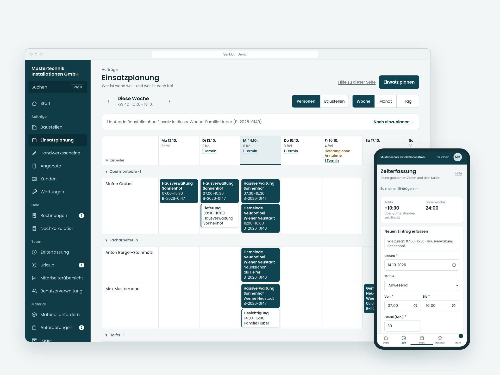

### Monatsplan und eigene Einsätze

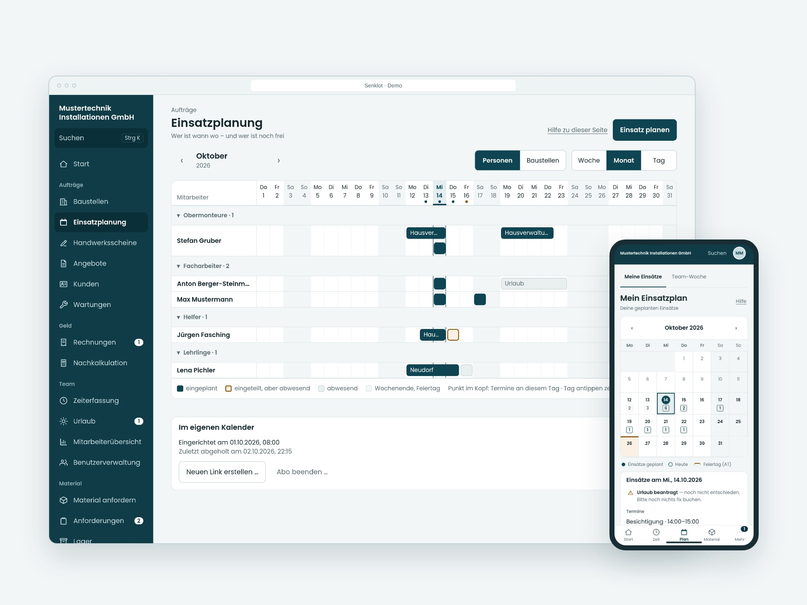

### Außendienst

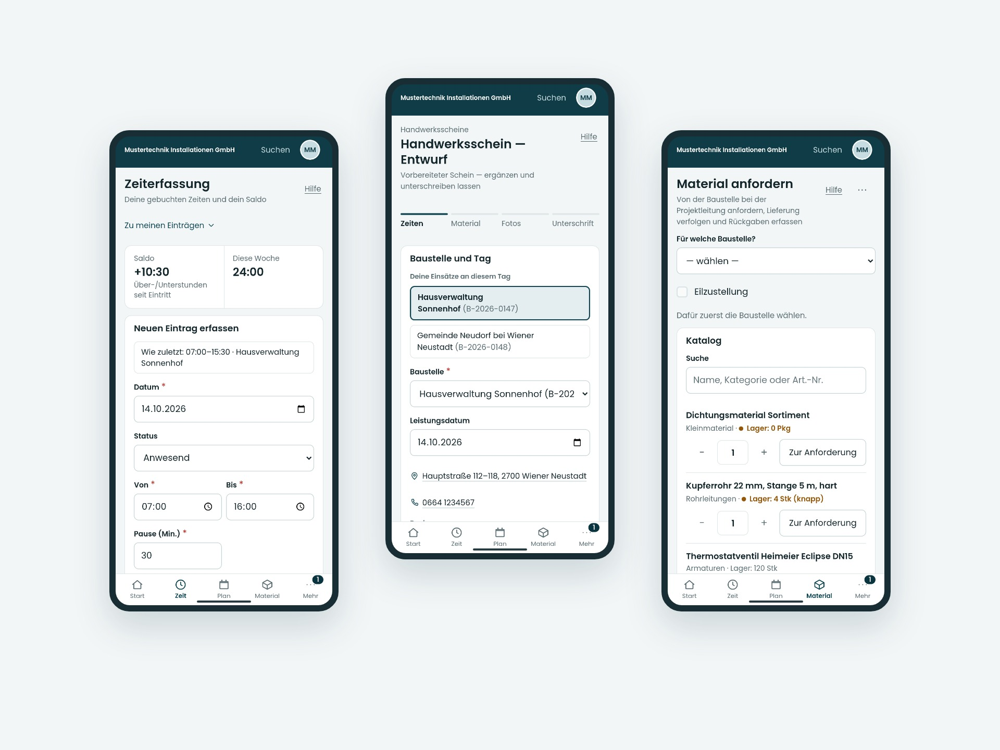

### Angebot und Rechnung

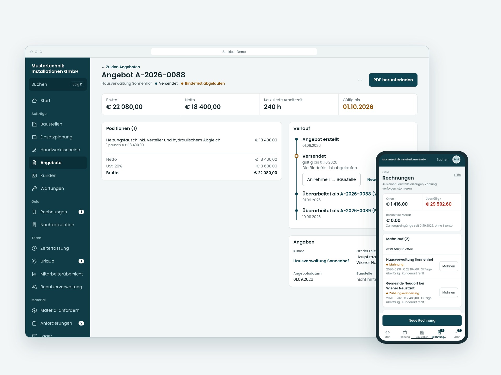

### Hell und dunkel

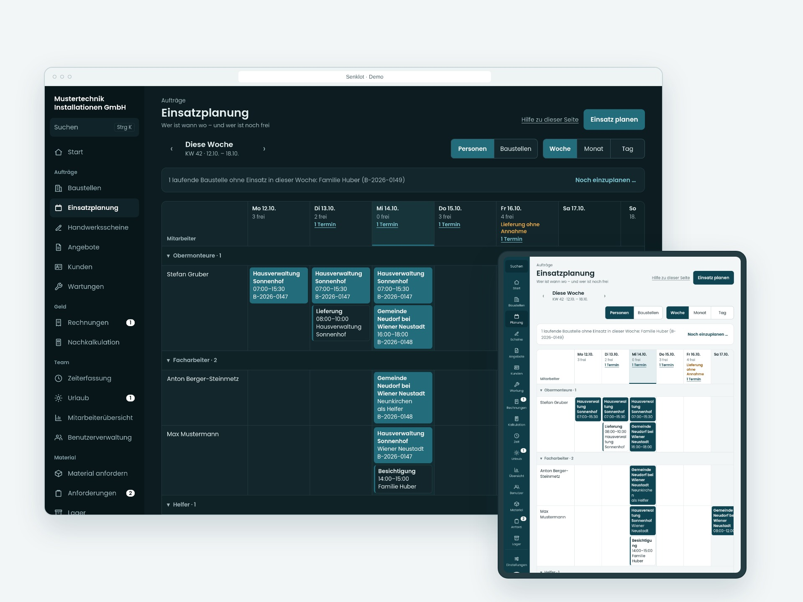

Dies ist ein eigener Bilderzweig, kein neuer App-Stand. `main`, App-Code, Produktivdaten und Deployments wurden für diese Bereitstellung nicht verändert. Die Demodaten und grünen Laufzustände bestätigen keine produktive Sicherung oder fachliche Abnahme. Interne Plattformadministration, Zwei-Faktor-Geheimnisse und Wiederherstellungscodes sind nicht enthalten.

## Neuer Gestaltungsentwurf: Lot v2

Vier eigenständig entworfene Ansichten: Heute, Rechnungen, Baustellenakte und Zeiterfassung. Weniger Karten, gemeinsame Listen-/Aktenmuster und mobile Erfassung.

- [Klickbaren Entwurf und alle Bilder herunterladen](Lot-v2-Entwurf-2026-10-14.zip?raw=true) – ZIP entpacken, `index.html` öffnen.
- [Entwurf: Umfang, Bedienung und Grenzen](lot-v2-entwurf/README.md)
- [Übersicht als großes Bild](lot-v2-entwurf/Lot-v2-Uebersicht.png?raw=true)

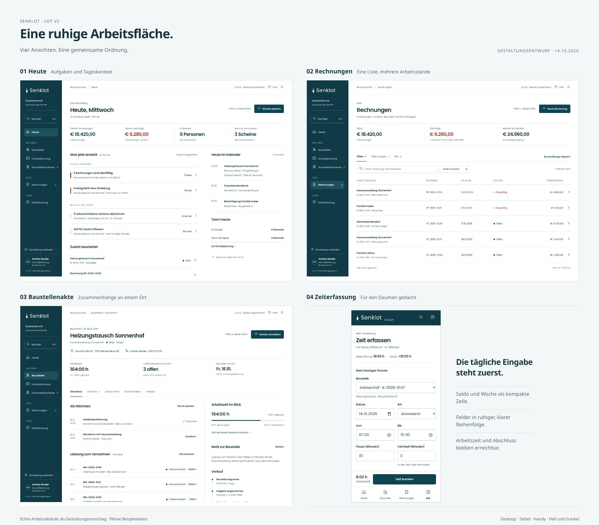

### Heute

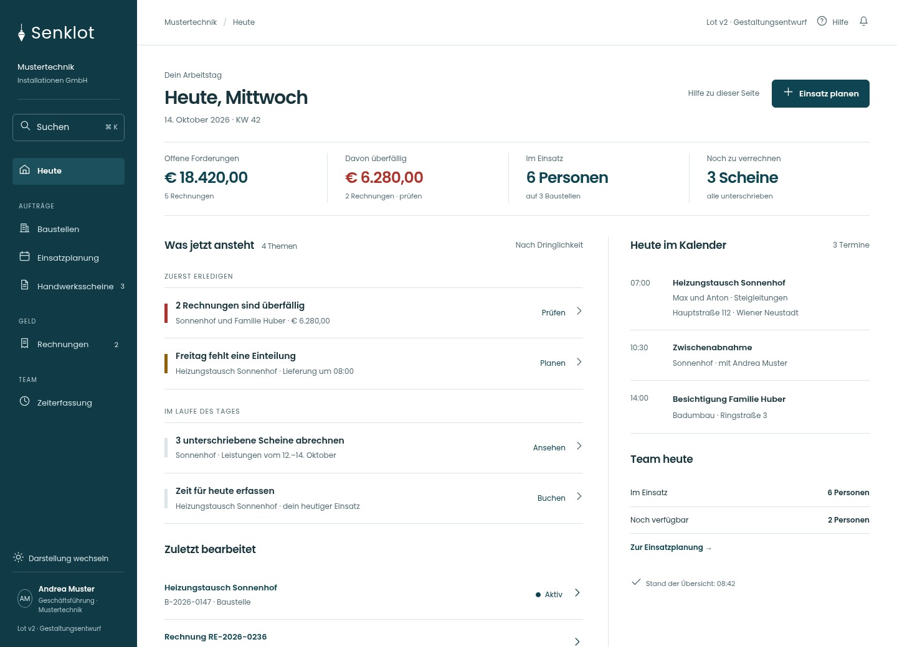

### Rechnungen

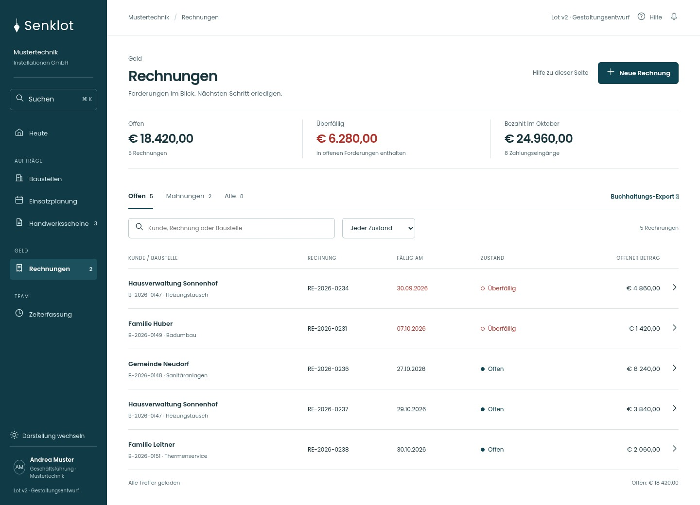

### Baustellenakte

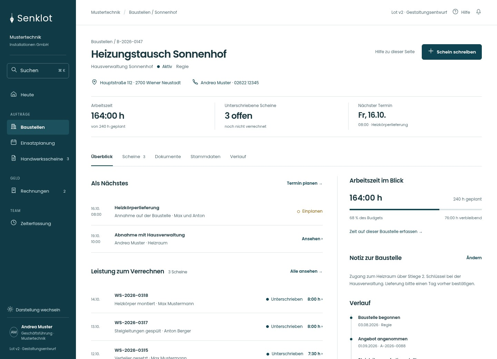

### Zeit erfassen am Handy

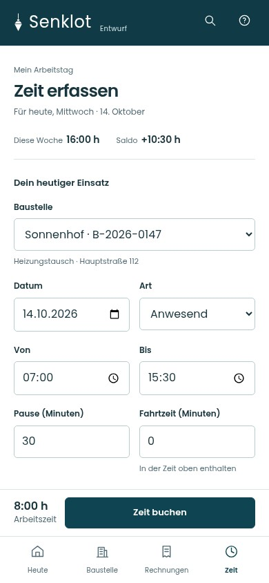

Dieser Entwurf verwendet fiktive Daten und simulierte Aktionen. Er ist keine bereits ausgeführte Änderung der App.

## Lot v2 – Feinschliff / Entwurf 02 (15.10.2026)

Typografie und Positionen verfeinert: größere, leichter gesetzte Kennzahlen, gezielte Betonungen und ein prägnanter Datumsanker. Ergänzt sind beschriftete Forderungsanteile, ein Stundenbudgetkreis und ein dynamisches Arbeitszeit-/Pausenband. Keine zusätzlichen Icons. Die erste Fassung bleibt erhalten.

- [Klickbaren Feinschliff und alle Bilder herunterladen](Lot-v2-Feinschliff-2026-10-15.zip?raw=true) – ZIP entpacken, `index.html` öffnen.
- [Vorher / Nachher als großes Bild](lot-v2-feinschliff/Lot-v2-Vergleich.png?raw=true)
- [Vier verfeinerte Ansichten](lot-v2-feinschliff/Lot-v2-Uebersicht.png?raw=true)
- [Beschreibung und Grenzen](lot-v2-feinschliff/README.md)

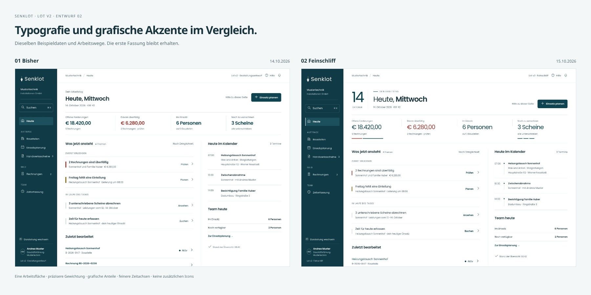

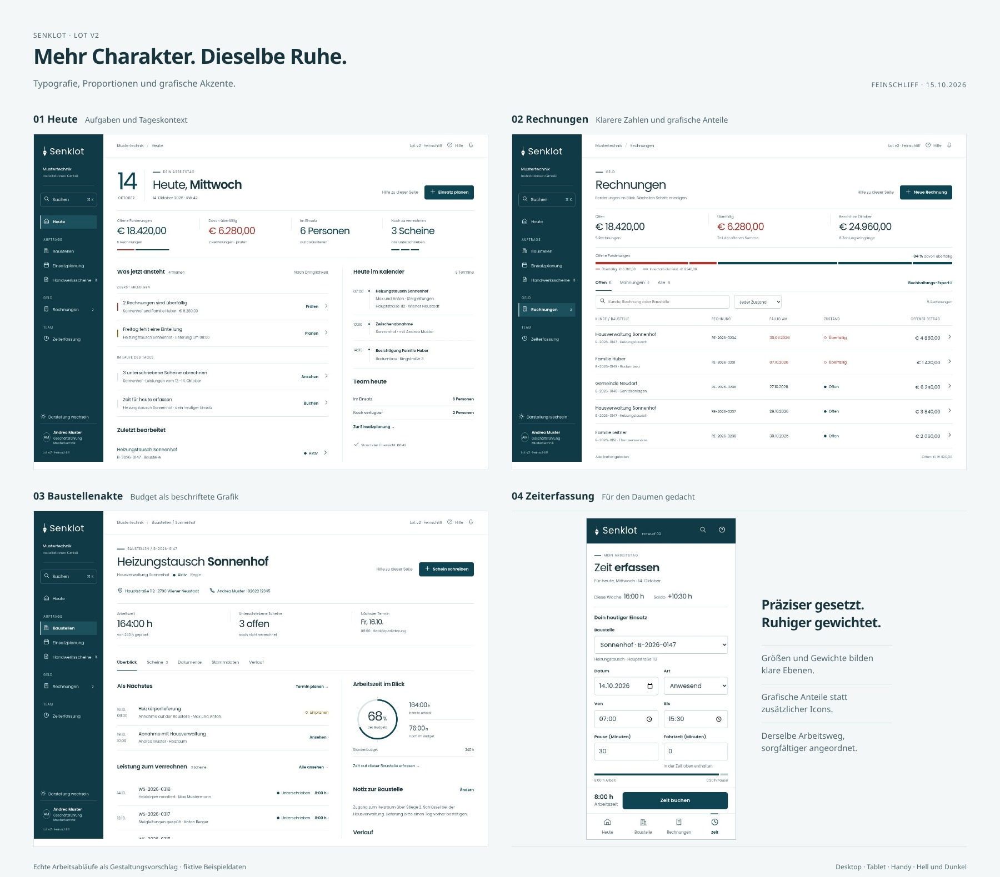

Eigenständige Gestaltungsvorschau mit fiktiven Daten; die App wurde nicht verändert.

## Lot v2 – Entwurf 03: erste Schriftgestaltung, neue Diagramme

Auf Wunsch vom 15.10.2026 kombiniert diese Fassung die einheitliche Typografie der ersten Version mit den inhaltlichen Grafiken der zweiten Version. Große Datumsziffer, wechselnde Titelgewichte und Schmucklinien sind entfernt. Forderungsanteile, Budgetkreis, Zeitband und die feine Kalender-Zeitachse bleiben erhalten.

- [Entwurf 03 und Bilder herunterladen](Lot-v2-Entwurf-03-2026-10-15.zip?raw=true) – entpacken, `index.html` öffnen.
- [Beschreibung und Umfang](lot-v2-entwurf-03/README.md)
- [Alle vier Ansichten als großes Bild](lot-v2-entwurf-03/Lot-v2-Uebersicht.png?raw=true)
- [Vergleich mit der ersten Fassung](lot-v2-entwurf-03/Lot-v2-Vergleich.png?raw=true)

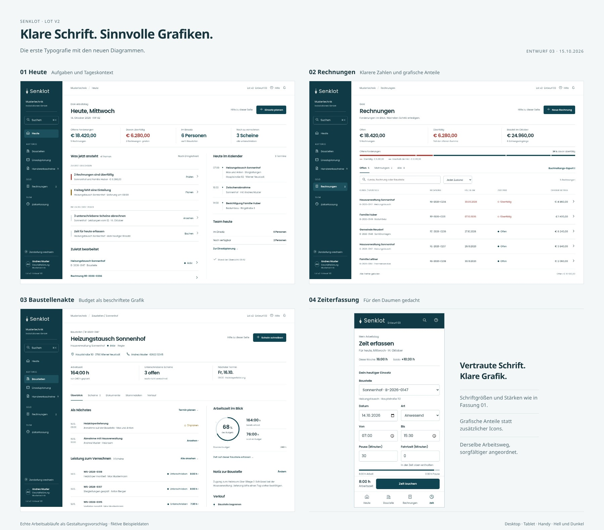

Die bisherigen Fassungen und die laufende App bleiben unverändert.
