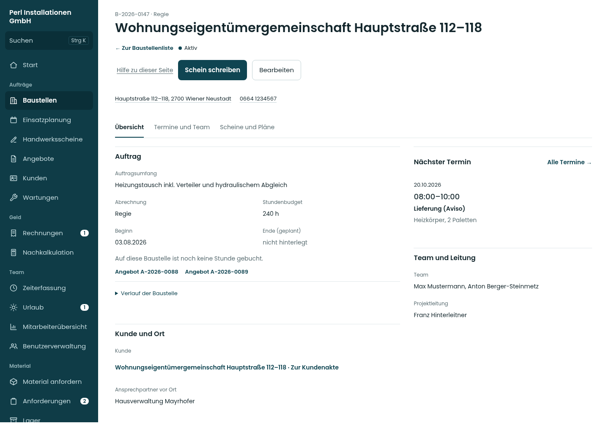
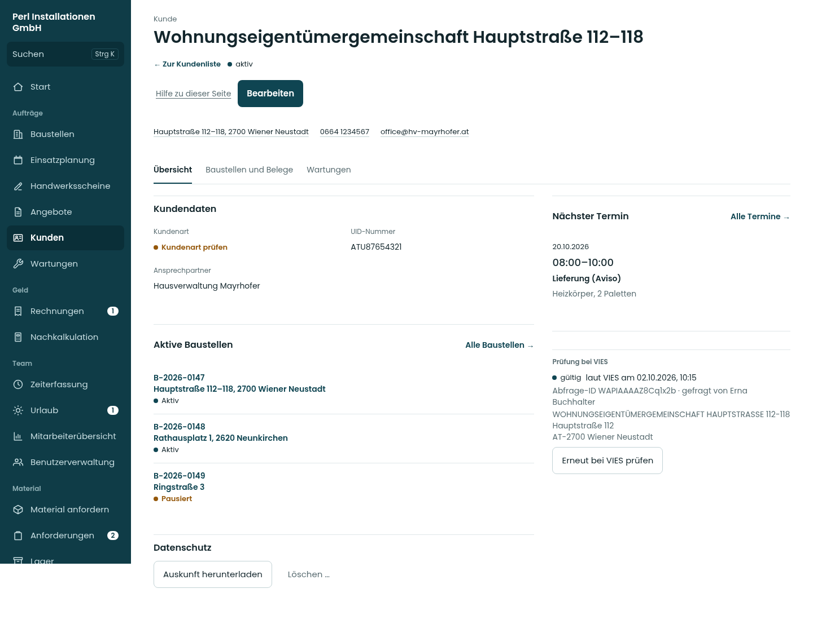
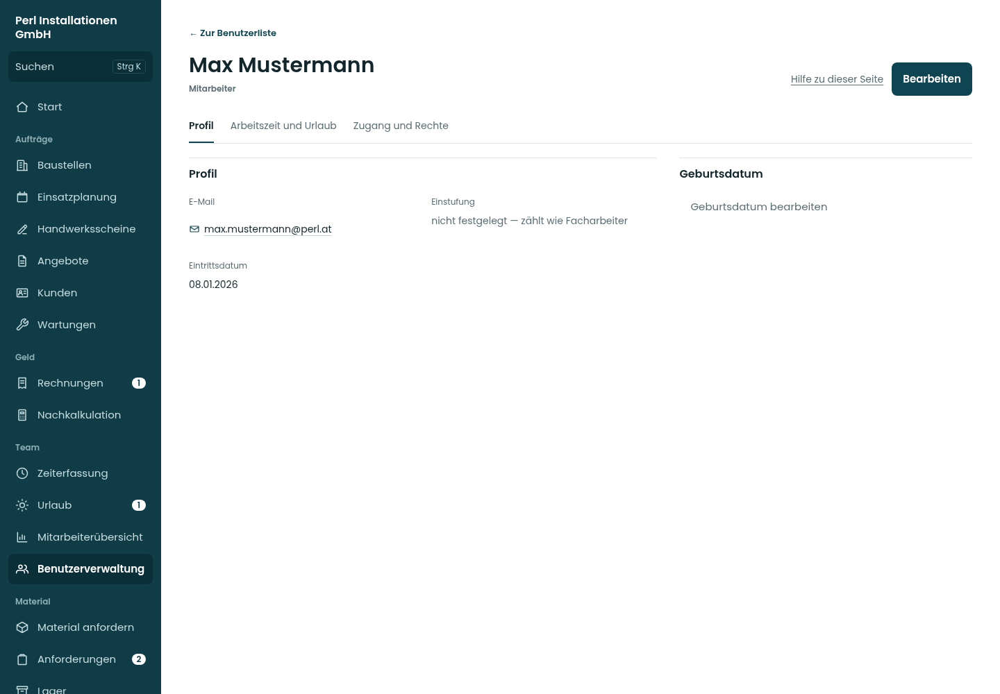

# Die drei Akten · tatsächliche Umsetzung

Diese Bilder zeigen die echten Ansichten der App mit fiktiven Vorschau-Daten, keine Bildentwürfe. Stand 20.10.2026, Quellstand [95e4e6f](https://github.com/juliandeutsch22/Prototype-App-Installateure/commit/95e4e6f).

Die große Kennzahlenleiste der Baustelle entfällt. Bearbeiten öffnet das vollständige Formular.

## Baustellenakte

[Mobil](bilder/baustelle-390-0.png) · [Tablet](bilder/baustelle-834-0.png) · [Bearbeiten mobil](bilder/baustelle-390-bearbeiten.png)

| Breite | Erster Bereich | Zweiter Bereich | Dritter Bereich | Bearbeiten |
| --- | --- | --- | --- | --- |

| 390 px | [Ansehen](bilder/baustelle-390-0.png) | [Ansehen](bilder/baustelle-390-1.png) | [Ansehen](bilder/baustelle-390-2.png) | [Ansehen](bilder/baustelle-390-bearbeiten.png) |

| 834 px | [Ansehen](bilder/baustelle-834-0.png) | [Ansehen](bilder/baustelle-834-1.png) | [Ansehen](bilder/baustelle-834-2.png) | [Ansehen](bilder/baustelle-834-bearbeiten.png) |

| 1440 px | [Ansehen](bilder/baustelle-1440-0.png) | [Ansehen](bilder/baustelle-1440-1.png) | [Ansehen](bilder/baustelle-1440-2.png) | [Ansehen](bilder/baustelle-1440-bearbeiten.png) |

[Dunkelmodus am Schreibtisch](bilder/dunkel-baustelle-1440-0.png)

## Kundenakte

[Mobil](bilder/kunde-390-0.png) · [Tablet](bilder/kunde-834-0.png) · [Bearbeiten mobil](bilder/kunde-390-bearbeiten.png)

| Breite | Erster Bereich | Zweiter Bereich | Dritter Bereich | Bearbeiten |
| --- | --- | --- | --- | --- |

| 390 px | [Ansehen](bilder/kunde-390-0.png) | [Ansehen](bilder/kunde-390-1.png) | [Ansehen](bilder/kunde-390-2.png) | [Ansehen](bilder/kunde-390-bearbeiten.png) |

| 834 px | [Ansehen](bilder/kunde-834-0.png) | [Ansehen](bilder/kunde-834-1.png) | [Ansehen](bilder/kunde-834-2.png) | [Ansehen](bilder/kunde-834-bearbeiten.png) |

| 1440 px | [Ansehen](bilder/kunde-1440-0.png) | [Ansehen](bilder/kunde-1440-1.png) | [Ansehen](bilder/kunde-1440-2.png) | [Ansehen](bilder/kunde-1440-bearbeiten.png) |

[Dunkelmodus am Schreibtisch](bilder/dunkel-kunde-1440-0.png)

## Benutzerakte

[Mobil](bilder/benutzer-390-0.png) · [Tablet](bilder/benutzer-834-0.png) · [Bearbeiten mobil](bilder/benutzer-390-bearbeiten.png)

| Breite | Erster Bereich | Zweiter Bereich | Dritter Bereich | Bearbeiten |
| --- | --- | --- | --- | --- |

| 390 px | [Ansehen](bilder/benutzer-390-0.png) | [Ansehen](bilder/benutzer-390-1.png) | [Ansehen](bilder/benutzer-390-2.png) | [Ansehen](bilder/benutzer-390-bearbeiten.png) |

| 834 px | [Ansehen](bilder/benutzer-834-0.png) | [Ansehen](bilder/benutzer-834-1.png) | [Ansehen](bilder/benutzer-834-2.png) | [Ansehen](bilder/benutzer-834-bearbeiten.png) |

| 1440 px | [Ansehen](bilder/benutzer-1440-0.png) | [Ansehen](bilder/benutzer-1440-1.png) | [Ansehen](bilder/benutzer-1440-2.png) | [Ansehen](bilder/benutzer-1440-bearbeiten.png) |

[Dunkelmodus am Schreibtisch](bilder/dunkel-benutzer-1440-0.png)

## Ungespeicherte Änderungen

[Speichern bereits nach der Änderung oben sichtbar · Handy](bilder/kunde-390-entwurf.png) · [Tablet](bilder/kunde-834-entwurf.png) · [Schreibtisch](bilder/kunde-1440-entwurf.png). Beim Schließen fragt die App vor dem Verwerfen; Abbrechen behält die Eingabe.

72 geprüfte Bereichs-/Fensteransichten in hell und dunkel, drei Breiten; keine JavaScript-Fehler, Überbreiten oder axe-Verstöße. Die JSON-Dateien enthalten die Einzelergebnisse. Screenshots „entwurf“ zeigen zusätzlich die sichtbare Speicherleiste nach einer Änderung oben.
