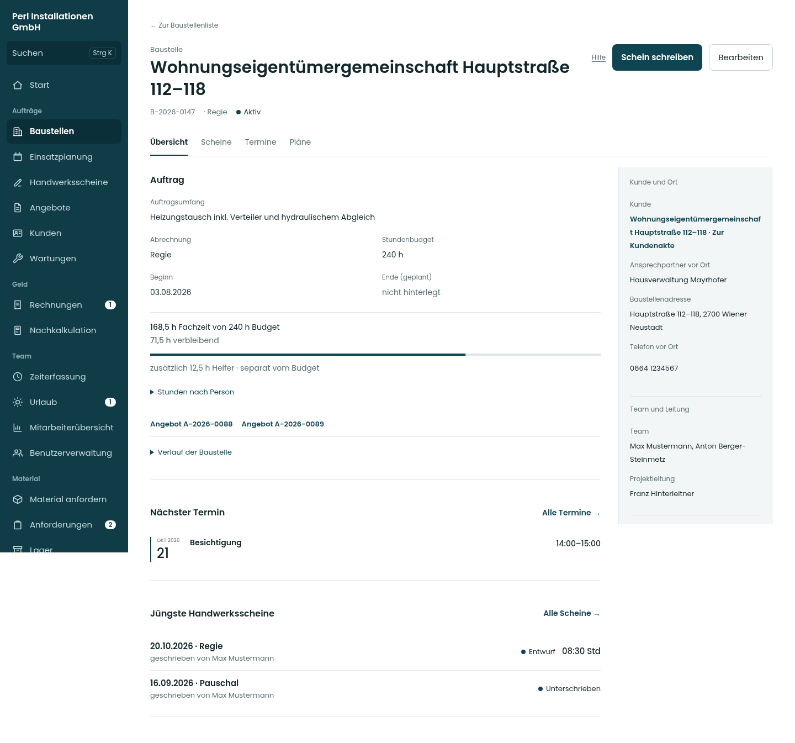
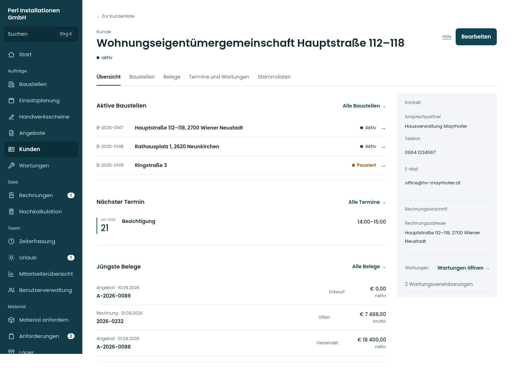
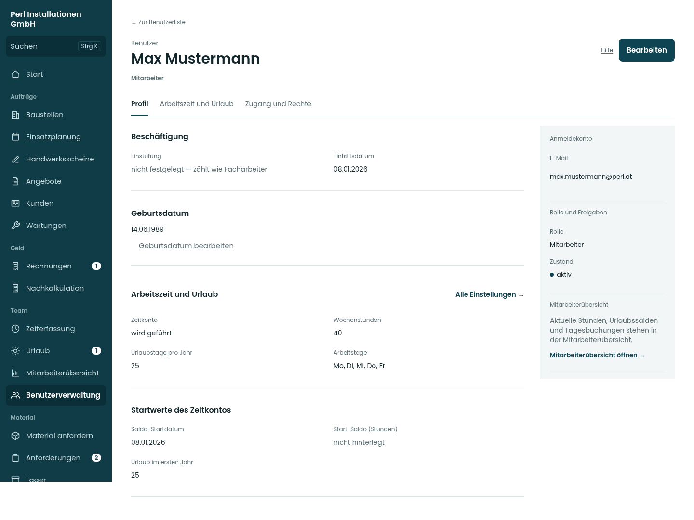

# Variante A · Umsetzung der drei Akten

Screens der tatsächlichen React-Ansichten von [PR #340](https://github.com/juliandeutsch22/Prototype-App-Installateure/pull/340), Quellstand [5527e83](https://github.com/juliandeutsch22/Prototype-App-Installateure/commit/5527e831beaaa653ee66839fc53efc2a02628ab4). Die ursprünglichen [drei Gestaltungsrichtungen](../Lot-Akten-Alternativen-04-2026-10-20/README.md) bleiben zum Vergleich erhalten.

Die Vorschau verwendet fiktive Daten und keine Produktionsdaten. Für diese Aufnahmen sind fiktives Geburtsdatum und Stundenbeispiele in den örtlichen Vorschau-Attrappen ergänzt, damit Geburtsdatum und Budgetlinie sichtbar sind. Die echte Datenschicht wurde dafür nicht verändert. Die gesonderte Funktionsabnahme läuft gegen die lokale Datenbank und wird im PR nachgewiesen.

| Akte | Desktop | Tablet | Handy | Dunkel |
| --- | --- | --- | --- | --- |
| Baustelle | [Übersicht](bilder/baustelle-1440-0.png) | [Übersicht](bilder/baustelle-834-0.png) | [Übersicht](bilder/baustelle-390-0.png) | [Desktop](bilder/dunkel-baustelle-1440-0.png) |
| Kunde | [Übersicht](bilder/kunde-1440-0.png) | [Übersicht](bilder/kunde-834-0.png) | [Übersicht](bilder/kunde-390-0.png) | [Desktop](bilder/dunkel-kunde-1440-0.png) |
| Benutzer | [Profil](bilder/benutzer-1440-0.png) | [Profil](bilder/benutzer-834-0.png) | [Profil](bilder/benutzer-390-0.png) | [Desktop](bilder/dunkel-benutzer-1440-0.png) |

## Weitere Bereiche

Dateinamen: `Akte-Breite-Bereich.png`, für Dunkelmodus mit `dunkel-` davor.

- Baustelle: `0` Übersicht, `1` Scheine, `2` Termine, `3` Pläne.
- Kunde: `0` Übersicht, `1` Baustellen, `2` Belege, `3` Termine und Wartungen, `4` Stammdaten.
- Benutzer: `0` Profil, `1` Arbeitszeit und Urlaub, `2` Zugang und Rechte.
- Bearbeiten jeweils als `Akte-Breite-bearbeiten.png`.

Alle Bereiche und Bearbeitungsfenster bei 390/834/1440 Pixeln in Hell und Dunkel: **90 Ansichten**. Keine JavaScript-Seitenfehler, Seitenüberbreiten oder gemeldeten axe-Verstöße nach den geprüften WCAG-A/AA-Regeln. [Hell](ansichten.json) · [Dunkel](ansichten-dunkel.json).

Die Aufnahmen prüfen die Darstellung mit Beispieldaten. Sie sind keine Zusicherung für sämtliche möglichen Rollen-, Fehler- und Datenkombinationen; Speicherwege, Rechte, Sonderfälle und Nachladen sind getrennt durch die bestehenden Tests und Browserwege abgesichert.
