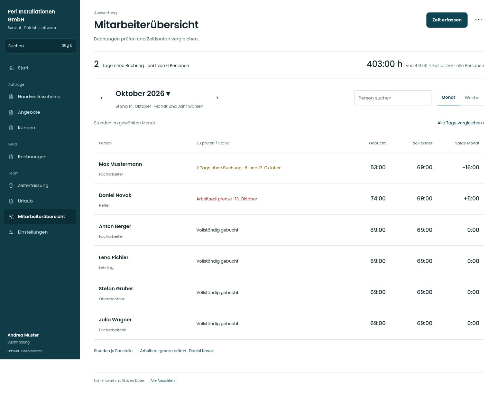

# Lot · Vollständiger Gesamtentwurf

Stand: 21. Oktober 2026 · Grundlage: [`3e49090`](https://github.com/juliandeutsch22/Prototype-App-Installateure/tree/3e49090d4054ebbd3ecbce6ab583bb944c2c0770)

**257 neue Entwurfsansichten und sechs Rollenansichten der bereits umgesetzten Startseite. Insgesamt 789 Screens auf Desktop, Tablet und Smartphone.** Die übrigen Seiten folgen der freigegebenen Akten- und Startseitenlinie: klare Arbeitsfläche, zurückhaltende Typografie, Linien statt Karten und Kontext dort, wo er hilft.

[Gesamtpaket als ZIP herunterladen](../lot-gesamtentwurf-2026-10-21.zip?raw=true)

[Visueller Überblick – Desktop](ueberblick-desktop.jpg) · [Visueller Überblick – Mobil](ueberblick-mobil.jpg)

## Direkt ansehen

Die Screens sind über diese Übersicht direkt auf GitHub erreichbar. Für die durchsuchbare Galerie das ZIP herunterladen, entpacken und **galerie.html** öffnen. Ein Server oder eine Installation ist dafür nicht erforderlich. **index.html** enthält den lokalen, klickbaren Entwurfsprototyp.

[Alle Seiten, Tabs und Funktionen](Abdeckung.md) · [Gestaltungsentscheidungen](Gestaltungsentscheidungen.md) · [Darstellungsprüfung](Pruefung.md)

- [Zugang (10 Ansichten)](bereiche/zugang.md)
- [Start (6 Ansichten)](bereiche/start.md)
- [Kunden (14 Ansichten)](bereiche/kunden.md)
- [Angebote (11 Ansichten)](bereiche/angebote.md)
- [Baustellen (15 Ansichten)](bereiche/baustellen.md)
- [Planung (17 Ansichten)](bereiche/planung.md)
- [Scheine (9 Ansichten)](bereiche/scheine.md)
- [Material (14 Ansichten)](bereiche/material.md)
- [Lager (13 Ansichten)](bereiche/lager.md)
- [Rechnungen (34 Ansichten)](bereiche/rechnungen.md)
- [Zeit (10 Ansichten)](bereiche/zeit.md)
- [Urlaub (17 Ansichten)](bereiche/urlaub.md)
- [Auswertung (11 Ansichten)](bereiche/auswertung.md)
- [Benutzer (16 Ansichten)](bereiche/benutzer.md)
- [Einstellungen (25 Ansichten)](bereiche/einstellungen.md)
- [Plattform (9 Ansichten)](bereiche/plattform.md)
- [Querschnitt (14 Ansichten)](bereiche/querschnitt.md)
- [Bestätigungen (11 Ansichten)](bereiche/bestaetigungen.md)
- [Werkzeug (1 Ansichten)](bereiche/werkzeug.md)
- [Wartungen (6 Ansichten)](bereiche/wartungen.md)

## Ein erster Eindruck

### Einsatzplanung

### Mitarbeiterübersicht

### Kundenakte

### Angebot

## Was dieses Paket abdeckt

Jeder aufgenommene Tab, Listenfilter, Formularschritt und wichtige Zustand hat eine eigene Ansicht. Die Übersicht deckt alle 19 Einträge der Hauptnavigation und alle elf Einstellungsseiten des Quellstands ab, einschließlich Rollenvarianten, Planung, Auswertungen, Dokumenten und Zugang. Die tabellarische Zuordnung steht in **Abdeckung.md**.

- Desktop: 1440 px; Tablet: 834 px; Smartphone: 390 px. Längere Seiten sind vollständig abgebildet. Das mobile Menü steht auf diesen Ganzseiten-Screens am Seitenende; im Prototyp bleibt es wie bisher am unteren Fensterrand.
- Das mobile Menü folgt der bestehenden Rollenaufteilung: vier direkte Ziele und „Mehr“. Die sechs Startseiten-Referenzen stammen aus den bereits geprüften Umsetzungsscreens.
- Kontaktdaten, Beträge, Termine und Texte sind fiktive Beispieldaten. Es wurden keine Betriebsdaten geladen.
- Die Dateien verändern die Live-App nicht. Der Prototyp simuliert einzelne Bedienwege lokal und ist keine implementierte App.
- Funktionserhalt ist pro Ansicht als Umsetzungsanforderung dokumentiert. Die vollständige Prüfung von Berechtigungen, Berechnungen, Speicherung und Integrationen erfolgt bei einer späteren Umsetzung.

## Dateien

- `galerie.html`: durchsuchbare, offline nutzbare Übersicht.
- `index.html`: lokaler Entwurfsprototyp; Navigation zwischen den Ansichten.
- `bereiche/`: direkt lesbare Bereichsübersichten mit allen Screenlinks.
- `ansichten/`: Felder, Aktionen, Funktionserhalt und Quellen pro Ansicht.
- `konzept.json`, `rollenmatrix.json`, `quelleninventar.json`: nachvollziehbares Inventar des Entwurfs und Quellstands.
- `bilder/`, `referenzen/`: neu gerenderte Entwürfe und bestehende Startseiten-Referenzen.
- `fonts/`, `OFL.txt`: lokal eingebundene Schrift und Lizenz; keine externen Fontabfragen.
