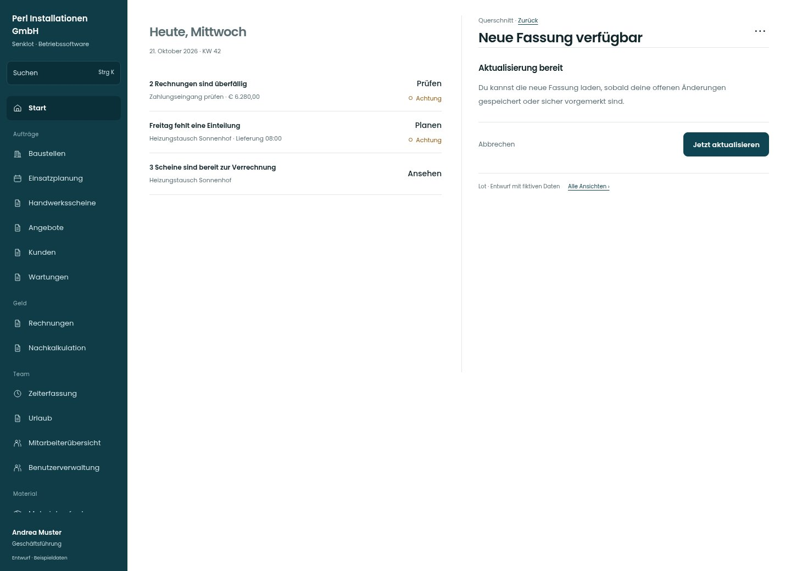

# Neue Fassung verfügbar

[Zur Übersicht](../README.md) · [Bereich: Querschnitt](../bereiche/querschnitt.md)

**Querschnitt · Geschäftsführung · Globale Aktualisierung**

Gestaltungsentwurf mit fiktiven Beispieldaten. Aktionen und Datenänderungen sind lokal simuliert, ohne Backend.

[Desktop](../bilder/171-aktualisierung-desktop.jpg) · [Tablet](../bilder/171-aktualisierung-tablet.jpg) · [Mobil](../bilder/171-aktualisierung-mobil.jpg)

## Aufbau

Neue Fassung erst bei gesicherten Eingaben laden; Unterschrift und Ausgangsfach behalten Vorrang.

## Vorhandene Funktionen für die spätere Umsetzung erhalten

- Keine ungespeicherten Eingaben verlieren
- Ausgangsfach beachten
- Keine erzwungene Neuladung während Unterschrift

## Aktionen

- Jetzt aktualisieren
- Später

## Quellen

Quellstand: `3e49090`.
- [src/components/NeueFassung.tsx](https://github.com/juliandeutsch22/Prototype-App-Installateure/blob/3e49090d4054ebbd3ecbce6ab583bb944c2c0770/src/components/NeueFassung.tsx)

Die Screens zeigen die vorgesehenen Bedienwege. Reale Speicherung, vollständige Rollenprüfung, Berechnungen, Exporte, Benachrichtigungen und Integrationen müssen bei einer Umsetzung gegen die App geprüft werden.
