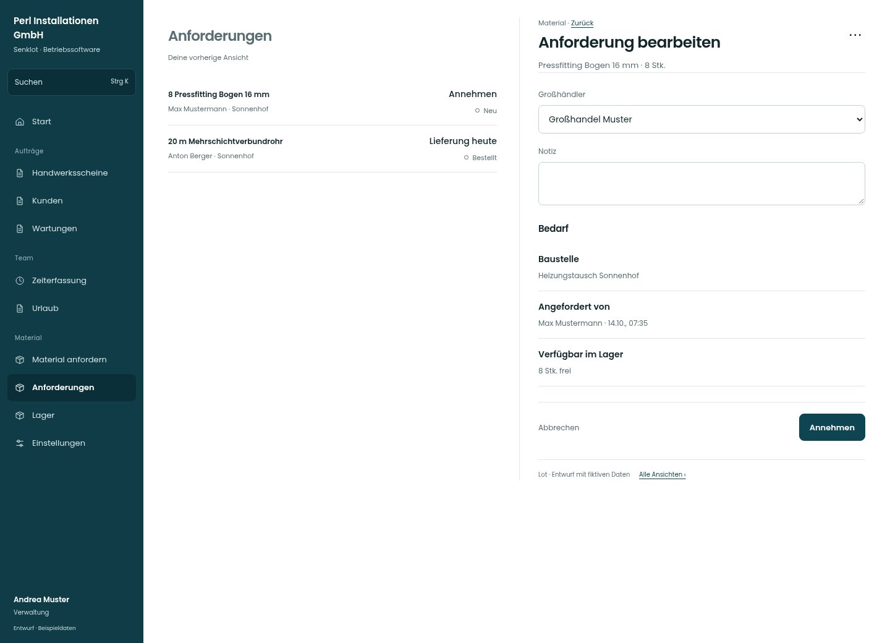

# Anforderung bearbeiten

[Zur Übersicht](../README.md) · [Bereich: Material](../bereiche/material.md)

**Material · Verwaltung · /anforderungen · Einzelheiten**

Gestaltungsentwurf mit fiktiven Beispieldaten. Aktionen und Datenänderungen sind lokal simuliert, ohne Backend.

[Desktop](../bilder/063-anforderung-detail-desktop.jpg) · [Tablet](../bilder/063-anforderung-detail-tablet.jpg) · [Mobil](../bilder/063-anforderung-detail-mobil.jpg)

## Aufbau

Die häufige nächste Aktion sichtbar, weitere Aktionen nur passend zum Status; Lagerverfügbarkeit und Anforderungsmenge getrennt lesen.

## Vorhandene Funktionen für die spätere Umsetzung erhalten

- Bestellen/Liefern/Abholbereit/Abschließen nur passend zum Status
- Lagerreservierung bleibt korrekt

## Felder im Beispiel

- Großhändler
- Notiz

## Aktionen

- Annehmen
- Auf die Einkaufsliste
- Als abholbereit markieren
- Anforderung abschließen

## Quellen

Quellstand: `3e49090`.
- [src/features/orders/AdminOrdersView.tsx](https://github.com/juliandeutsch22/Prototype-App-Installateure/blob/3e49090d4054ebbd3ecbce6ab583bb944c2c0770/src/features/orders/AdminOrdersView.tsx)

Die Screens zeigen die vorgesehenen Bedienwege. Reale Speicherung, vollständige Rollenprüfung, Berechnungen, Exporte, Benachrichtigungen und Integrationen müssen bei einer Umsetzung gegen die App geprüft werden.
