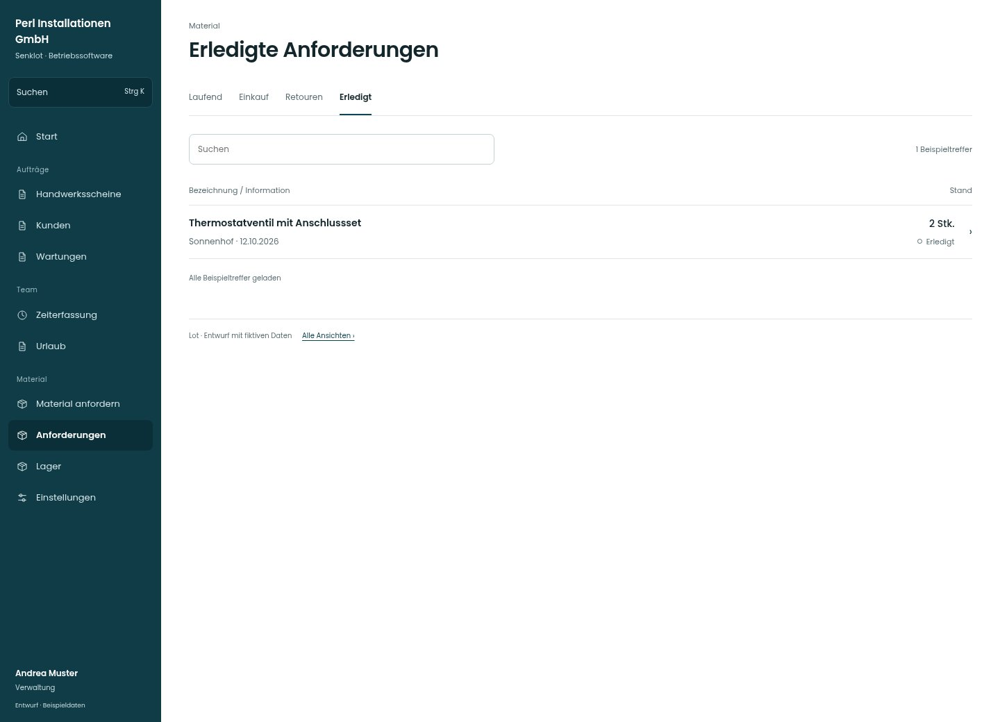

# Erledigte Anforderungen

[Zur Übersicht](../README.md) · [Bereich: Material](../bereiche/material.md)

**Material · Verwaltung · /anforderungen · Erledigt**

Gestaltungsentwurf mit fiktiven Beispieldaten. Aktionen und Datenänderungen sind lokal simuliert, ohne Backend.

[Desktop](../bilder/070-anforderungen-archiv-desktop.jpg) · [Tablet](../bilder/070-anforderungen-archiv-tablet.jpg) · [Mobil](../bilder/070-anforderungen-archiv-mobil.jpg)

## Aufbau

Erledigte Anforderungen suchbar erhalten; historische Details nicht in einen neuen aktiven Status umdeuten.

## Vorhandene Funktionen für die spätere Umsetzung erhalten

- Historie bleibt suchbar
- Löschen mit bestehender Bestätigung

## Register und Filter

- Laufend → [anforderungen](anforderungen.md)
- Einkauf → [einkauf](einkauf.md)
- Retouren → [retouren](retouren.md)
- Erledigt → [anforderungen-archiv](anforderungen-archiv.md)

## Quellen

Quellstand: `3e49090`.
- [src/features/orders/AdminOrdersView.tsx](https://github.com/juliandeutsch22/Prototype-App-Installateure/blob/3e49090d4054ebbd3ecbce6ab583bb944c2c0770/src/features/orders/AdminOrdersView.tsx)

Die Screens zeigen die vorgesehenen Bedienwege. Reale Speicherung, vollständige Rollenprüfung, Berechnungen, Exporte, Benachrichtigungen und Integrationen müssen bei einer Umsetzung gegen die App geprüft werden.
