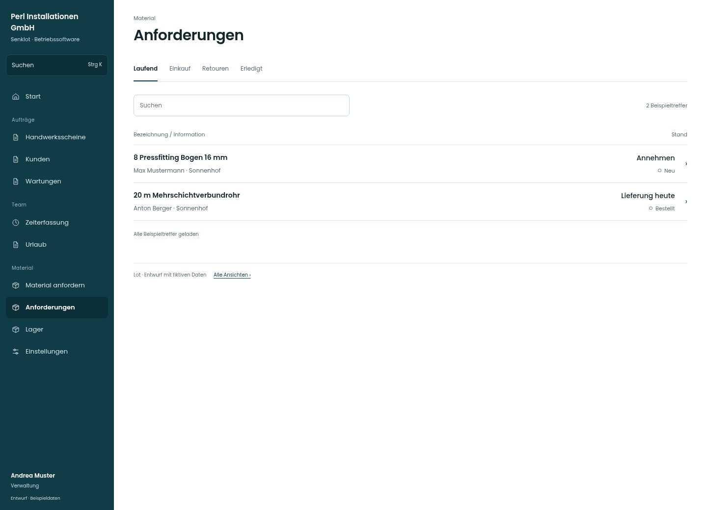

# Anforderungen

[Zur Übersicht](../README.md) · [Bereich: Material](../bereiche/material.md)

**Material · Verwaltung · /anforderungen**

Gestaltungsentwurf mit fiktiven Beispieldaten. Aktionen und Datenänderungen sind lokal simuliert, ohne Backend.

[Desktop](../bilder/062-anforderungen-desktop.jpg) · [Tablet](../bilder/062-anforderungen-tablet.jpg) · [Mobil](../bilder/062-anforderungen-mobil.jpg)

## Aufbau

Dringlichkeit, Baustelle und Lieferstatus in Zeilen vergleichbar halten; Sammelaktionen brauchen echte Auswahl und Teilfehler je Vorgang.

## Vorhandene Funktionen für die spätere Umsetzung erhalten

- Baustellenfilter
- Eilige/überfällige/abholbereite Anforderungen
- Sammelaktionen und Teilfehler
- Statusaktionen je Eintrag

## Register und Filter

- Laufend → [anforderungen](anforderungen.md)
- Einkauf → [einkauf](einkauf.md)
- Retouren → [retouren](retouren.md)
- Erledigt → [anforderungen-archiv](anforderungen-archiv.md)

## Quellen

Quellstand: `3e49090`.
- [src/features/orders/AdminOrdersView.tsx](https://github.com/juliandeutsch22/Prototype-App-Installateure/blob/3e49090d4054ebbd3ecbce6ab583bb944c2c0770/src/features/orders/AdminOrdersView.tsx)

Die Screens zeigen die vorgesehenen Bedienwege. Reale Speicherung, vollständige Rollenprüfung, Berechnungen, Exporte, Benachrichtigungen und Integrationen müssen bei einer Umsetzung gegen die App geprüft werden.
