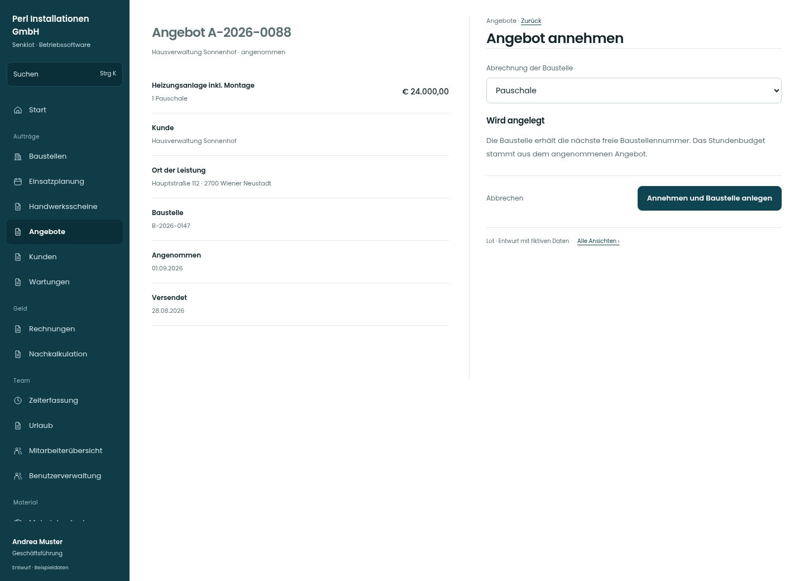

# Angebot annehmen

[Zur Übersicht](../README.md) · [Bereich: Angebote](../bereiche/angebote.md)

**Angebote · Geschäftsführung · /quotes/:id · Annahme**

Gestaltungsentwurf mit fiktiven Beispieldaten. Aktionen und Datenänderungen sind lokal simuliert, ohne Backend.

[Desktop](../bilder/027-angebot-annehmen-desktop.jpg) · [Tablet](../bilder/027-angebot-annehmen-tablet.jpg) · [Mobil](../bilder/027-angebot-annehmen-mobil.jpg)

## Aufbau

Abrechnungsart und Wirkung vor der verbindlichen Annahme zeigen; keine beiläufige doppelte Baustellenanlage.

## Vorhandene Funktionen für die spätere Umsetzung erhalten

- Bestätigung vor verbindlicher Annahme
- Pauschale oder Regie
- Kein doppeltes Anlegen

## Felder im Beispiel

- Abrechnung der Baustelle

## Aktionen

- Annehmen und Baustelle anlegen

## Quellen

Quellstand: `3e49090`.
- [src/features/quotes/AngebotView.tsx](https://github.com/juliandeutsch22/Prototype-App-Installateure/blob/3e49090d4054ebbd3ecbce6ab583bb944c2c0770/src/features/quotes/AngebotView.tsx)
- [src/features/quotes/AbrechnungWahl.tsx](https://github.com/juliandeutsch22/Prototype-App-Installateure/blob/3e49090d4054ebbd3ecbce6ab583bb944c2c0770/src/features/quotes/AbrechnungWahl.tsx)

Die Screens zeigen die vorgesehenen Bedienwege. Reale Speicherung, vollständige Rollenprüfung, Berechnungen, Exporte, Benachrichtigungen und Integrationen müssen bei einer Umsetzung gegen die App geprüft werden.
