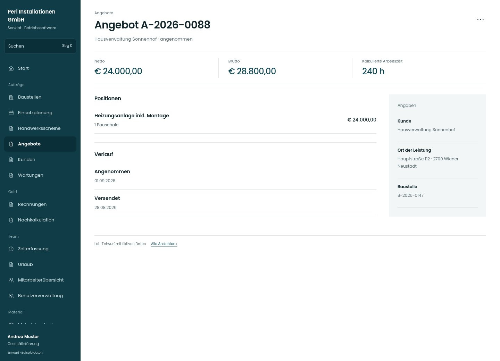

# Angebot A-2026-0088

[Zur Übersicht](../README.md) · [Bereich: Angebote](../bereiche/angebote.md)

**Angebote · Geschäftsführung · /quotes/:id**

Gestaltungsentwurf mit fiktiven Beispieldaten. Aktionen und Datenänderungen sind lokal simuliert, ohne Backend.

[Desktop](../bilder/026-angebot-detail-desktop.jpg) · [Tablet](../bilder/026-angebot-detail-tablet.jpg) · [Mobil](../bilder/026-angebot-detail-mobil.jpg)

## Aufbau

Beim angenommenen Angebot PDF und vorhandene Baustelle direkt anbieten; keine Bearbeitung oder erneute Annahme suggerieren.

## Vorhandene Funktionen für die spätere Umsetzung erhalten

- Angenommenes Angebot nicht als veränderbarer Entwurf darstellen
- PDF
- Bestehende Baustelle verlinken
- Neue Fassung nur für versendet/abgelehnt; Buchhaltung liest nur

## Aktionen

- PDF laden

## Quellen

Quellstand: `3e49090`.
- [src/features/quotes/AngebotView.tsx](https://github.com/juliandeutsch22/Prototype-App-Installateure/blob/3e49090d4054ebbd3ecbce6ab583bb944c2c0770/src/features/quotes/AngebotView.tsx)
- [src/features/quotes/AbrechnungWahl.tsx](https://github.com/juliandeutsch22/Prototype-App-Installateure/blob/3e49090d4054ebbd3ecbce6ab583bb944c2c0770/src/features/quotes/AbrechnungWahl.tsx)

Die Screens zeigen die vorgesehenen Bedienwege. Reale Speicherung, vollständige Rollenprüfung, Berechnungen, Exporte, Benachrichtigungen und Integrationen müssen bei einer Umsetzung gegen die App geprüft werden.
