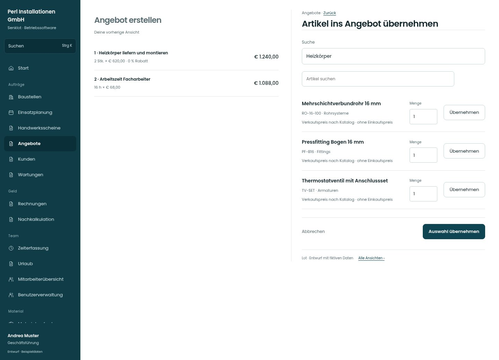

# Artikel ins Angebot übernehmen

[Zur Übersicht](../README.md) · [Bereich: Angebote](../bereiche/angebote.md)

**Angebote · Geschäftsführung · /quotes · Katalogsuche**

Gestaltungsentwurf mit fiktiven Beispieldaten. Aktionen und Datenänderungen sind lokal simuliert, ohne Backend.

[Desktop](../bilder/025-angebot-katalog-desktop.jpg) · [Tablet](../bilder/025-angebot-katalog-tablet.jpg) · [Mobil](../bilder/025-angebot-katalog-mobil.jpg)

## Aufbau

Katalogartikel müssen übernommen werden können; ein Lagerdetail-Link ersetzt die Auswahl nicht. Preise und Einheiten am Auswahlziel zeigen.

## Vorhandene Funktionen für die spätere Umsetzung erhalten

- Suche und verfügbare Artikelpreise
- Rückkehr zum unveränderten Entwurf

## Felder im Beispiel

- Suche

## Aktionen

- Auswahl übernehmen

## Quellen

Quellstand: `3e49090`.
- [src/features/quotes/KatalogSuche.tsx](https://github.com/juliandeutsch22/Prototype-App-Installateure/blob/3e49090d4054ebbd3ecbce6ab583bb944c2c0770/src/features/quotes/KatalogSuche.tsx)
- [src/features/quotes/QuotesView.tsx](https://github.com/juliandeutsch22/Prototype-App-Installateure/blob/3e49090d4054ebbd3ecbce6ab583bb944c2c0770/src/features/quotes/QuotesView.tsx)

Die Screens zeigen die vorgesehenen Bedienwege. Reale Speicherung, vollständige Rollenprüfung, Berechnungen, Exporte, Benachrichtigungen und Integrationen müssen bei einer Umsetzung gegen die App geprüft werden.
