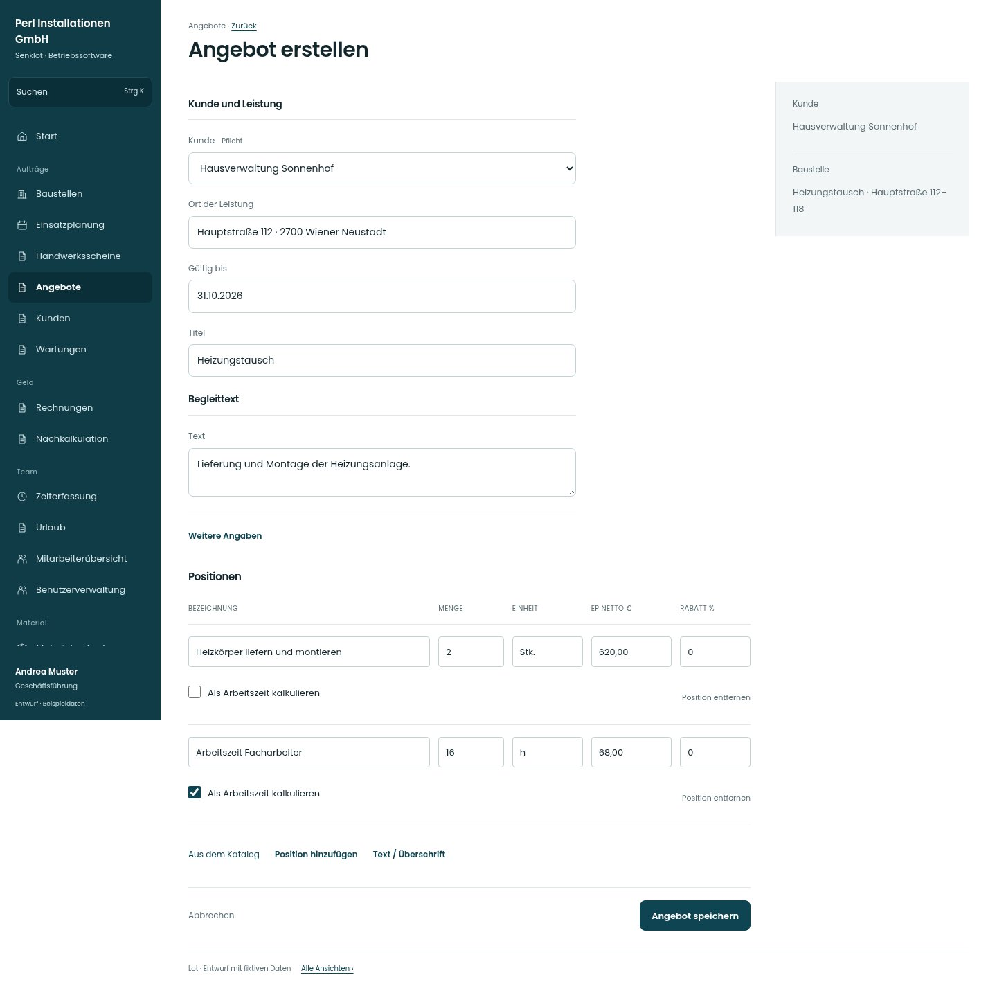

# Angebot erstellen

[Zur Übersicht](../README.md) · [Bereich: Angebote](../bereiche/angebote.md)

**Angebote · Geschäftsführung · /quotes · Entwurf**

Gestaltungsentwurf mit fiktiven Beispieldaten. Aktionen und Datenänderungen sind lokal simuliert, ohne Backend.

[Desktop](../bilder/024-angebot-neu-desktop.jpg) · [Tablet](../bilder/024-angebot-neu-tablet.jpg) · [Mobil](../bilder/024-angebot-neu-mobil.jpg)

## Aufbau

Kunde und Leistung zuerst, Positionen als Hauptarbeitsfläche, Begleittext getrennt; Katalog, Arbeitszeitmarkierung und Zeilenbearbeitung an der Position.

## Vorhandene Funktionen für die spätere Umsetzung erhalten

- Text- und Titelpositionen
- Menge/Einheit/Einzelpreis/Rabatt
- Arbeitszeit markierbar
- Katalogartikel
- Belegsumme und Steuer
- Katalog direkt an den Positionen erreichbar

## Felder im Beispiel

- Kunde (Pflichtfeld)
- Ort der Leistung
- Gültig bis
- Titel
- Text
- Anmerkungen

## Aktionen

- Angebot speichern

## Quellen

Quellstand: `3e49090`.
- [src/features/quotes/QuotesView.tsx](https://github.com/juliandeutsch22/Prototype-App-Installateure/blob/3e49090d4054ebbd3ecbce6ab583bb944c2c0770/src/features/quotes/QuotesView.tsx)
- [src/features/quotes/KatalogSuche.tsx](https://github.com/juliandeutsch22/Prototype-App-Installateure/blob/3e49090d4054ebbd3ecbce6ab583bb944c2c0770/src/features/quotes/KatalogSuche.tsx)

Die Screens zeigen die vorgesehenen Bedienwege. Reale Speicherung, vollständige Rollenprüfung, Berechnungen, Exporte, Benachrichtigungen und Integrationen müssen bei einer Umsetzung gegen die App geprüft werden.
