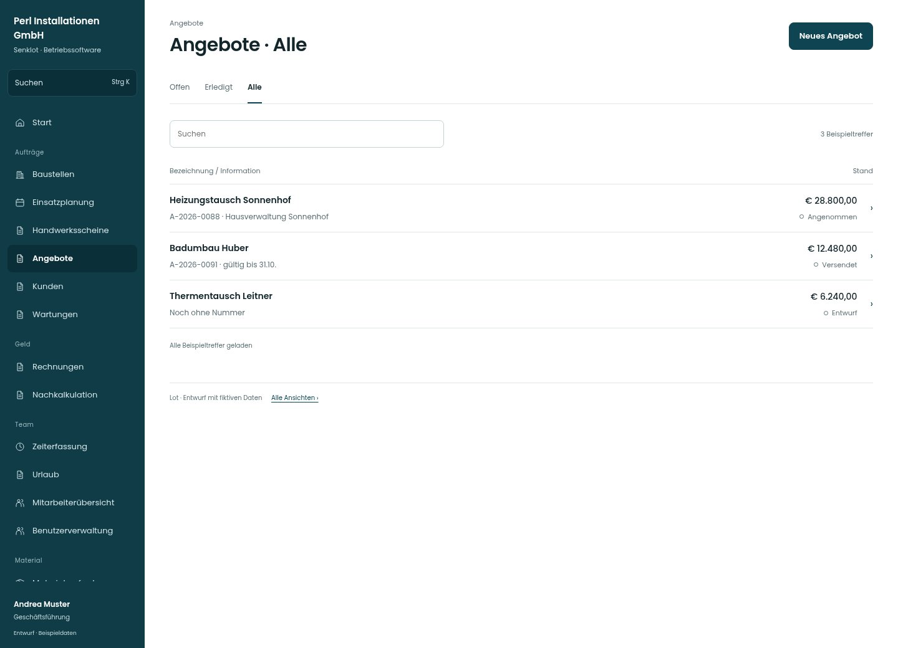

# Angebote · Alle

[Zur Übersicht](../README.md) · [Bereich: Angebote](../bereiche/angebote.md)

**Angebote · Geschäftsführung · /quotes**

Gestaltungsentwurf mit fiktiven Beispieldaten. Aktionen und Datenänderungen sind lokal simuliert, ohne Backend.

[Desktop](../bilder/221-angebote-filter-2-desktop.jpg) · [Tablet](../bilder/221-angebote-filter-2-tablet.jpg) · [Mobil](../bilder/221-angebote-filter-2-mobil.jpg)

## Aufbau

Entwurf, versendetes und angenommenes Angebot müssen zum passenden Zustand führen; dieselbe Detailansicht darf diese Zustände nicht verwischen.

## Vorhandene Funktionen für die spätere Umsetzung erhalten

- Gruppen nach Arbeitsstand
- Suche über alle
- Versendet/Ablehnen/Entwurf löschen
- PDF

## Register und Filter

- Offen → [angebote](angebote.md)
- Erledigt → [angebote-filter-1](angebote-filter-1.md)
- Alle → [angebote-filter-2](angebote-filter-2.md)

## Aktionen

- Neues Angebot

## Quellen

Quellstand: `3e49090`.
- [src/features/quotes/QuotesView.tsx](https://github.com/juliandeutsch22/Prototype-App-Installateure/blob/3e49090d4054ebbd3ecbce6ab583bb944c2c0770/src/features/quotes/QuotesView.tsx)

Die Screens zeigen die vorgesehenen Bedienwege. Reale Speicherung, vollständige Rollenprüfung, Berechnungen, Exporte, Benachrichtigungen und Integrationen müssen bei einer Umsetzung gegen die App geprüft werden.
