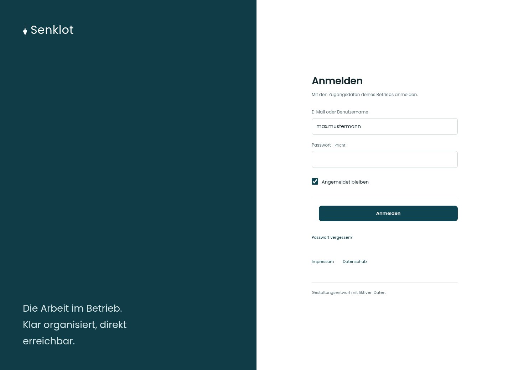

# Anmelden

[Zur Übersicht](../README.md) · [Bereich: Zugang](../bereiche/zugang.md)

**Zugang · Mitarbeiter · /login**

Gestaltungsentwurf mit fiktiven Beispieldaten. Aktionen und Datenänderungen sind lokal simuliert, ohne Backend.

[Desktop](../bilder/001-anmelden-desktop.jpg) · [Tablet](../bilder/001-anmelden-tablet.jpg) · [Mobil](../bilder/001-anmelden-mobil.jpg)

## Aufbau

Ein schlankes Formular mit einem Anmeldeschritt passt zur Aufgabe; Rücksetzweg und dauerhafte Anmeldung bleiben direkt erreichbar.

## Vorhandene Funktionen für die spätere Umsetzung erhalten

- Benutzername und E-Mail
- Neutrale Fehlermeldung
- Angemeldet bleiben
- Rücksetzweg

## Felder im Beispiel

- E-Mail oder Benutzername
- Passwort (Pflichtfeld)
- Angemeldet bleiben

## Aktionen

- Anmelden
- Passwort vergessen?

## Quellen

Quellstand: `3e49090`.
- [src/features/auth/LoginPage.tsx](https://github.com/juliandeutsch22/Prototype-App-Installateure/blob/3e49090d4054ebbd3ecbce6ab583bb944c2c0770/src/features/auth/LoginPage.tsx)

Die Screens zeigen die vorgesehenen Bedienwege. Reale Speicherung, vollständige Rollenprüfung, Berechnungen, Exporte, Benachrichtigungen und Integrationen müssen bei einer Umsetzung gegen die App geprüft werden.
