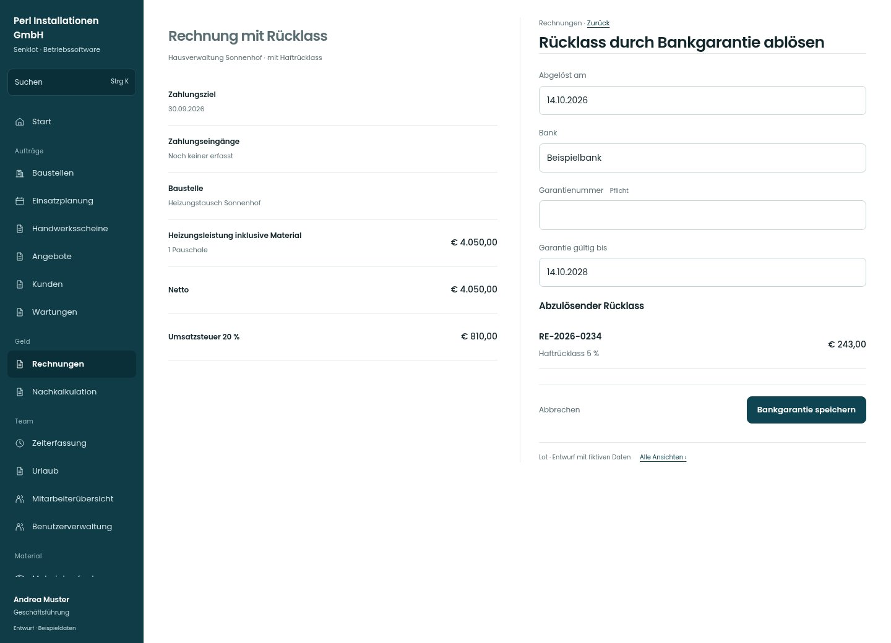

# Rücklass durch Bankgarantie ablösen

[Zur Übersicht](../README.md) · [Bereich: Rechnungen](../bereiche/rechnungen.md)

**Rechnungen · Geschäftsführung · /invoices · Bankgarantie**

Gestaltungsentwurf mit fiktiven Beispieldaten. Aktionen und Datenänderungen sind lokal simuliert, ohne Backend.

[Desktop](../bilder/094-bankgarantie-desktop.jpg) · [Tablet](../bilder/094-bankgarantie-tablet.jpg) · [Mobil](../bilder/094-bankgarantie-mobil.jpg)

## Aufbau

Rücklassbezug und Gültigkeit vor dem Ablösen erklären; Einstieg nur aus dem passenden Rechnungzustand vorsehen.

## Vorhandene Funktionen für die spätere Umsetzung erhalten

- Rücklassberechnung unverändert
- Gültigkeit und Nachweis

## Felder im Beispiel

- Abgelöst am
- Bank
- Garantienummer (Pflichtfeld)
- Garantie gültig bis

## Aktionen

- Bankgarantie speichern

## Quellen

Quellstand: `3e49090`.
- [src/features/invoices/BankgarantieDialog.tsx](https://github.com/juliandeutsch22/Prototype-App-Installateure/blob/3e49090d4054ebbd3ecbce6ab583bb944c2c0770/src/features/invoices/BankgarantieDialog.tsx)

Die Screens zeigen die vorgesehenen Bedienwege. Reale Speicherung, vollständige Rollenprüfung, Berechnungen, Exporte, Benachrichtigungen und Integrationen müssen bei einer Umsetzung gegen die App geprüft werden.
