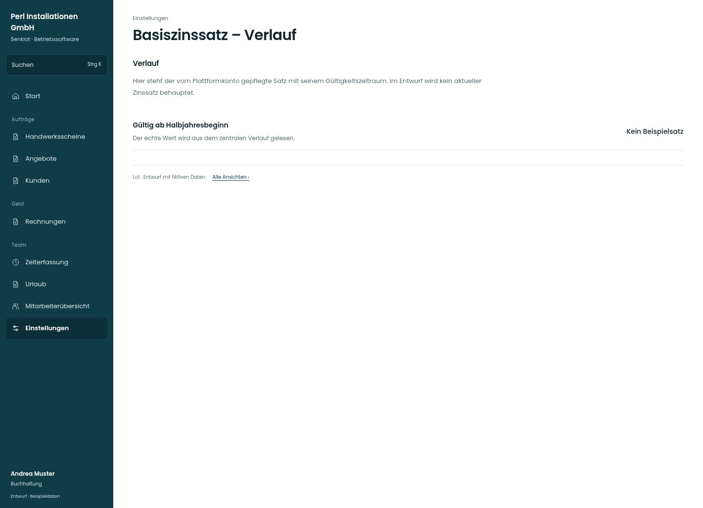

# Basiszinssatz – Verlauf

[Zur Übersicht](../README.md) · [Bereich: Einstellungen](../bereiche/einstellungen.md)

**Einstellungen · Buchhaltung · /settings/rechnung · Basiszins**

Gestaltungsentwurf mit fiktiven Beispieldaten. Aktionen und Datenänderungen sind lokal simuliert, ohne Backend.

[Desktop](../bilder/140-basiszins-verlauf-desktop.jpg) · [Tablet](../bilder/140-basiszins-verlauf-tablet.jpg) · [Mobil](../bilder/140-basiszins-verlauf-mobil.jpg)

## Aufbau

Gültigkeitszeiträume und zentralen Ursprung zeigen; keine erfundene aktuelle Rate als feste Kennzahl ausgeben.

## Vorhandene Funktionen für die spätere Umsetzung erhalten

- Keine erfundenen aktuellen Zinssätze
- Bestehende Historie und Datenquelle

## Quellen

Quellstand: `3e49090`.
- [src/features/settings/BasiszinsVerlauf.tsx](https://github.com/juliandeutsch22/Prototype-App-Installateure/blob/3e49090d4054ebbd3ecbce6ab583bb944c2c0770/src/features/settings/BasiszinsVerlauf.tsx)

Die Screens zeigen die vorgesehenen Bedienwege. Reale Speicherung, vollständige Rollenprüfung, Berechnungen, Exporte, Benachrichtigungen und Integrationen müssen bei einer Umsetzung gegen die App geprüft werden.
