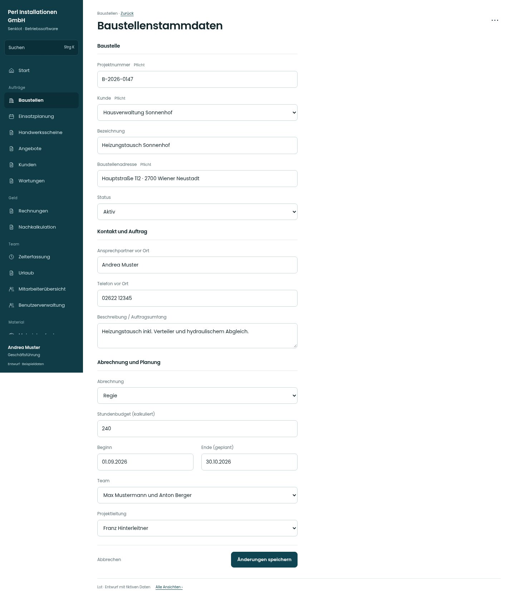

# Baustellenstammdaten

[Zur Übersicht](../README.md) · [Bereich: Baustellen](../bereiche/baustellen.md)

**Baustellen · Geschäftsführung · /admin-projects/:id · Stammdaten**

Gestaltungsentwurf mit fiktiven Beispieldaten. Aktionen und Datenänderungen sind lokal simuliert, ohne Backend.

[Desktop](../bilder/031-baustelle-daten-desktop.jpg) · [Tablet](../bilder/031-baustelle-daten-tablet.jpg) · [Mobil](../bilder/031-baustelle-daten-mobil.jpg)

## Aufbau

Stammdaten nach derselben Ordnung wie Neuanlage gliedern; Team, Projektleitung und Warnung bei Nummernänderung erhalten.

## Vorhandene Funktionen für die spätere Umsetzung erhalten

- Warnung bei Nummernänderung
- Ungespeicherte Angaben
- Bisher zugeordnete deaktivierte Personen bleiben sichtbar

## Felder im Beispiel

- Projektnummer (Pflichtfeld)
- Kunde (Pflichtfeld)
- Bezeichnung
- Baustellenadresse (Pflichtfeld)
- Status
- Abrechnung
- Stundenbudget (kalkuliert)
- Beginn
- Ende (geplant)
- Ansprechpartner vor Ort
- Telefon vor Ort
- Beschreibung / Auftragsumfang
- Team
- Projektleitung

## Aktionen

- Änderungen speichern
- Baustelle löschen

## Quellen

Quellstand: `3e49090`.
- [src/features/projects/BaustellenakteView.tsx](https://github.com/juliandeutsch22/Prototype-App-Installateure/blob/3e49090d4054ebbd3ecbce6ab583bb944c2c0770/src/features/projects/BaustellenakteView.tsx)

Die Screens zeigen die vorgesehenen Bedienwege. Reale Speicherung, vollständige Rollenprüfung, Berechnungen, Exporte, Benachrichtigungen und Integrationen müssen bei einer Umsetzung gegen die App geprüft werden.
