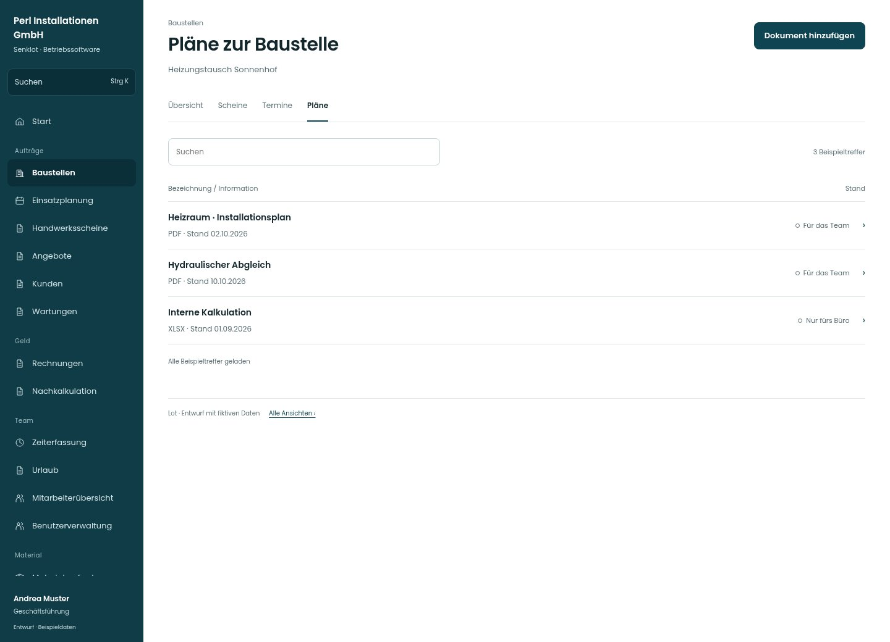

# Pläne zur Baustelle

[Zur Übersicht](../README.md) · [Bereich: Baustellen](../bereiche/baustellen.md)

**Baustellen · Geschäftsführung · /admin-projects/:id · Dokumente**

Gestaltungsentwurf mit fiktiven Beispieldaten. Aktionen und Datenänderungen sind lokal simuliert, ohne Backend.

[Desktop](../bilder/032-baustelle-dokumente-desktop.jpg) · [Tablet](../bilder/032-baustelle-dokumente-tablet.jpg) · [Mobil](../bilder/032-baustelle-dokumente-mobil.jpg)

## Aufbau

Titel, Version und Freigabe tragen die Dokumentliste; Bürodateien bleiben erkennbar und geschützt.

## Vorhandene Funktionen für die spätere Umsetzung erhalten

- Bürodokumente nur für berechtigte Rollen
- Pläne für Monteure
- Löschen mit Bestätigung
- Download/Öffnen

## Register und Filter

- Übersicht → [baustelle](baustelle.md)
- Scheine → [baustelle-scheine](baustelle-scheine.md)
- Termine → [baustelle-termine](baustelle-termine.md)
- Pläne → [baustelle-dokumente](baustelle-dokumente.md)

## Aktionen

- Dokument hinzufügen

## Quellen

Quellstand: `3e49090`.
- [src/features/projects/BaustellenPlaene.tsx](https://github.com/juliandeutsch22/Prototype-App-Installateure/blob/3e49090d4054ebbd3ecbce6ab583bb944c2c0770/src/features/projects/BaustellenPlaene.tsx)
- [src/features/projects/PlaeneListe.tsx](https://github.com/juliandeutsch22/Prototype-App-Installateure/blob/3e49090d4054ebbd3ecbce6ab583bb944c2c0770/src/features/projects/PlaeneListe.tsx)

Die Screens zeigen die vorgesehenen Bedienwege. Reale Speicherung, vollständige Rollenprüfung, Berechnungen, Exporte, Benachrichtigungen und Integrationen müssen bei einer Umsetzung gegen die App geprüft werden.
