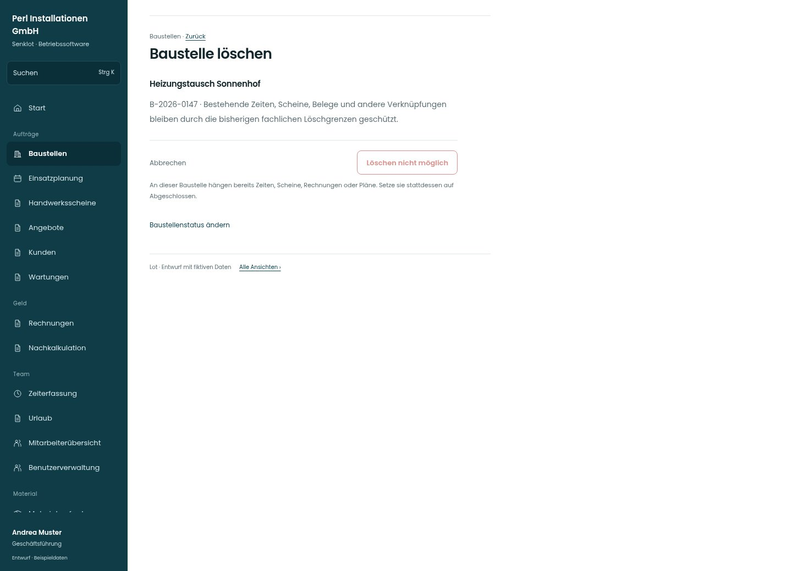

# Baustelle löschen

[Zur Übersicht](../README.md) · [Bereich: Baustellen](../bereiche/baustellen.md)

**Baustellen · Geschäftsführung · /admin-projects/:id · Baustelle löschen**

Gestaltungsentwurf mit fiktiven Beispieldaten. Aktionen und Datenänderungen sind lokal simuliert, ohne Backend.

[Desktop](../bilder/195-baustelle-loeschen-desktop.jpg) · [Tablet](../bilder/195-baustelle-loeschen-tablet.jpg) · [Mobil](../bilder/195-baustelle-loeschen-mobil.jpg)

## Aufbau

Bei den gezeigten vorhandenen Bezügen Löschen sichtbar sperren und zur Änderung auf Abgeschlossen führen; DB-Schutz bleibt maßgeblich.

## Vorhandene Funktionen für die spätere Umsetzung erhalten

- Bestehende Bestätigung und Löschgrenzen
- Keine produktiven Daten im Entwurf

## Aktionen

- Baustelle löschen

## Quellen

Quellstand: `3e49090`.
- [src/features/projects/AdminProjectsView.tsx](https://github.com/juliandeutsch22/Prototype-App-Installateure/blob/3e49090d4054ebbd3ecbce6ab583bb944c2c0770/src/features/projects/AdminProjectsView.tsx)

Die Screens zeigen die vorgesehenen Bedienwege. Reale Speicherung, vollständige Rollenprüfung, Berechnungen, Exporte, Benachrichtigungen und Integrationen müssen bei einer Umsetzung gegen die App geprüft werden.
