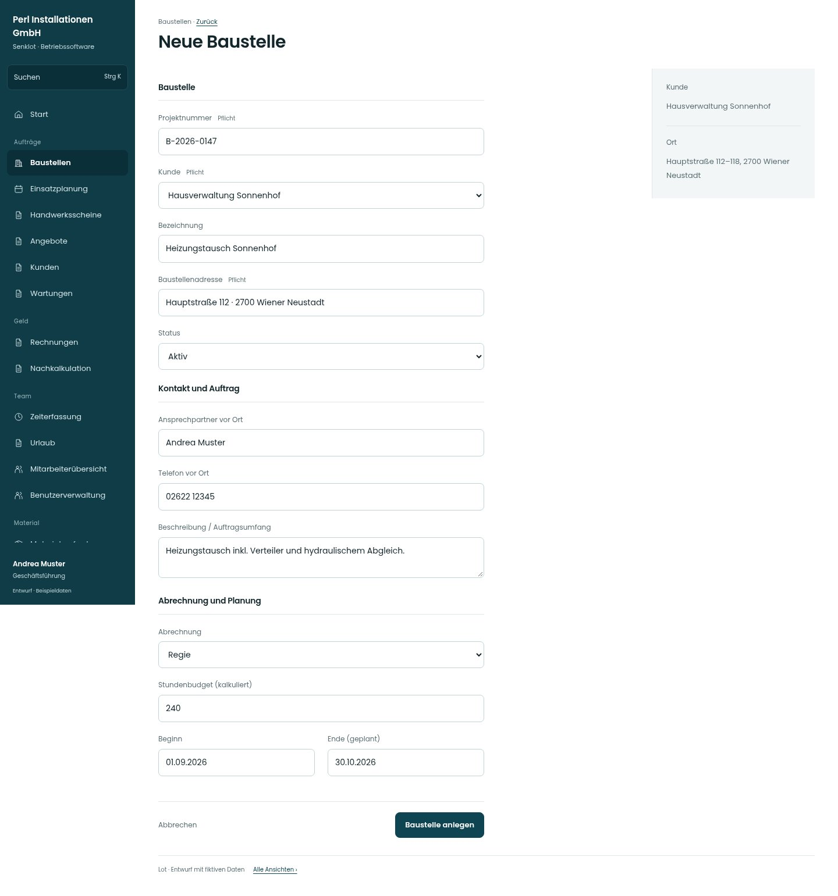

# Neue Baustelle

[Zur Übersicht](../README.md) · [Bereich: Baustellen](../bereiche/baustellen.md)

**Baustellen · Geschäftsführung · /admin-projects · Anlegen**

Gestaltungsentwurf mit fiktiven Beispieldaten. Aktionen und Datenänderungen sind lokal simuliert, ohne Backend.

[Desktop](../bilder/029-baustelle-neu-desktop.jpg) · [Tablet](../bilder/029-baustelle-neu-tablet.jpg) · [Mobil](../bilder/029-baustelle-neu-mobil.jpg)

## Aufbau

Baustelle, Kontakt/Auftrag und Abrechnung/Planung gruppieren; keine Felder streichen und keine freie Nummernvergabelogik erfinden.

## Vorhandene Funktionen für die spätere Umsetzung erhalten

- Kunde und eindeutige Nummer
- Abrechnungsart und Budget
- Kontakt und geplante Laufzeit

## Felder im Beispiel

- Projektnummer (Pflichtfeld)
- Kunde (Pflichtfeld)
- Bezeichnung
- Baustellenadresse (Pflichtfeld)
- Status
- Abrechnung
- Stundenbudget (kalkuliert)
- Beginn
- Ende (geplant)
- Ansprechpartner vor Ort
- Telefon vor Ort
- Beschreibung / Auftragsumfang

## Aktionen

- Baustelle anlegen

## Quellen

Quellstand: `3e49090`.
- [src/features/projects/AdminProjectsView.tsx](https://github.com/juliandeutsch22/Prototype-App-Installateure/blob/3e49090d4054ebbd3ecbce6ab583bb944c2c0770/src/features/projects/AdminProjectsView.tsx)

Die Screens zeigen die vorgesehenen Bedienwege. Reale Speicherung, vollständige Rollenprüfung, Berechnungen, Exporte, Benachrichtigungen und Integrationen müssen bei einer Umsetzung gegen die App geprüft werden.
