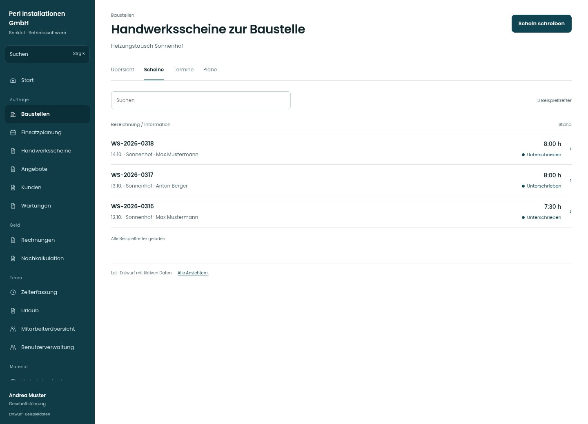

# Handwerksscheine zur Baustelle

[Zur Übersicht](../README.md) · [Bereich: Baustellen](../bereiche/baustellen.md)

**Baustellen · Geschäftsführung · /admin-projects/:id · Handwerksscheine**

Gestaltungsentwurf mit fiktiven Beispieldaten. Aktionen und Datenänderungen sind lokal simuliert, ohne Backend.

[Desktop](../bilder/035-baustelle-scheine-desktop.jpg) · [Tablet](../bilder/035-baustelle-scheine-tablet.jpg) · [Mobil](../bilder/035-baustelle-scheine-mobil.jpg)

## Aufbau

Datum, Person und Scheinstatus genügen zur Auswahl; neue Scheine bleiben im richtigen Baustellenkontext.

## Vorhandene Funktionen für die spätere Umsetzung erhalten

- Alle Scheine der Baustelle
- Entwurf/Unterschrieben/Verrechnet unterscheidbar

## Register und Filter

- Übersicht → [baustelle](baustelle.md)
- Scheine → [baustelle-scheine](baustelle-scheine.md)
- Termine → [baustelle-termine](baustelle-termine.md)
- Pläne → [baustelle-dokumente](baustelle-dokumente.md)

## Aktionen

- Schein schreiben

## Quellen

Quellstand: `3e49090`.
- [src/features/projects/BaustellenScheine.tsx](https://github.com/juliandeutsch22/Prototype-App-Installateure/blob/3e49090d4054ebbd3ecbce6ab583bb944c2c0770/src/features/projects/BaustellenScheine.tsx)

Die Screens zeigen die vorgesehenen Bedienwege. Reale Speicherung, vollständige Rollenprüfung, Berechnungen, Exporte, Benachrichtigungen und Integrationen müssen bei einer Umsetzung gegen die App geprüft werden.
