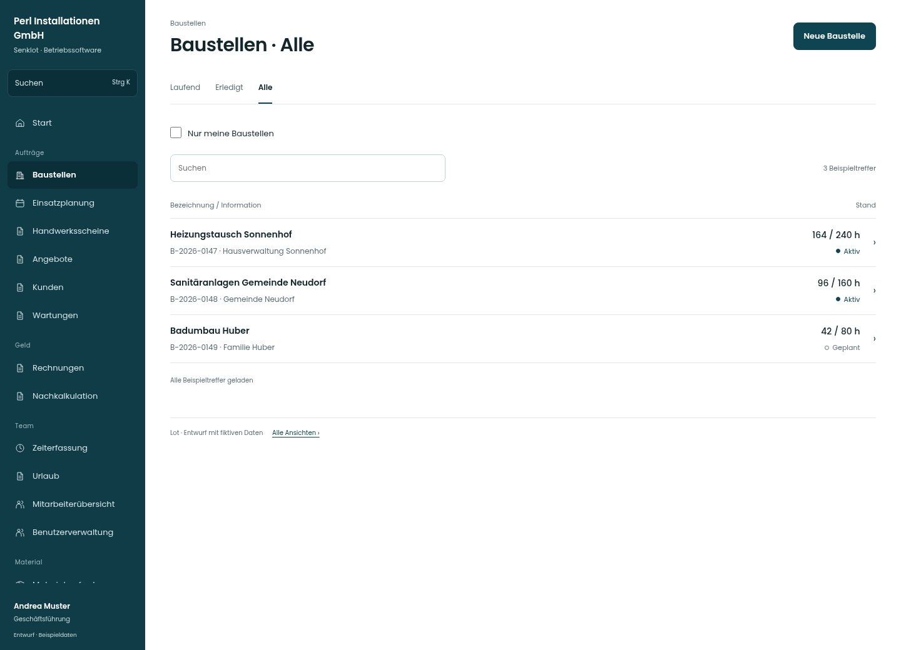

# Baustellen · Alle

[Zur Übersicht](../README.md) · [Bereich: Baustellen](../bereiche/baustellen.md)

**Baustellen · Geschäftsführung · /admin-projects**

Gestaltungsentwurf mit fiktiven Beispieldaten. Aktionen und Datenänderungen sind lokal simuliert, ohne Backend.

[Desktop](../bilder/223-baustellen-filter-2-desktop.jpg) · [Tablet](../bilder/223-baustellen-filter-2-tablet.jpg) · [Mobil](../bilder/223-baustellen-filter-2-mobil.jpg)

## Aufbau

Baustellenname, Nummer und Arbeitsstand als durchgängige Zeilen erhalten; nur eigene Baustellen bleibt ein eigener Filter.

## Vorhandene Funktionen für die spätere Umsetzung erhalten

- Suche
- Eigene/alle Baustellen
- Status und Kundenbezug
- Löschen bleibt geschützt

## Register und Filter

- Laufend → [baustellen](baustellen.md)
- Erledigt → [baustellen-filter-1](baustellen-filter-1.md)
- Alle → [baustellen-filter-2](baustellen-filter-2.md)

## Felder im Beispiel

- Nur meine Baustellen

## Aktionen

- Neue Baustelle

## Quellen

Quellstand: `3e49090`.
- [src/features/projects/AdminProjectsView.tsx](https://github.com/juliandeutsch22/Prototype-App-Installateure/blob/3e49090d4054ebbd3ecbce6ab583bb944c2c0770/src/features/projects/AdminProjectsView.tsx)

Die Screens zeigen die vorgesehenen Bedienwege. Reale Speicherung, vollständige Rollenprüfung, Berechnungen, Exporte, Benachrichtigungen und Integrationen müssen bei einer Umsetzung gegen die App geprüft werden.
