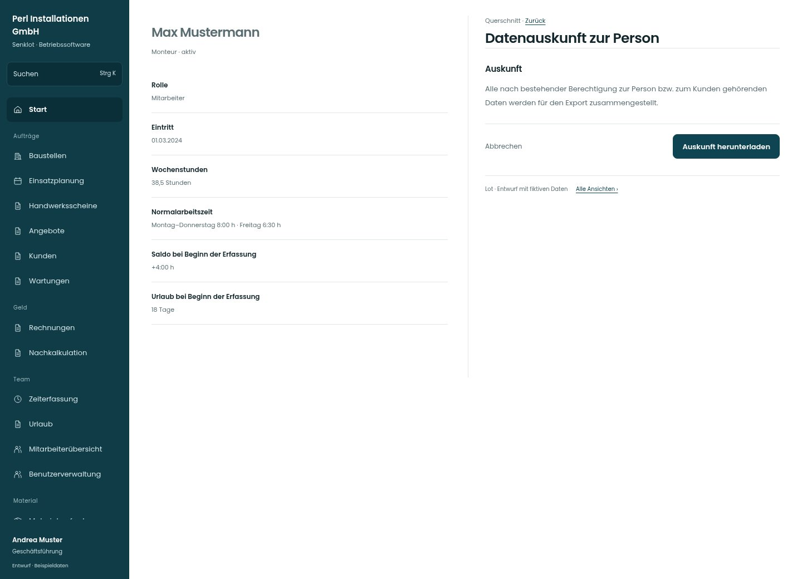

# Datenauskunft zur Person

[Zur Übersicht](../README.md) · [Bereich: Querschnitt](../bereiche/querschnitt.md)

**Querschnitt · Geschäftsführung · Akte · Datenauskunft**

Gestaltungsentwurf mit fiktiven Beispieldaten. Aktionen und Datenänderungen sind lokal simuliert, ohne Backend.

[Desktop](../bilder/173-benutzer-auskunft-desktop.jpg) · [Tablet](../bilder/173-benutzer-auskunft-tablet.jpg) · [Mobil](../bilder/173-benutzer-auskunft-mobil.jpg)

## Aufbau

Auskunft als eigener geschützter Vorgang; keine personenbezogenen Echtdaten oder neuen Exportrechte im Konzept.

## Vorhandene Funktionen für die spätere Umsetzung erhalten

- Bestehender Umfang und Berechtigungen
- Ausgenommene Teile benennen
- Keine echten Personendaten im Konzept

## Aktionen

- Auskunft herunterladen

## Quellen

Quellstand: `3e49090`.
- [src/features/users/BenutzerakteView.tsx](https://github.com/juliandeutsch22/Prototype-App-Installateure/blob/3e49090d4054ebbd3ecbce6ab583bb944c2c0770/src/features/users/BenutzerakteView.tsx)
- [src/features/recht/Datenauskunft.tsx](https://github.com/juliandeutsch22/Prototype-App-Installateure/blob/3e49090d4054ebbd3ecbce6ab583bb944c2c0770/src/features/recht/Datenauskunft.tsx)

Die Screens zeigen die vorgesehenen Bedienwege. Reale Speicherung, vollständige Rollenprüfung, Berechnungen, Exporte, Benachrichtigungen und Integrationen müssen bei einer Umsetzung gegen die App geprüft werden.
