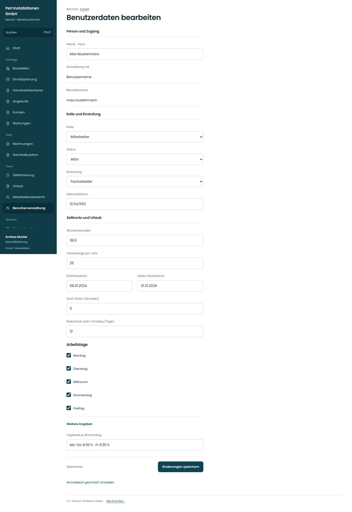

# Benutzerdaten bearbeiten

[Zur Übersicht](../README.md) · [Bereich: Benutzer](../bereiche/benutzer.md)

**Benutzer · Geschäftsführung · /user-mgmt/:uid · Stammdaten**

Gestaltungsentwurf mit fiktiven Beispieldaten. Aktionen und Datenänderungen sind lokal simuliert, ohne Backend.

[Desktop](../bilder/129-benutzer-daten-desktop.jpg) · [Tablet](../bilder/129-benutzer-daten-tablet.jpg) · [Mobil](../bilder/129-benutzer-daten-mobil.jpg)

## Aufbau

Anmeldekennung nicht direkt editierbar, Kontoumstellung separat; Arbeitstage/Tagessoll und zulässige Rollen vollständig erhalten.

## Vorhandene Funktionen für die spätere Umsetzung erhalten

- Zusatzrechte nur für passende Rollen
- Zeitkonto der GF personenspezifisch
- Tagessoll/Wochentage
- Ungespeicherte Änderungen

## Felder im Beispiel

- Name (Pflichtfeld)
- Anmeldung mit
- Benutzername (Pflichtfeld)
- Rolle
- Status
- Einstufung
- Geburtsdatum
- Wochenstunden
- Urlaubstage pro Jahr
- Eintrittsdatum
- Saldo-Startdatum
- Start-Saldo (Stunden)
- Resturlaub beim Umstieg (Tage)
- Führt ein Zeitkonto
- Montag
- Dienstag
- Mittwoch
- Donnerstag
- Freitag
- Tagessoll je Wochentag

## Aktionen

- Änderungen speichern

## Quellen

Quellstand: `3e49090`.
- [src/features/users/BenutzerakteView.tsx](https://github.com/juliandeutsch22/Prototype-App-Installateure/blob/3e49090d4054ebbd3ecbce6ab583bb944c2c0770/src/features/users/BenutzerakteView.tsx)
- [src/features/users/EinstufungFelder.tsx](https://github.com/juliandeutsch22/Prototype-App-Installateure/blob/3e49090d4054ebbd3ecbce6ab583bb944c2c0770/src/features/users/EinstufungFelder.tsx)
- [src/features/users/TagessollFelder.tsx](https://github.com/juliandeutsch22/Prototype-App-Installateure/blob/3e49090d4054ebbd3ecbce6ab583bb944c2c0770/src/features/users/TagessollFelder.tsx)

Die Screens zeigen die vorgesehenen Bedienwege. Reale Speicherung, vollständige Rollenprüfung, Berechnungen, Exporte, Benachrichtigungen und Integrationen müssen bei einer Umsetzung gegen die App geprüft werden.
