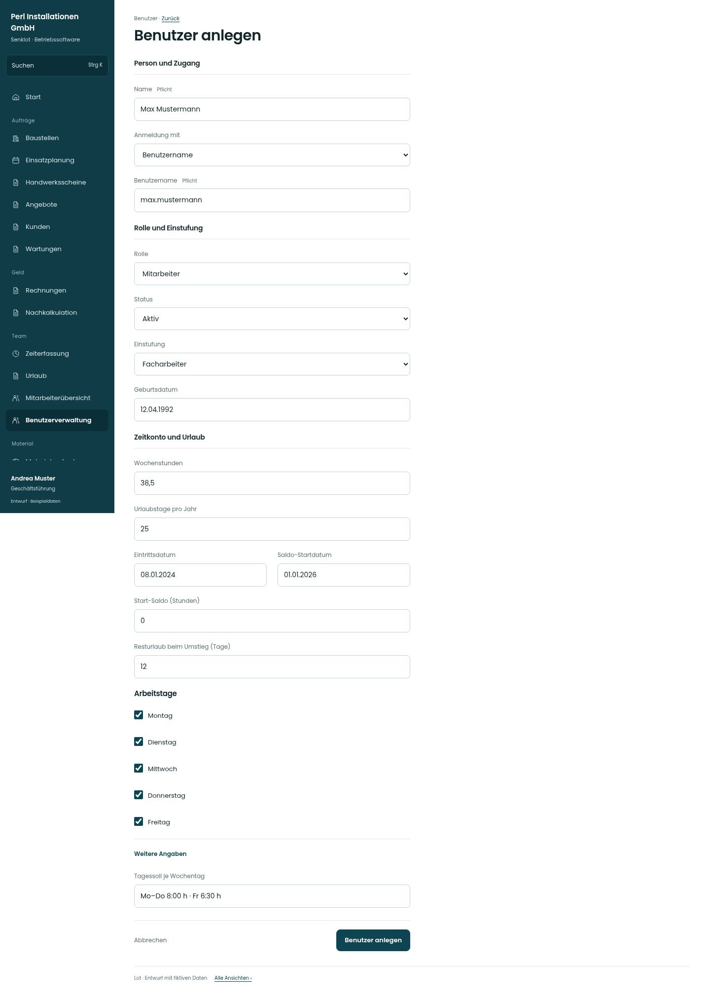

# Benutzer anlegen

[Zur Übersicht](../README.md) · [Bereich: Benutzer](../bereiche/benutzer.md)

**Benutzer · Geschäftsführung · /user-mgmt · Anlegen**

Gestaltungsentwurf mit fiktiven Beispieldaten. Aktionen und Datenänderungen sind lokal simuliert, ohne Backend.

[Desktop](../bilder/127-benutzer-neu-desktop.jpg) · [Tablet](../bilder/127-benutzer-neu-tablet.jpg) · [Mobil](../bilder/127-benutzer-neu-mobil.jpg)

## Aufbau

Zugang, Rolle/Einstufung und Zeitkonto gruppieren; Geschäftsführung erhält keine Administratoroption und Startpasswort bleibt ein eigener Übergabeweg.

## Vorhandene Funktionen für die spätere Umsetzung erhalten

- Benutzername benötigt Startpasswort statt Mail
- Neueinstellung vs bestehender Mitarbeiter
- Aliquoter Erstjahresurlaub
- Lehrbeginn/-zeit/Budgetzählung
- Kein neues Adminrecht für GF

## Felder im Beispiel

- Name (Pflichtfeld)
- Anmeldung mit
- Benutzername (Pflichtfeld)
- E-Mail
- Rolle
- Status
- Einstufung
- Geburtsdatum
- Wochenstunden
- Urlaubstage pro Jahr
- Eintrittsdatum
- Saldo-Startdatum
- Start-Saldo (Stunden)
- Resturlaub beim Umstieg (Tage)
- Montag
- Dienstag
- Mittwoch
- Donnerstag
- Freitag
- Tagessoll je Wochentag

## Aktionen

- Benutzer anlegen

## Quellen

Quellstand: `3e49090`.
- [src/features/users/UserMgmtView.tsx](https://github.com/juliandeutsch22/Prototype-App-Installateure/blob/3e49090d4054ebbd3ecbce6ab583bb944c2c0770/src/features/users/UserMgmtView.tsx)
- [src/features/users/EinstufungFelder.tsx](https://github.com/juliandeutsch22/Prototype-App-Installateure/blob/3e49090d4054ebbd3ecbce6ab583bb944c2c0770/src/features/users/EinstufungFelder.tsx)
- [src/features/users/TagessollFelder.tsx](https://github.com/juliandeutsch22/Prototype-App-Installateure/blob/3e49090d4054ebbd3ecbce6ab583bb944c2c0770/src/features/users/TagessollFelder.tsx)

Die Screens zeigen die vorgesehenen Bedienwege. Reale Speicherung, vollständige Rollenprüfung, Berechnungen, Exporte, Benachrichtigungen und Integrationen müssen bei einer Umsetzung gegen die App geprüft werden.
