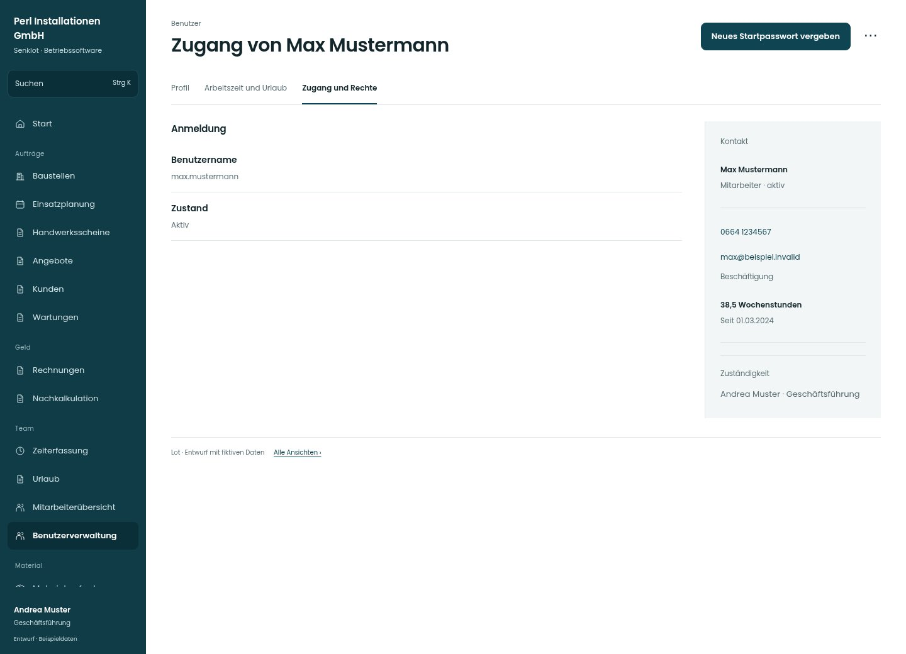

# Zugang von Max Mustermann

[Zur Übersicht](../README.md) · [Bereich: Benutzer](../bereiche/benutzer.md)

**Benutzer · Geschäftsführung · /user-mgmt/:uid · Zugang**

Gestaltungsentwurf mit fiktiven Beispieldaten. Aktionen und Datenänderungen sind lokal simuliert, ohne Backend.

[Desktop](../bilder/130-benutzer-zugang-desktop.jpg) · [Tablet](../bilder/130-benutzer-zugang-tablet.jpg) · [Mobil](../bilder/130-benutzer-zugang-mobil.jpg)

## Aufbau

Anmeldeart und Zustand vor Reset/Deaktivierung zeigen; eigenes Konto und letzter Administrator bleiben geschützt.

## Vorhandene Funktionen für die spätere Umsetzung erhalten

- Bei E-Mail Passwort-Mail statt Startpasswort
- Eigener Zugang unter Mein Konto
- Letzter Administrator geschützt

## Register und Filter

- Profil → [benutzerakte](benutzerakte.md)
- Arbeitszeit und Urlaub → [benutzer-arbeitszeit](benutzer-arbeitszeit.md)
- Zugang und Rechte → [benutzer-zugang](benutzer-zugang.md)

## Aktionen

- Neues Startpasswort vergeben
- Anmeldeart umstellen
- Benutzer deaktivieren

## Quellen

Quellstand: `3e49090`.
- [src/features/users/BenutzerakteView.tsx](https://github.com/juliandeutsch22/Prototype-App-Installateure/blob/3e49090d4054ebbd3ecbce6ab583bb944c2c0770/src/features/users/BenutzerakteView.tsx)
- [src/features/users/KontoUmstellen.tsx](https://github.com/juliandeutsch22/Prototype-App-Installateure/blob/3e49090d4054ebbd3ecbce6ab583bb944c2c0770/src/features/users/KontoUmstellen.tsx)

Die Screens zeigen die vorgesehenen Bedienwege. Reale Speicherung, vollständige Rollenprüfung, Berechnungen, Exporte, Benachrichtigungen und Integrationen müssen bei einer Umsetzung gegen die App geprüft werden.
