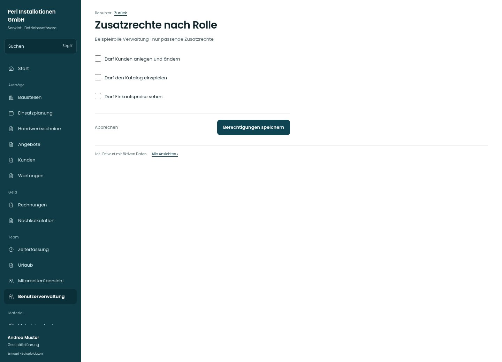

# Zusatzrechte nach Rolle

[Zur Übersicht](../README.md) · [Bereich: Benutzer](../bereiche/benutzer.md)

**Benutzer · Geschäftsführung · /user-mgmt/:uid · Berechtigungen**

Gestaltungsentwurf mit fiktiven Beispieldaten. Aktionen und Datenänderungen sind lokal simuliert, ohne Backend.

[Desktop](../bilder/192-benutzer-zusatzrechte-desktop.jpg) · [Tablet](../bilder/192-benutzer-zusatzrechte-tablet.jpg) · [Mobil](../bilder/192-benutzer-zusatzrechte-mobil.jpg)

## Aufbau

Zielrolle deutlich nennen und nur passende Zusatzrechte zeigen; Kundenpflege, Katalogimport und Preisleserecht nicht verwechseln.

## Vorhandene Funktionen für die spätere Umsetzung erhalten

- Im echten Formular nur die zur aktuellen Rolle passenden Felder
- Katalogfreigabe umfasst Einkaufspreise
- Kein Rechnungs-Schreibrecht für Projektleitung
- Projektleitung erhält ausschließlich das separate Feld Rechnungen seiner Baustellen lesen, kein Rechnungs-Schreibrecht

## Felder im Beispiel

- Darf Kunden anlegen und ändern
- Darf den Katalog einspielen
- Darf Einkaufspreise sehen

## Aktionen

- Berechtigungen speichern

## Quellen

Quellstand: `3e49090`.
- [src/features/users/BenutzerakteView.tsx](https://github.com/juliandeutsch22/Prototype-App-Installateure/blob/3e49090d4054ebbd3ecbce6ab583bb944c2c0770/src/features/users/BenutzerakteView.tsx)

Die Screens zeigen die vorgesehenen Bedienwege. Reale Speicherung, vollständige Rollenprüfung, Berechnungen, Exporte, Benachrichtigungen und Integrationen müssen bei einer Umsetzung gegen die App geprüft werden.
