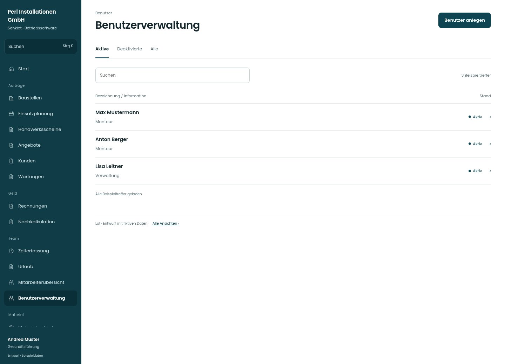

# Benutzerverwaltung

[Zur Übersicht](../README.md) · [Bereich: Benutzer](../bereiche/benutzer.md)

**Benutzer · Geschäftsführung · /user-mgmt**

Gestaltungsentwurf mit fiktiven Beispieldaten. Aktionen und Datenänderungen sind lokal simuliert, ohne Backend.

[Desktop](../bilder/126-benutzer-desktop.jpg) · [Tablet](../bilder/126-benutzer-tablet.jpg) · [Mobil](../bilder/126-benutzer-mobil.jpg)

## Aufbau

Person, Rolle und Aktivstatus tragen die Benutzerverwaltung; Salden gehören in die Mitarbeiterübersicht und werden hier nicht doppelt aufgeführt.

## Vorhandene Funktionen für die spätere Umsetzung erhalten

- Gruppierung nach Rolle
- Administratoren nur durch Admin ändern
- Zeitkonto nicht allein aus Rolle ableiten

## Register und Filter

- Aktive → [benutzer](benutzer.md)
- Deaktivierte → [benutzer-filter-1](benutzer-filter-1.md)
- Alle → [benutzer-filter-2](benutzer-filter-2.md)

## Aktionen

- Benutzer anlegen

## Quellen

Quellstand: `3e49090`.
- [src/features/users/UserMgmtView.tsx](https://github.com/juliandeutsch22/Prototype-App-Installateure/blob/3e49090d4054ebbd3ecbce6ab583bb944c2c0770/src/features/users/UserMgmtView.tsx)

Die Screens zeigen die vorgesehenen Bedienwege. Reale Speicherung, vollständige Rollenprüfung, Berechnungen, Exporte, Benachrichtigungen und Integrationen müssen bei einer Umsetzung gegen die App geprüft werden.
