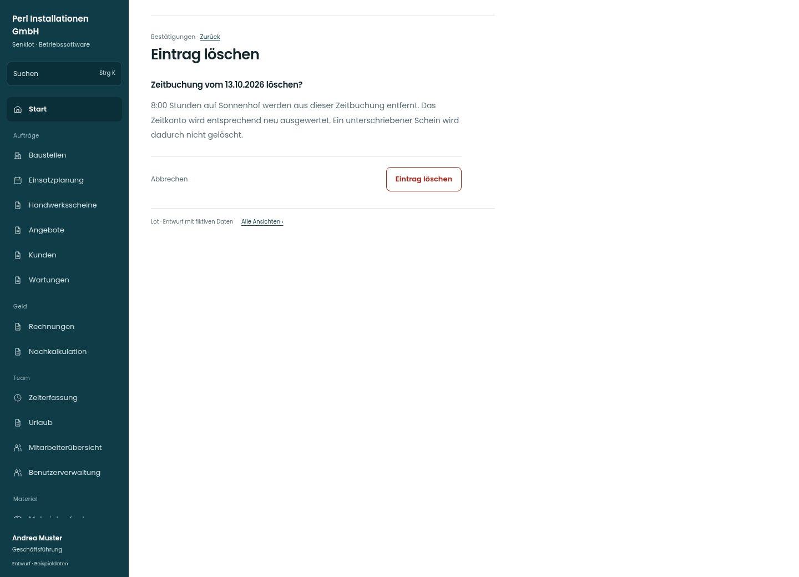

# Eintrag löschen

[Zur Übersicht](../README.md) · [Bereich: Bestätigungen](../bereiche/bestaetigungen.md)

**Bestätigungen · Geschäftsführung · Bestehender Bestätigungsdialog**

Gestaltungsentwurf mit fiktiven Beispieldaten. Aktionen und Datenänderungen sind lokal simuliert, ohne Backend.

[Desktop](../bilder/180-bestaetigen-zeit-desktop.jpg) · [Tablet](../bilder/180-bestaetigen-zeit-tablet.jpg) · [Mobil](../bilder/180-bestaetigen-zeit-mobil.jpg)

## Aufbau

Betroffenen Tag und Stunden vor Löschung benennen; bestätigte Leistung nicht zugleich löschen.

## Vorhandene Funktionen für die spätere Umsetzung erhalten

- Bestehende Bestätigung nicht lockern
- Abbrechen mit Fokus-Rückkehr
- Fehlversuch lässt Daten und Kontext stehen

## Aktionen

- Eintrag löschen

## Quellen

Quellstand: `3e49090`.
- [src/features/time/TimeView.tsx](https://github.com/juliandeutsch22/Prototype-App-Installateure/blob/3e49090d4054ebbd3ecbce6ab583bb944c2c0770/src/features/time/TimeView.tsx)

Die Screens zeigen die vorgesehenen Bedienwege. Reale Speicherung, vollständige Rollenprüfung, Berechnungen, Exporte, Benachrichtigungen und Integrationen müssen bei einer Umsetzung gegen die App geprüft werden.
