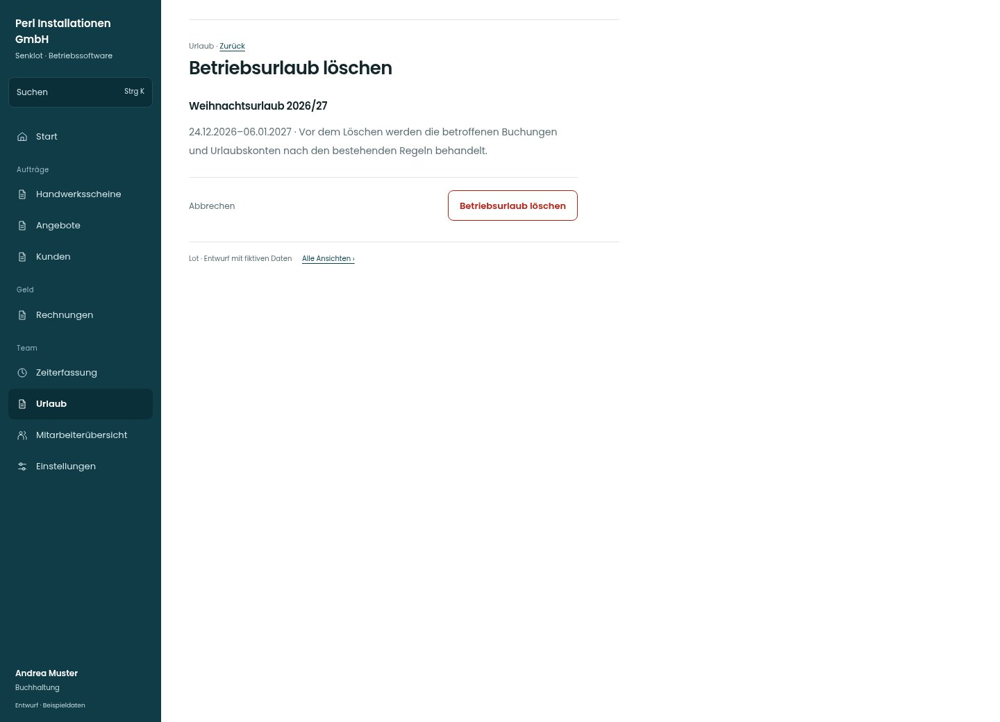

# Betriebsurlaub löschen

[Zur Übersicht](../README.md) · [Bereich: Urlaub](../bereiche/urlaub.md)

**Urlaub · Buchhaltung · /vacations · Betriebsurlaub löschen**

Gestaltungsentwurf mit fiktiven Beispieldaten. Aktionen und Datenänderungen sind lokal simuliert, ohne Backend.

[Desktop](../bilder/198-betriebsurlaub-loeschen-desktop.jpg) · [Tablet](../bilder/198-betriebsurlaub-loeschen-tablet.jpg) · [Mobil](../bilder/198-betriebsurlaub-loeschen-mobil.jpg)

## Aufbau

Jahresübergreifenden Zeitraum und betroffene Konten vor Bestätigung zeigen; Rücknahme bleibt an Bestandslogik gebunden.

## Vorhandene Funktionen für die spätere Umsetzung erhalten

- Bestehende Bestätigung
- Rücknahme der zugehörigen Buchungen nur nach bestehender Funktion

## Aktionen

- Betriebsurlaub löschen

## Quellen

Quellstand: `3e49090`.
- [src/features/vacations/BetriebsurlaubReiter.tsx](https://github.com/juliandeutsch22/Prototype-App-Installateure/blob/3e49090d4054ebbd3ecbce6ab583bb944c2c0770/src/features/vacations/BetriebsurlaubReiter.tsx)

Die Screens zeigen die vorgesehenen Bedienwege. Reale Speicherung, vollständige Rollenprüfung, Berechnungen, Exporte, Benachrichtigungen und Integrationen müssen bei einer Umsetzung gegen die App geprüft werden.
