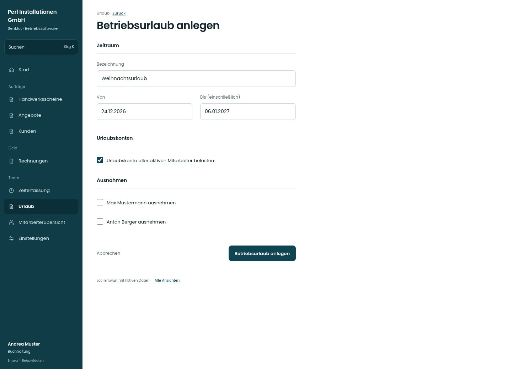

# Betriebsurlaub anlegen

[Zur Übersicht](../README.md) · [Bereich: Urlaub](../bereiche/urlaub.md)

**Urlaub · Buchhaltung · /vacations · Betriebsurlaub anlegen**

Gestaltungsentwurf mit fiktiven Beispieldaten. Aktionen und Datenänderungen sind lokal simuliert, ohne Backend.

[Desktop](../bilder/118-betriebsurlaub-neu-desktop.jpg) · [Tablet](../bilder/118-betriebsurlaub-neu-tablet.jpg) · [Mobil](../bilder/118-betriebsurlaub-neu-mobil.jpg)

## Aufbau

Zeitraum, Belastung der Konten und personenspezifische Ausnahmen gruppieren; Auswirkungen vor der Anlage prüfen.

## Vorhandene Funktionen für die spätere Umsetzung erhalten

- Ausnahmen sichtbar wählen
- Vor Anlage Auswirkung prüfen
- Bestehende Überschneidungsregeln

## Felder im Beispiel

- Bezeichnung
- Von
- Bis (einschließlich)
- Urlaubskonto aller aktiven Mitarbeiter belasten
- Max Mustermann ausnehmen
- Anton Berger ausnehmen

## Aktionen

- Betriebsurlaub anlegen

## Quellen

Quellstand: `3e49090`.
- [src/features/vacations/BetriebsurlaubReiter.tsx](https://github.com/juliandeutsch22/Prototype-App-Installateure/blob/3e49090d4054ebbd3ecbce6ab583bb944c2c0770/src/features/vacations/BetriebsurlaubReiter.tsx)

Die Screens zeigen die vorgesehenen Bedienwege. Reale Speicherung, vollständige Rollenprüfung, Berechnungen, Exporte, Benachrichtigungen und Integrationen müssen bei einer Umsetzung gegen die App geprüft werden.
