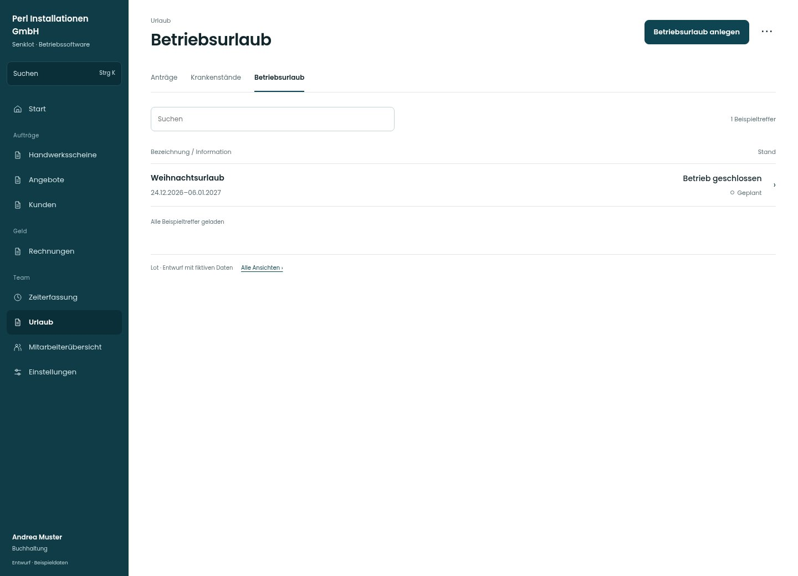

# Betriebsurlaub

[Zur Übersicht](../README.md) · [Bereich: Urlaub](../bereiche/urlaub.md)

**Urlaub · Buchhaltung · /vacations · Betriebsurlaub**

Gestaltungsentwurf mit fiktiven Beispieldaten. Aktionen und Datenänderungen sind lokal simuliert, ohne Backend.

[Desktop](../bilder/117-betriebsurlaub-desktop.jpg) · [Tablet](../bilder/117-betriebsurlaub-tablet.jpg) · [Mobil](../bilder/117-betriebsurlaub-mobil.jpg)

## Aufbau

Zeitraum und Ausnahmen im Überblick; Löschen bleibt ein bewusster gesonderter Vorgang mit korrekter Rücknahme.

## Vorhandene Funktionen für die spätere Umsetzung erhalten

- Ausnahmen je Mitarbeiter
- Abbuchung je Urlaubsjahr
- Halbe Feiertage
- Löschen mit Bestätigung

## Register und Filter

- Anträge → [urlaub-buero](urlaub-buero.md)
- Krankenstände → [krankenstaende](krankenstaende.md)
- Betriebsurlaub → [betriebsurlaub](betriebsurlaub.md)

## Aktionen

- Betriebsurlaub anlegen
- Betriebsurlaub löschen

## Quellen

Quellstand: `3e49090`.
- [src/features/vacations/BetriebsurlaubReiter.tsx](https://github.com/juliandeutsch22/Prototype-App-Installateure/blob/3e49090d4054ebbd3ecbce6ab583bb944c2c0770/src/features/vacations/BetriebsurlaubReiter.tsx)
- [src/features/vacations/UrlaubMonat.tsx](https://github.com/juliandeutsch22/Prototype-App-Installateure/blob/3e49090d4054ebbd3ecbce6ab583bb944c2c0770/src/features/vacations/UrlaubMonat.tsx)

Die Screens zeigen die vorgesehenen Bedienwege. Reale Speicherung, vollständige Rollenprüfung, Berechnungen, Exporte, Benachrichtigungen und Integrationen müssen bei einer Umsetzung gegen die App geprüft werden.
