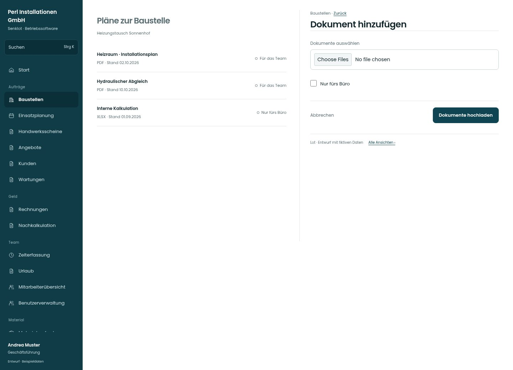

# Dokument hinzufügen

[Zur Übersicht](../README.md) · [Bereich: Baustellen](../bereiche/baustellen.md)

**Baustellen · Geschäftsführung · /admin-projects/:id · Upload**

Gestaltungsentwurf mit fiktiven Beispieldaten. Aktionen und Datenänderungen sind lokal simuliert, ohne Backend.

[Desktop](../bilder/033-dokument-upload-desktop.jpg) · [Tablet](../bilder/033-dokument-upload-tablet.jpg) · [Mobil](../bilder/033-dokument-upload-mobil.jpg)

## Aufbau

Dateiauswahl und Bürofreigabe nebeneinander verständlich halten; Fehler je Datei und Wiederholung dürfen keine Eingaben entfernen.

## Vorhandene Funktionen für die spätere Umsetzung erhalten

- Dateiformat/-größe prüfen
- Bürobeleg nicht versehentlich als Plan freigeben
- Uploadfehler je Datei

## Felder im Beispiel

- Dokumente auswählen
- Nur fürs Büro

## Aktionen

- Dokumente hochladen

## Quellen

Quellstand: `3e49090`.
- [src/features/projects/BaustellenPlaene.tsx](https://github.com/juliandeutsch22/Prototype-App-Installateure/blob/3e49090d4054ebbd3ecbce6ab583bb944c2c0770/src/features/projects/BaustellenPlaene.tsx)

Die Screens zeigen die vorgesehenen Bedienwege. Reale Speicherung, vollständige Rollenprüfung, Berechnungen, Exporte, Benachrichtigungen und Integrationen müssen bei einer Umsetzung gegen die App geprüft werden.
