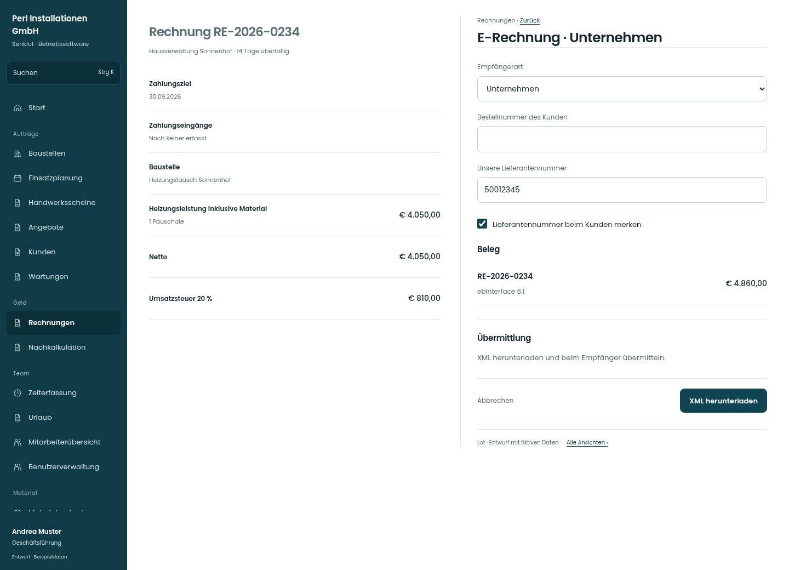

# E-Rechnung · Unternehmen

[Zur Übersicht](../README.md) · [Bereich: Rechnungen](../bereiche/rechnungen.md)

**Rechnungen · Geschäftsführung · /invoices · Zahlungen**

Gestaltungsentwurf mit fiktiven Beispieldaten. Aktionen und Datenänderungen sind lokal simuliert, ohne Backend.

[Desktop](../bilder/243-e-rechnung-allgemein-desktop.jpg) · [Tablet](../bilder/243-e-rechnung-allgemein-tablet.jpg) · [Mobil](../bilder/243-e-rechnung-allgemein-mobil.jpg)

## Aufbau

Richtung, Datum, Betrag und Belegbezug genügen; Teilzahlung, Guthaben, Rückzahlung und Korrekturwege bleiben erhalten.

## Vorhandene Funktionen für die spätere Umsetzung erhalten

- Teilzahlung/Rückzahlung
- Überzahlung als Guthaben
- Skontobedingungen
- Protokoll und Korrekturwege

## Felder im Beispiel

- Empfängerart
- Bestellnummer des Kunden
- Unsere Lieferantennummer
- Lieferantennummer beim Kunden merken

## Aktionen

- XML herunterladen

## Quellen

Quellstand: `3e49090`.
- [src/features/invoices/EbInterfaceDialog.tsx](https://github.com/juliandeutsch22/Prototype-App-Installateure/blob/3e49090d4054ebbd3ecbce6ab583bb944c2c0770/src/features/invoices/EbInterfaceDialog.tsx)

Die Screens zeigen die vorgesehenen Bedienwege. Reale Speicherung, vollständige Rollenprüfung, Berechnungen, Exporte, Benachrichtigungen und Integrationen müssen bei einer Umsetzung gegen die App geprüft werden.
