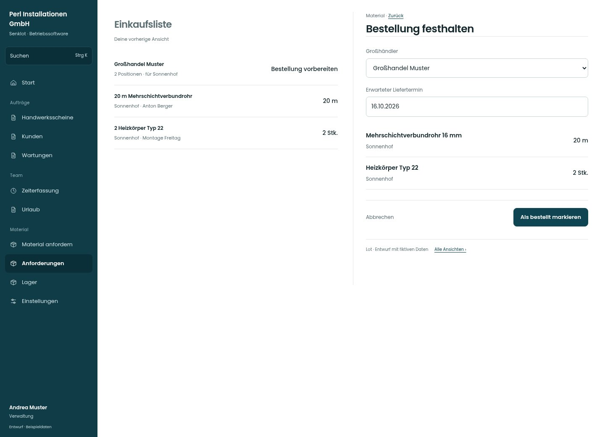

# Bestellung festhalten

[Zur Übersicht](../README.md) · [Bereich: Material](../bereiche/material.md)

**Material · Verwaltung · /anforderungen · Als bestellt markieren**

Gestaltungsentwurf mit fiktiven Beispieldaten. Aktionen und Datenänderungen sind lokal simuliert, ohne Backend.

[Desktop](../bilder/065-einkauf-bestellen-desktop.jpg) · [Tablet](../bilder/065-einkauf-bestellen-tablet.jpg) · [Mobil](../bilder/065-einkauf-bestellen-mobil.jpg)

## Aufbau

Ausgewählte Positionen, Lieferant und Termin vor Statuswechsel zeigen; keine automatische E-Mail-Zusage einführen.

## Vorhandene Funktionen für die spätere Umsetzung erhalten

- Bewusste Bestätigung
- Bestellaktion versendet nicht automatisch eine E-Mail
- Liefertermin optional

## Felder im Beispiel

- Großhändler
- Erwarteter Liefertermin

## Aktionen

- Als bestellt markieren

## Quellen

Quellstand: `3e49090`.
- [src/features/orders/Einkaufsliste.tsx](https://github.com/juliandeutsch22/Prototype-App-Installateure/blob/3e49090d4054ebbd3ecbce6ab583bb944c2c0770/src/features/orders/Einkaufsliste.tsx)

Die Screens zeigen die vorgesehenen Bedienwege. Reale Speicherung, vollständige Rollenprüfung, Berechnungen, Exporte, Benachrichtigungen und Integrationen müssen bei einer Umsetzung gegen die App geprüft werden.
