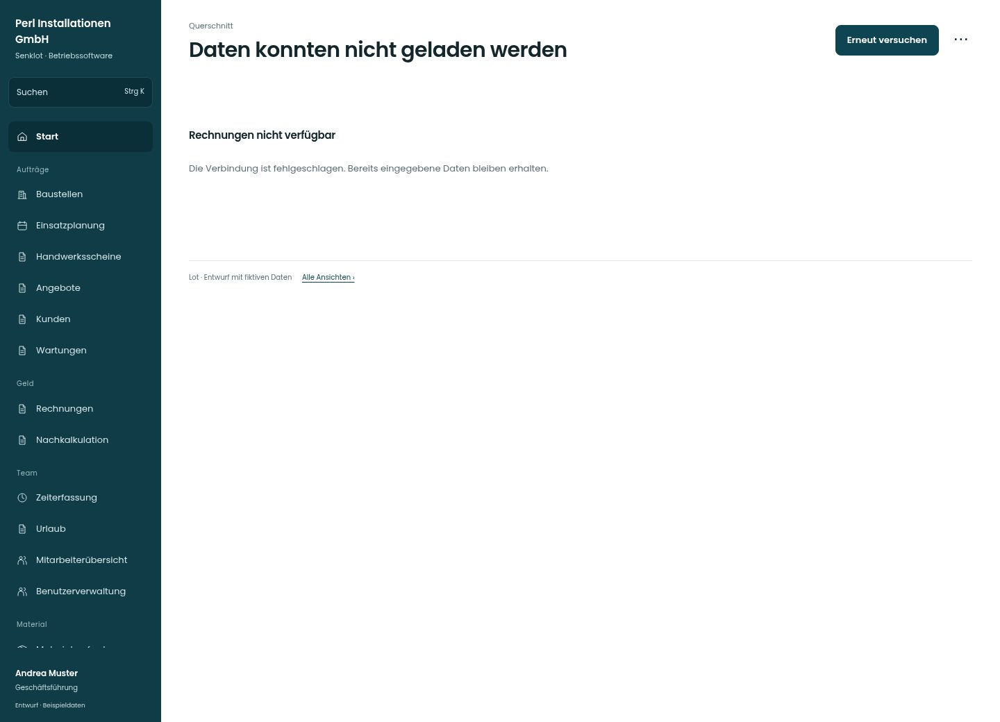

# Daten konnten nicht geladen werden

[Zur Übersicht](../README.md) · [Bereich: Querschnitt](../bereiche/querschnitt.md)

**Querschnitt · Geschäftsführung · Fehlerzustand**

Gestaltungsentwurf mit fiktiven Beispieldaten. Aktionen und Datenänderungen sind lokal simuliert, ohne Backend.

[Desktop](../bilder/167-fehler-desktop.jpg) · [Tablet](../bilder/167-fehler-tablet.jpg) · [Mobil](../bilder/167-fehler-mobil.jpg)

## Aufbau

Fehler und erneuter Versuch direkt am betroffenen Bereich; bestehende Eingaben und Navigation bleiben erhalten.

## Vorhandene Funktionen für die spätere Umsetzung erhalten

- Navigation bleibt nutzbar
- Originale fachliche Fehlermeldung
- Keine leere Liste als Erfolg

## Aktionen

- Erneut versuchen
- Problem melden

## Quellen

Quellstand: `3e49090`.
- [src/components/States.tsx](https://github.com/juliandeutsch22/Prototype-App-Installateure/blob/3e49090d4054ebbd3ecbce6ab583bb944c2c0770/src/components/States.tsx)
- [src/app/ErrorBoundary.tsx](https://github.com/juliandeutsch22/Prototype-App-Installateure/blob/3e49090d4054ebbd3ecbce6ab583bb944c2c0770/src/app/ErrorBoundary.tsx)

Die Screens zeigen die vorgesehenen Bedienwege. Reale Speicherung, vollständige Rollenprüfung, Berechnungen, Exporte, Benachrichtigungen und Integrationen müssen bei einer Umsetzung gegen die App geprüft werden.
