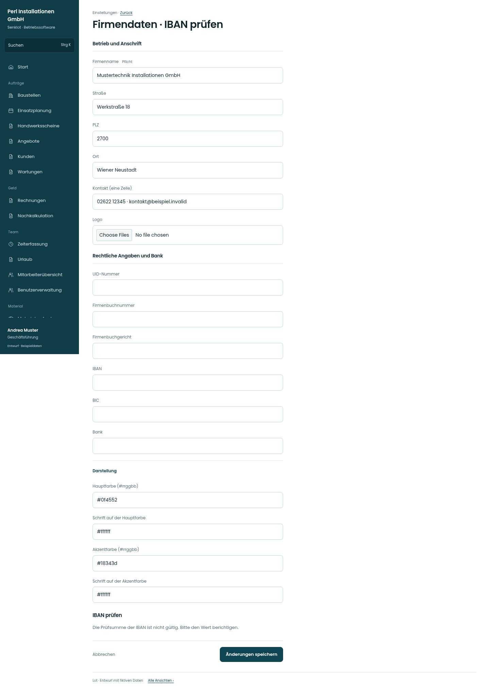

# Firmendaten · IBAN prüfen

[Zur Übersicht](../README.md) · [Bereich: Einstellungen](../bereiche/einstellungen.md)

**Einstellungen · Geschäftsführung · /settings/firma**

Gestaltungsentwurf mit fiktiven Beispieldaten. Aktionen und Datenänderungen sind lokal simuliert, ohne Backend.

[Desktop](../bilder/246-firma-iban-fehler-desktop.jpg) · [Tablet](../bilder/246-firma-iban-fehler-tablet.jpg) · [Mobil](../bilder/246-firma-iban-fehler-mobil.jpg)

## Aufbau

Anschrift, rechtliche Angaben/Bank und Darstellung gliedern; Briefkopfdaten nicht zwischen Farbfeldern verstecken.

## Vorhandene Funktionen für die spätere Umsetzung erhalten

- Briefkopf-/Logo-Vorschau
- UID/IBAN-Prüfung
- Kontrastprüfung
- Bestehende PDF-Belegfarben unabhängig vom UI

## Felder im Beispiel

- Firmenname (Pflichtfeld)
- Straße
- PLZ
- Ort
- Kontakt (eine Zeile)
- Logo
- UID-Nummer
- Firmenbuchnummer
- Firmenbuchgericht
- IBAN
- BIC
- Bank
- Hauptfarbe (#rrggbb)
- Schrift auf der Hauptfarbe
- Akzentfarbe (#rrggbb)
- Schrift auf der Akzentfarbe

## Aktionen

- Änderungen speichern

## Quellen

Quellstand: `3e49090`.
- [src/features/settings/FirmendatenView.tsx](https://github.com/juliandeutsch22/Prototype-App-Installateure/blob/3e49090d4054ebbd3ecbce6ab583bb944c2c0770/src/features/settings/FirmendatenView.tsx)

Die Screens zeigen die vorgesehenen Bedienwege. Reale Speicherung, vollständige Rollenprüfung, Berechnungen, Exporte, Benachrichtigungen und Integrationen müssen bei einer Umsetzung gegen die App geprüft werden.
