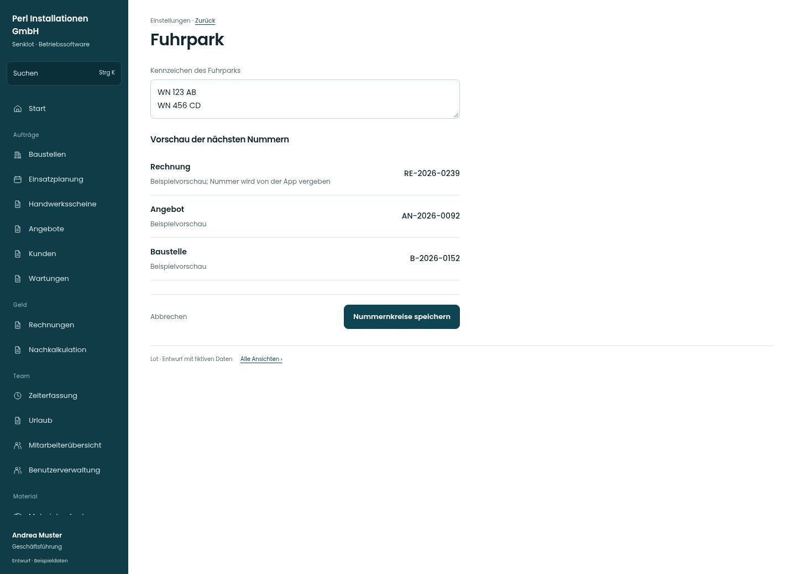

# Fuhrpark

[Zur Übersicht](../README.md) · [Bereich: Einstellungen](../bereiche/einstellungen.md)

**Einstellungen · Geschäftsführung · /settings/nummern**

Gestaltungsentwurf mit fiktiven Beispieldaten. Aktionen und Datenänderungen sind lokal simuliert, ohne Backend.

[Desktop](../bilder/237-fuhrpark-desktop.jpg) · [Tablet](../bilder/237-fuhrpark-tablet.jpg) · [Mobil](../bilder/237-fuhrpark-mobil.jpg)

## Aufbau

Vorsätze und Vorschau der nächsten Nummern klar unterscheiden; vergebene Nummern bleiben unveränderliche Beleggrundlage.

## Vorhandene Funktionen für die spätere Umsetzung erhalten

- Keine Wiederverwendung vergebener Nummern
- Präfixe und Jahreswechsel nach Bestand
- Fuhrpark für Zeiterfassung
- Nächste laufende Nummer ist eine Vorschau, kein freies Eingabefeld
- Fuhrparkfeld ist der Vorsatz, keine neue Fahrzeugverwaltung

## Felder im Beispiel

- Kennzeichen des Fuhrparks

## Aktionen

- Nummernkreise speichern

## Quellen

Quellstand: `3e49090`.
- [src/features/settings/SettingsView.tsx](https://github.com/juliandeutsch22/Prototype-App-Installateure/blob/3e49090d4054ebbd3ecbce6ab583bb944c2c0770/src/features/settings/SettingsView.tsx)

Die Screens zeigen die vorgesehenen Bedienwege. Reale Speicherung, vollständige Rollenprüfung, Berechnungen, Exporte, Benachrichtigungen und Integrationen müssen bei einer Umsetzung gegen die App geprüft werden.
