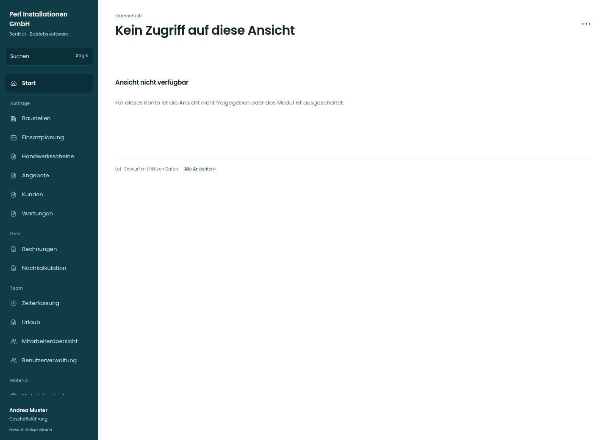

# Kein Zugriff auf diese Ansicht

[Zur Übersicht](../README.md) · [Bereich: Querschnitt](../bereiche/querschnitt.md)

**Querschnitt · Geschäftsführung · RequireNav / RequireRole / RequireModul**

Gestaltungsentwurf mit fiktiven Beispieldaten. Aktionen und Datenänderungen sind lokal simuliert, ohne Backend.

[Desktop](../bilder/170-gesperrt-desktop.jpg) · [Tablet](../bilder/170-gesperrt-tablet.jpg) · [Mobil](../bilder/170-gesperrt-mobil.jpg)

## Aufbau

Keine sensiblen Beispieldaten in der gesperrten Ansicht; erlaubter Rückweg ohne Selbstfreischaltung.

## Vorhandene Funktionen für die spätere Umsetzung erhalten

- Keine sensiblen Vorschaudaten
- Keine Selbstfreischaltung
- Unbekannte Route führt wie bisher zur Startseite

## Aktionen

- Zur Startseite

## Quellen

Quellstand: `3e49090`.
- [src/app/guards.tsx](https://github.com/juliandeutsch22/Prototype-App-Installateure/blob/3e49090d4054ebbd3ecbce6ab583bb944c2c0770/src/app/guards.tsx)

Die Screens zeigen die vorgesehenen Bedienwege. Reale Speicherung, vollständige Rollenprüfung, Berechnungen, Exporte, Benachrichtigungen und Integrationen müssen bei einer Umsetzung gegen die App geprüft werden.
