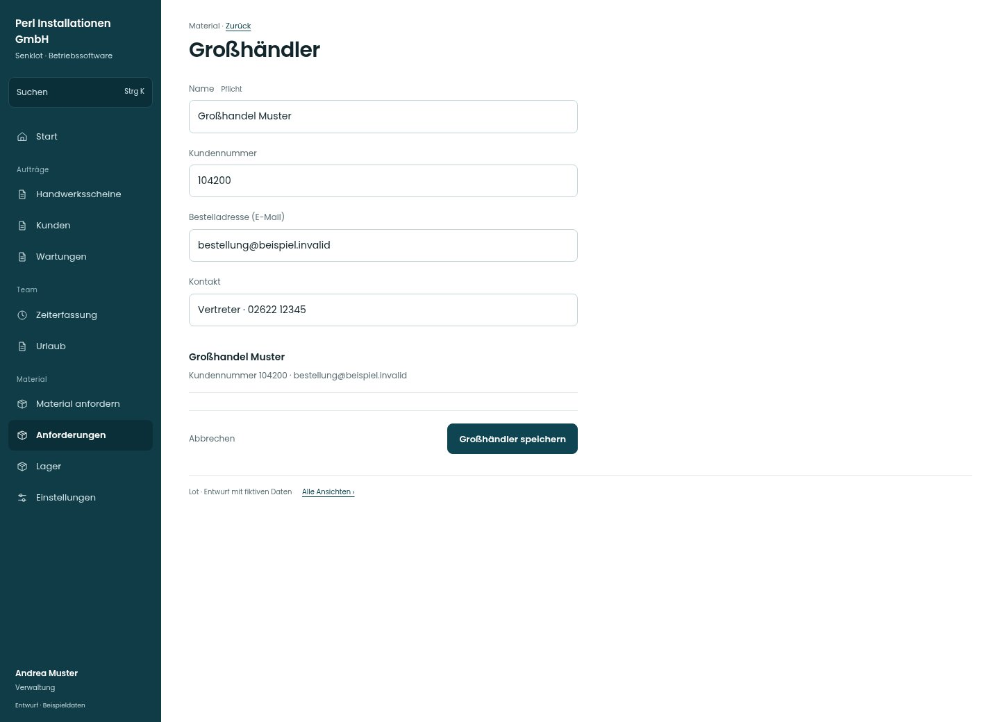

# Großhändler

[Zur Übersicht](../README.md) · [Bereich: Material](../bereiche/material.md)

**Material · Verwaltung · /anforderungen · Großhändler**

Gestaltungsentwurf mit fiktiven Beispieldaten. Aktionen und Datenänderungen sind lokal simuliert, ohne Backend.

[Desktop](../bilder/067-grosshaendler-desktop.jpg) · [Tablet](../bilder/067-grosshaendler-tablet.jpg) · [Mobil](../bilder/067-grosshaendler-mobil.jpg)

## Aufbau

Bestehende Lieferanten und das bearbeitete Kontaktformular klar trennen; Kundennummer und Bestelladresse bleiben lesbar.

## Vorhandene Funktionen für die spätere Umsetzung erhalten

- Siehe Quellcode und Seitenübersicht.

## Felder im Beispiel

- Name (Pflichtfeld)
- Kundennummer
- Bestelladresse (E-Mail)
- Kontakt

## Aktionen

- Großhändler speichern

## Quellen

Quellstand: `3e49090`.
- [src/features/orders/Einkaufsliste.tsx](https://github.com/juliandeutsch22/Prototype-App-Installateure/blob/3e49090d4054ebbd3ecbce6ab583bb944c2c0770/src/features/orders/Einkaufsliste.tsx)

Die Screens zeigen die vorgesehenen Bedienwege. Reale Speicherung, vollständige Rollenprüfung, Berechnungen, Exporte, Benachrichtigungen und Integrationen müssen bei einer Umsetzung gegen die App geprüft werden.
