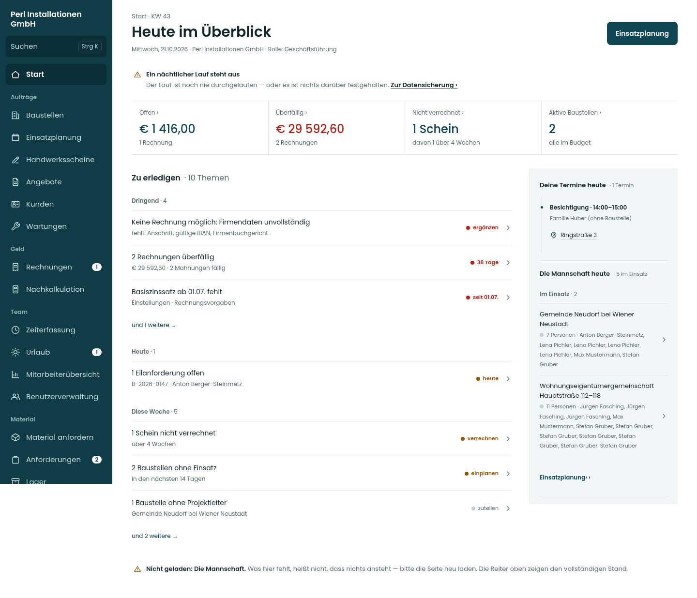

# Heute, Mittwoch

[Zur Übersicht](../README.md) · [Bereich: Start](../bereiche/start.md)

**Start · Geschäftsführung · /**

Referenz der bereits umgesetzten Startseite.

[Desktop](../referenzen/heute-desktop.png) · [Tablet](../referenzen/heute-tablet.png) · [Mobil](../referenzen/heute-mobil.png)

## Aufbau

Handlungsbedarf zuerst, Kalender vor zuletzt geöffnet auf Mobil; keine doppelte Teamkennzahl und keine erfundene Verfügbarkeit.

## Vorhandene Funktionen für die spätere Umsetzung erhalten

- Rollenabhängiger Handlungsbedarf
- Bestehende Ausfall- und Wartungshinweise
- Keine Margen oder fremden Zeitkonten für Projektleitung

## Quellen

Quellstand: `3e49090`.
- [src/features/dashboard/DashboardView.tsx](https://github.com/juliandeutsch22/Prototype-App-Installateure/blob/3e49090d4054ebbd3ecbce6ab583bb944c2c0770/src/features/dashboard/DashboardView.tsx)
- [src/features/dashboard/start/HeuteEigene.tsx](https://github.com/juliandeutsch22/Prototype-App-Installateure/blob/3e49090d4054ebbd3ecbce6ab583bb944c2c0770/src/features/dashboard/start/HeuteEigene.tsx)
- [src/features/dashboard/start/HeuteLeitung.tsx](https://github.com/juliandeutsch22/Prototype-App-Installateure/blob/3e49090d4054ebbd3ecbce6ab583bb944c2c0770/src/features/dashboard/start/HeuteLeitung.tsx)
- [src/features/dashboard/start/Handlungsbedarf.tsx](https://github.com/juliandeutsch22/Prototype-App-Installateure/blob/3e49090d4054ebbd3ecbce6ab583bb944c2c0770/src/features/dashboard/start/Handlungsbedarf.tsx)

Die Screens zeigen die vorgesehenen Bedienwege. Reale Speicherung, vollständige Rollenprüfung, Berechnungen, Exporte, Benachrichtigungen und Integrationen müssen bei einer Umsetzung gegen die App geprüft werden.
