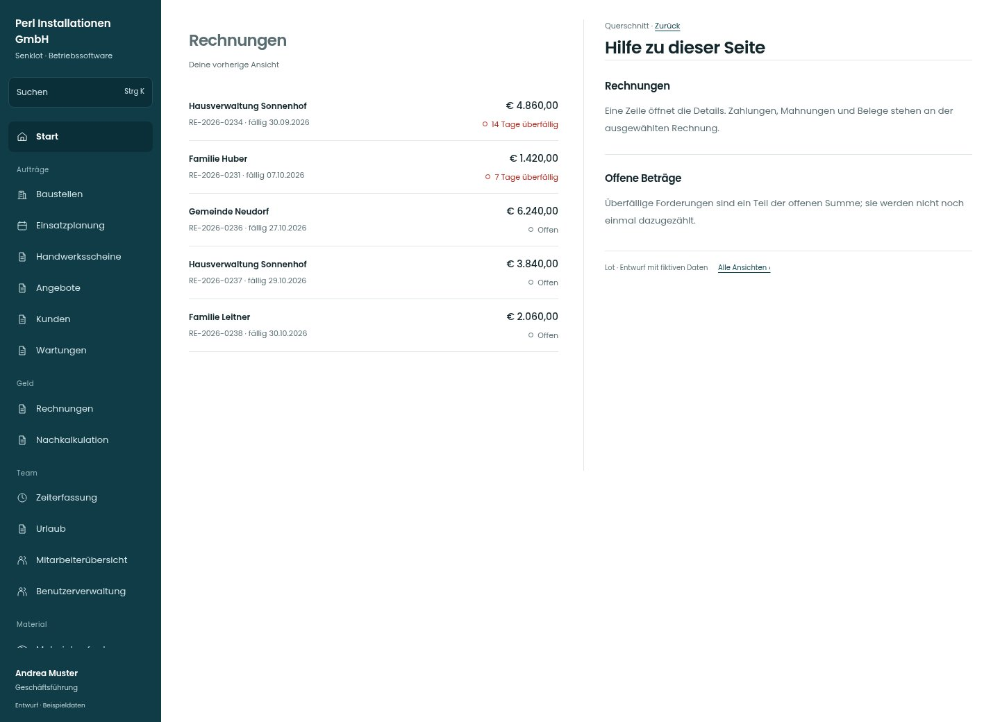

# Hilfe zu dieser Seite

[Zur Übersicht](../README.md) · [Bereich: Querschnitt](../bereiche/querschnitt.md)

**Querschnitt · Geschäftsführung · Seitenhilfe**

Gestaltungsentwurf mit fiktiven Beispieldaten. Aktionen und Datenänderungen sind lokal simuliert, ohne Backend.

[Desktop](../bilder/165-hilfe-desktop.jpg) · [Tablet](../bilder/165-hilfe-tablet.jpg) · [Mobil](../bilder/165-hilfe-mobil.jpg)

## Aufbau

Eine kontextbezogene Hilfe pro Seite statt ständig sichtbarer Erklärungskarten; alle Bestandsinformationen erhalten.

## Vorhandene Funktionen für die spätere Umsetzung erhalten

- Alle vorhandenen Hilfetexte
- Kontextbezogen statt allgemeiner Dauertipps

## Quellen

Quellstand: `3e49090`.
- [src/components/SeitenHilfe.tsx](https://github.com/juliandeutsch22/Prototype-App-Installateure/blob/3e49090d4054ebbd3ecbce6ab583bb944c2c0770/src/components/SeitenHilfe.tsx)

Die Screens zeigen die vorgesehenen Bedienwege. Reale Speicherung, vollständige Rollenprüfung, Berechnungen, Exporte, Benachrichtigungen und Integrationen müssen bei einer Umsetzung gegen die App geprüft werden.
