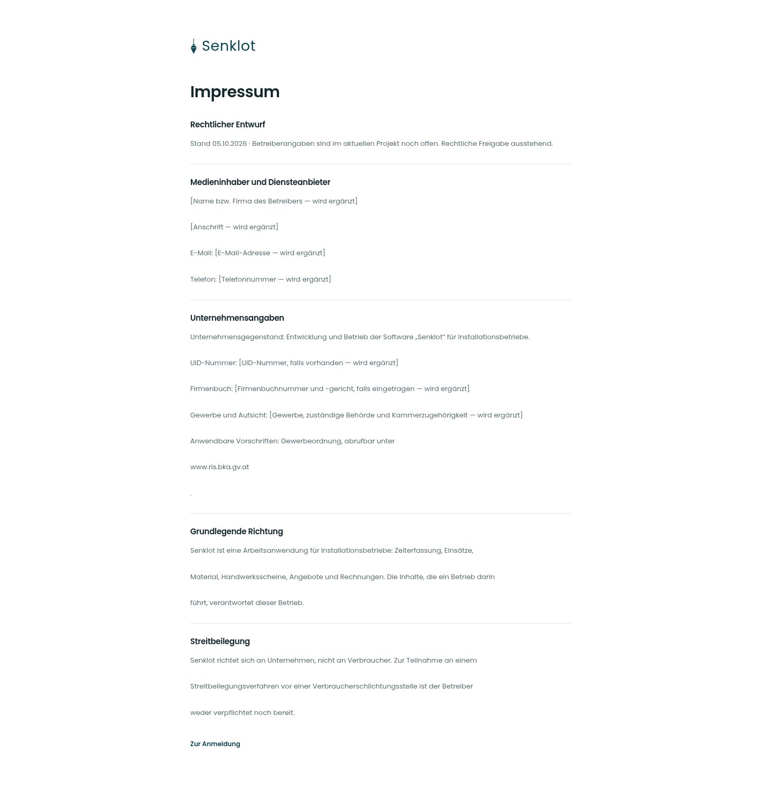

# Impressum

[Zur Übersicht](../README.md) · [Bereich: Zugang](../bereiche/zugang.md)

**Zugang · Geschäftsführung · /impressum**

Gestaltungsentwurf mit fiktiven Beispieldaten. Aktionen und Datenänderungen sind lokal simuliert, ohne Backend.

[Desktop](../bilder/009-impressum-desktop.jpg) · [Tablet](../bilder/009-impressum-tablet.jpg) · [Mobil](../bilder/009-impressum-mobil.jpg)

## Aufbau

Lange Rechtstexte benötigen begrenzte Zeilenlänge, klare Abschnittsüberschriften und unveränderten Wortlaut; offene Betreiberangaben bleiben benannt.

## Vorhandene Funktionen für die spätere Umsetzung erhalten

- Öffentlich ohne Anmeldung erreichbar
- Vollständiger Rechtstext aus dem Bestand
- GEPRUEFT=false bleibt sichtbar; neue Gestaltung ersetzt keine rechtliche Freigabe
- Wortlaut aus den bestehenden Abschnitten übernommen

## Quellen

Quellstand: `3e49090`.
- [src/features/recht/ImpressumView.tsx](https://github.com/juliandeutsch22/Prototype-App-Installateure/blob/3e49090d4054ebbd3ecbce6ab583bb944c2c0770/src/features/recht/ImpressumView.tsx)

Die Screens zeigen die vorgesehenen Bedienwege. Reale Speicherung, vollständige Rollenprüfung, Berechnungen, Exporte, Benachrichtigungen und Integrationen müssen bei einer Umsetzung gegen die App geprüft werden.
