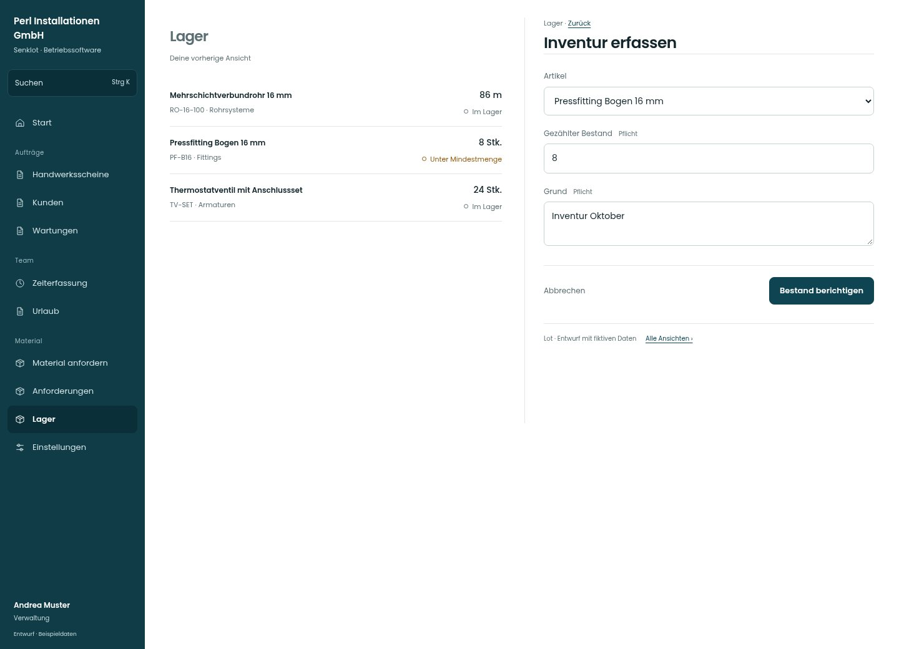

# Inventur erfassen

[Zur Übersicht](../README.md) · [Bereich: Lager](../bereiche/lager.md)

**Lager · Verwaltung · /lager · Inventur**

Gestaltungsentwurf mit fiktiven Beispieldaten. Aktionen und Datenänderungen sind lokal simuliert, ohne Backend.

[Desktop](../bilder/074-inventur-desktop.jpg) · [Tablet](../bilder/074-inventur-tablet.jpg) · [Mobil](../bilder/074-inventur-mobil.jpg)

## Aufbau

Gezählten Bestand und Pflichtgrund vor der Berichtigung zeigen; nicht wie einen normalen Zugang oder Abgang beschriften.

## Vorhandene Funktionen für die spätere Umsetzung erhalten

- Gezählter Bestand statt Zu-/Abgang
- Pflichtgrund
- Reservierungen berücksichtigen

## Felder im Beispiel

- Artikel
- Gezählter Bestand (Pflichtfeld)
- Grund (Pflichtfeld)

## Aktionen

- Bestand berichtigen

## Quellen

Quellstand: `3e49090`.
- [src/features/orders/LagerDialoge.tsx](https://github.com/juliandeutsch22/Prototype-App-Installateure/blob/3e49090d4054ebbd3ecbce6ab583bb944c2c0770/src/features/orders/LagerDialoge.tsx)

Die Screens zeigen die vorgesehenen Bedienwege. Reale Speicherung, vollständige Rollenprüfung, Berechnungen, Exporte, Benachrichtigungen und Integrationen müssen bei einer Umsetzung gegen die App geprüft werden.
