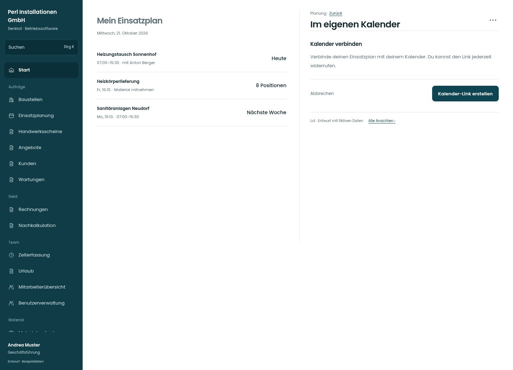

# Im eigenen Kalender

[Zur Übersicht](../README.md) · [Bereich: Planung](../bereiche/planung.md)

**Planung · Geschäftsführung · Planung / Mein Einsatzplan · Kalender-Abo**

Gestaltungsentwurf mit fiktiven Beispieldaten. Aktionen und Datenänderungen sind lokal simuliert, ohne Backend.

[Desktop](../bilder/048-kalender-abo-desktop.jpg) · [Tablet](../bilder/048-kalender-abo-tablet.jpg) · [Mobil](../bilder/048-kalender-abo-mobil.jpg)

## Aufbau

Erzeugen, Kopieren und Widerrufen gehören zusammen; Betriebsschalter und persönlicher geheimer Link bleiben geschützt.

## Vorhandene Funktionen für die spätere Umsetzung erhalten

- Betriebsschalter
- Geheimen Link nicht öffentlich zeigen
- Widerruf bleibt erreichbar

## Aktionen

- Kalender-Link erstellen
- Link widerrufen

## Quellen

Quellstand: `3e49090`.
- [src/features/assignments/KalenderAboKarte.tsx](https://github.com/juliandeutsch22/Prototype-App-Installateure/blob/3e49090d4054ebbd3ecbce6ab583bb944c2c0770/src/features/assignments/KalenderAboKarte.tsx)

Die Screens zeigen die vorgesehenen Bedienwege. Reale Speicherung, vollständige Rollenprüfung, Berechnungen, Exporte, Benachrichtigungen und Integrationen müssen bei einer Umsetzung gegen die App geprüft werden.
