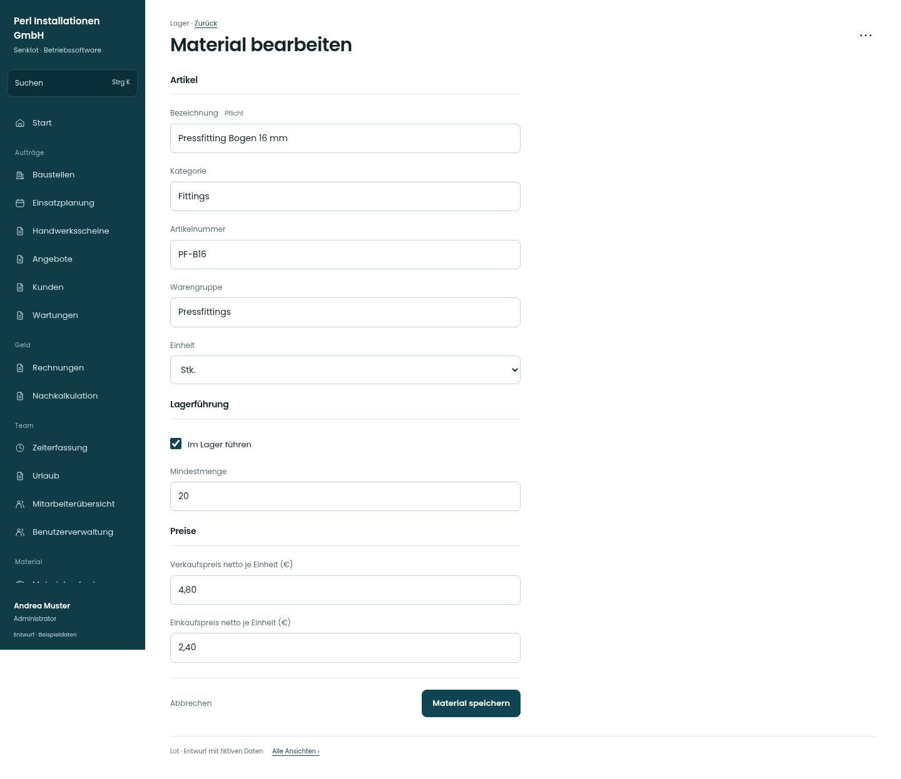

# Material bearbeiten

[Zur Übersicht](../README.md) · [Bereich: Lager](../bereiche/lager.md)

**Lager · Administrator · /lager · Katalogartikel**

Gestaltungsentwurf mit fiktiven Beispieldaten. Aktionen und Datenänderungen sind lokal simuliert, ohne Backend.

[Desktop](../bilder/077-katalog-artikel-desktop.jpg) · [Tablet](../bilder/077-katalog-artikel-tablet.jpg) · [Mobil](../bilder/077-katalog-artikel-mobil.jpg)

## Aufbau

Anfangsbestand aus der Bearbeitung bestehender Artikel herausnehmen; er bleibt beim gesonderten Anlegen verfügbar.

## Vorhandene Funktionen für die spätere Umsetzung erhalten

- Anfangsbestand nicht als freie Bestandsänderung missbrauchen
- Einkauf nur für Berechtigte

## Felder im Beispiel

- Bezeichnung (Pflichtfeld)
- Kategorie
- Artikelnummer
- Warengruppe
- Einheit
- Im Lager führen
- Mindestmenge
- Verkaufspreis netto je Einheit (€)
- Einkaufspreis netto je Einheit (€)

## Aktionen

- Material speichern
- Material löschen

## Quellen

Quellstand: `3e49090`.
- [src/features/orders/MaterialCatalog.tsx](https://github.com/juliandeutsch22/Prototype-App-Installateure/blob/3e49090d4054ebbd3ecbce6ab583bb944c2c0770/src/features/orders/MaterialCatalog.tsx)

Die Screens zeigen die vorgesehenen Bedienwege. Reale Speicherung, vollständige Rollenprüfung, Berechnungen, Exporte, Benachrichtigungen und Integrationen müssen bei einer Umsetzung gegen die App geprüft werden.
