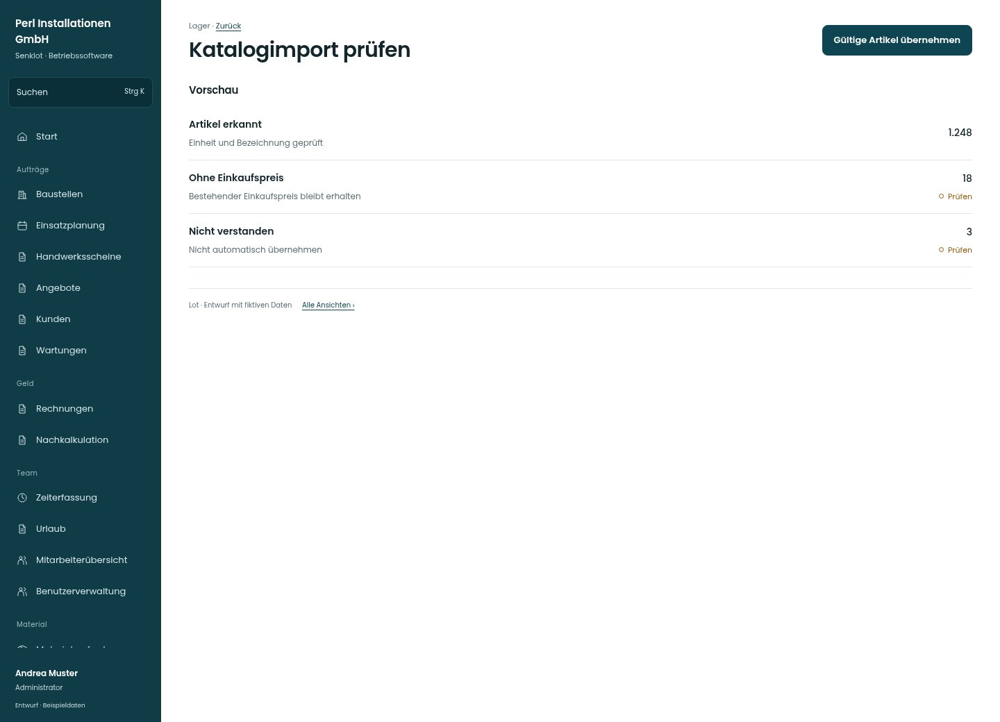

# Katalogimport prüfen

[Zur Übersicht](../README.md) · [Bereich: Lager](../bereiche/lager.md)

**Lager · Administrator · /lager · DATANORM-Import**

Gestaltungsentwurf mit fiktiven Beispieldaten. Aktionen und Datenänderungen sind lokal simuliert, ohne Backend.

[Desktop](../bilder/079-katalog-import-vorschau-desktop.jpg) · [Tablet](../bilder/079-katalog-import-vorschau-tablet.jpg) · [Mobil](../bilder/079-katalog-import-vorschau-mobil.jpg)

## Aufbau

Probelauf mit verständlichen Ausnahmen vor Übernahme erhalten; Feldmapping und nicht verstandene Zeilen bleiben erreichbar.

## Vorhandene Funktionen für die spätere Umsetzung erhalten

- Freigabe katalogEinspielen
- Lieferant wählen
- Mapping abweichender Felder
- Vorschau/Probelauf/Übernahme getrennt
- Resultat neu/aktualisiert/ausgelaufen/ohne Preis

## Aktionen

- Gültige Artikel übernehmen

## Quellen

Quellstand: `3e49090`.
- [src/features/materials/KatalogImport.tsx](https://github.com/juliandeutsch22/Prototype-App-Installateure/blob/3e49090d4054ebbd3ecbce6ab583bb944c2c0770/src/features/materials/KatalogImport.tsx)

Die Screens zeigen die vorgesehenen Bedienwege. Reale Speicherung, vollständige Rollenprüfung, Berechnungen, Exporte, Benachrichtigungen und Integrationen müssen bei einer Umsetzung gegen die App geprüft werden.
